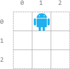
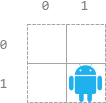
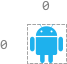

# [2120. Execution of All Suffix Instructions Staying in a Grid](https://leetcode.com/problems/execution-of-all-suffix-instructions-staying-in-a-grid/)

| Category | Difficulty | Likes | Dislikes |
| :------: | :--------: | :---: | :------: |
| Algorithms | Medium | 565 | 54 |

**Tags:** [`string`](https://leetcode.com/tag/string), [`simulation`](https://leetcode.com/tag/simulation)


## Description

There is an `n x n` grid, with the top-left cell at `(0, 0)` and the bottom-right cell at `(n - 1, n - 1)`. You are given the integer `n` and an integer array `startPos` where `startPos = [start_row, start_col]` indicates that a robot is initially at cell `(start_row, start_col)`.

You are also given a **0-indexed** string `s` of length `m` where `s[i]` is the `i^th` instruction for the robot: `'L'` (move left), `'R'` (move right), `'U'` (move up), and `'D'` (move down).

The robot can begin executing from any `i^th` instruction in `s`. It executes the instructions one by one towards the end of `s` but it stops if either of these conditions is met:

	- The next instruction will move the robot off the grid.

	- There are no more instructions left to execute.

Return *an array* `answer` *of length* `m` *where* `answer[i]` *is **the number of instructions** the robot can execute if the robot **begins executing from** the* `i^th` *instruction in* `s`.

 

**Example 1:**


```

Input: n = 3, startPos = [0,1], s = &quot;RRDDLU&quot;
Output: [1,5,4,3,1,0]
Explanation: Starting from startPos and beginning execution from the ith instruction:
- 0th: &quot;RRDDLU&quot;. Only one instruction &quot;R&quot; can be executed before it moves off the grid.
- 1st:  &quot;RDDLU&quot;. All five instructions can be executed while it stays in the grid and ends at (1, 1).
- 2nd:   &quot;DDLU&quot;. All four instructions can be executed while it stays in the grid and ends at (1, 0).
- 3rd:    &quot;DLU&quot;. All three instructions can be executed while it stays in the grid and ends at (0, 0).
- 4th:     &quot;LU&quot;. Only one instruction &quot;L&quot; can be executed before it moves off the grid.
- 5th:      &quot;U&quot;. If moving up, it would move off the grid.

```

**Example 2:**


```

Input: n = 2, startPos = [1,1], s = &quot;LURD&quot;
Output: [4,1,0,0]
Explanation:
- 0th: &quot;LURD&quot;.
- 1st:  &quot;URD&quot;.
- 2nd:   &quot;RD&quot;.
- 3rd:    &quot;D&quot;.

```

**Example 3:**


```

Input: n = 1, startPos = [0,0], s = &quot;LRUD&quot;
Output: [0,0,0,0]
Explanation: No matter which instruction the robot begins execution from, it would move off the grid.

```

 

**Constraints:**

	- `m == s.length`

	- `1 <= n, m <= 500`

	- `startPos.length == 2`

	- `0 <= start_row, start_col < n`

	- `s` consists of `'L'`, `'R'`, `'U'`, and `'D'`.

---

**Links:** [Submissions](https://leetcode.com/problems/execution-of-all-suffix-instructions-staying-in-a-grid/) | [Solutions](https://leetcode.com/problems/execution-of-all-suffix-instructions-staying-in-a-grid/)
