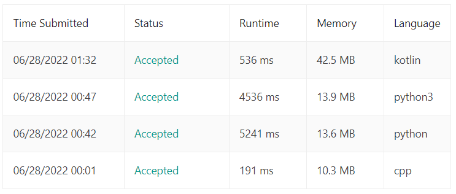

# C++, Python, Kotlin || Easy Explained Solution || O(n^2)

**Author:** r_o_xx_
**Votes:** 1
**Link:** [https://leetcode.com/problems/execution-of-all-suffix-instructions-staying-in-a-grid/solutions/2206750/](https://leetcode.com/problems/execution-of-all-suffix-instructions-staying-in-a-grid/solutions/2206750/)

---



\u200E
**C++ :**
```
class Solution {
public:
    vector<int> executeInstructions(int n, vector<int>& startPos, string s) {
        vector<int> ans; //To save movements we have done in all iteration
        int count = 0; //To save movements we have done
        int ini = startPos[0]; //Saving initial i
        int inj = startPos[1]; //Saving initial j
        for(int  i = 0; i < s.length(); i++){
            for(int  j = i; j < s.length(); j++){ //Iterating over every element with starting index +1 in every iteration
                if(s[j] == 'R') startPos[1]++; //If we encounter R move to right i.e. incrementing j value
                else if(s[j] == 'L') startPos[1]--;
                else if(s[j] == 'U') startPos[0]--;
                else if(s[j] == 'D') startPos[0]++;
                
                if(startPos[1] > -1 && startPos[1] < n && startPos[0] > -1 && startPos[0] < n) count++; //Breaking loop if we encounter any position outside of grid
                else j = INT_MAX-1; //-1 becasue while looping again it will make j++ than compare and break loop
            }
            ans.push_back(count); //Pushing count in ans because all iterations are done for this condition
            count = 0; //Ready to count again
            startPos = {ini, inj}; //Ready at given position
        }
        return ans;
    }
};
```
\u200E
**Python :**
```
class Solution(object):
    def executeInstructions(self, n, startPos, s):
        li = []
        count = 0;
        ini = startPos[0]
        inj = startPos[1]
        for i in range(len(s)):
            for j in range(i, len(s)):
                if s[j] == 'R' : startPos[1] += 1
                elif s[j] == 'L' : startPos[1] -= 1
                elif s[j] == 'U' : startPos[0] -= 1
                elif s[j] == 'D' : startPos[0] += 1
                
                if (startPos[1] > -1 and startPos[1] < n and startPos[0] > -1 and startPos[0] < n) : count += 1
                else : startPos = [-1,-1] 
            startPos = [ini, inj]
            li.append(count)
            count = 0
        return li
```
\u200E
**Kotlin :**
```
class Solution {
    fun executeInstructions(n: Int, startPos: IntArray, s: String): IntArray {
        var li = IntArray(s.length)
        var count = 0
        var ini = startPos[0]
        var inj = startPos[1]
        
        var currPosition = startPos
        
        for (i in 0..s.length-1){
            for(j in i..s.length-1){
                
                if (s[j] == 'R') {inj += 1}
                else if (s[j] == 'L') {inj -= 1}
                else if (s[j] == 'U') {ini -= 1}
                else if (s[j] == 'D') {ini += 1}
                
                if (inj > -1 && inj < n && ini > -1 && ini < n) count += 1
                else {
                    ini = -1
                    inj = -1
                }
            }
            ini = startPos[0]
            inj = startPos[1]
            li[i] = count
            count = 0
        }
        return li
    }
}
```
\u200E
If you think this post was ***helpful***, I will be happy if you give a ***upvote***. Any questions or discussions are welcome! **Thanks a lot.** \uD83D\uDE04