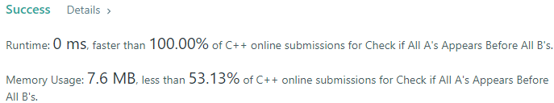
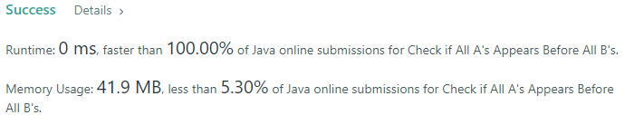
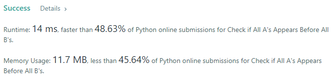
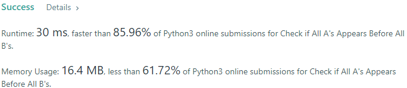
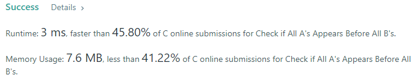
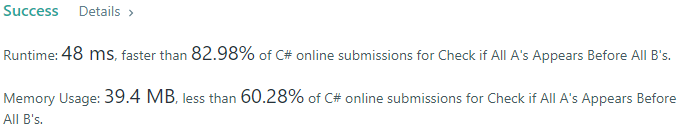
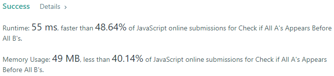

# 💢☠💫Easiest👾Faster✅💯 Lesser🧠 🎯 C++✅Python3🐍✅Java✅C✅Python🐍✅C#✅💥🔥💫Explained☠💥🔥 Beats 💯

**Author:** Edwards310
**Votes:** 3
**Link:** [https://leetcode.com/problems/check-if-all-as-appears-before-all-bs/solutions/5606292/](https://leetcode.com/problems/check-if-all-as-appears-before-all-bs/solutions/5606292/)

---

# Intuition








```javascript []
//JavaScript Code
/**
 * @param {string} s
 * @return {boolean}
 */
var checkString = function(s) {
    return !s.includes("ba");
};
```
```C++ []
//C++ Code
class Solution {
public:
    bool checkString(string s) {
        int idx = 0;
        while (s[idx] == 'a')
            idx++;
        
        for (; idx < s.length(); idx++)
            if (s[idx] == 'a')
                return false;
        return true;
    }
};
```
```Python3 []
#Python3 Code
class Solution:
    def checkString(self, s: str) -> bool:
        if "ba" in s: return False
        return True

```
```Java []
//Java Code
class Solution {
    public boolean checkString(String s) {
        int n = s.length();
        for(int i = 0; i < n - 1; ++i)
            if(s.charAt(i) == 'b' && s.charAt(i + 1) == 'a')
                return false;
        return true;
    }
}
```
```C []
//C Code
bool checkString(char* s) {
    int i = 0;
    while(*s == 'a'){
        *s++;
    }
    for(; s[i]; i++)
        if(s[i] == 'a')
            return false;
    return true;
}
```
```Python []
#Python Code
class Solution(object):
    def checkString(self, s):
        """
        :type s: str
        :rtype: bool
        """
        return False if "ba" in s else True
```
```C# []
//C# Code
public class Solution {
    public bool CheckString(string s) {
        int n = s.Length;
        for(int i = 0; i < n - 1; ++i)
            if(s[i] == 'b' && s[i + 1] == 'a')
                return false;
        return true;
        
    }
}
```
<!-- Describe your first thoughts on how to solve this problem. -->

# Approach
<!-- Describe your approach to solving the problem. -->

# Complexity
- Time complexity:
<!-- Add your time complexity here, e.g. $$O(n)$$ -->
     O(n)
- Space complexity:
<!-- Add your space complexity here, e.g. $$O(n)$$ -->
     O(1)
# Code

