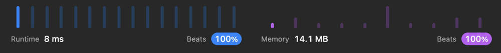

# ✅ [Swift] Easy to understand, 100% speed, 100% memory

**Author:** lmvtsv
**Votes:** 1
**Link:** [https://leetcode.com/problems/capitalize-the-title/solutions/2947628/](https://leetcode.com/problems/capitalize-the-title/solutions/2947628/)

---



```
class Solution {
    func capitalizeTitle(_ title: String) -> String {
        var title = title.lowercased().split(separator: " ")
	    for i in 0 ..< title.count where title[i].count > 2 {
		    let up = title[i].removeFirst().uppercased()
		    title[i] = up + title[i]
	    }
	    return title.joined(separator: " ")
    }
}
```