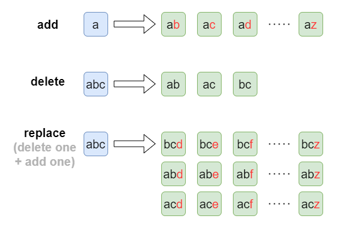
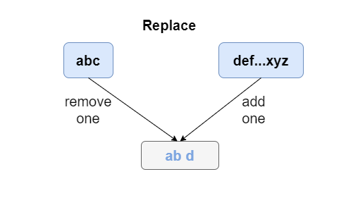
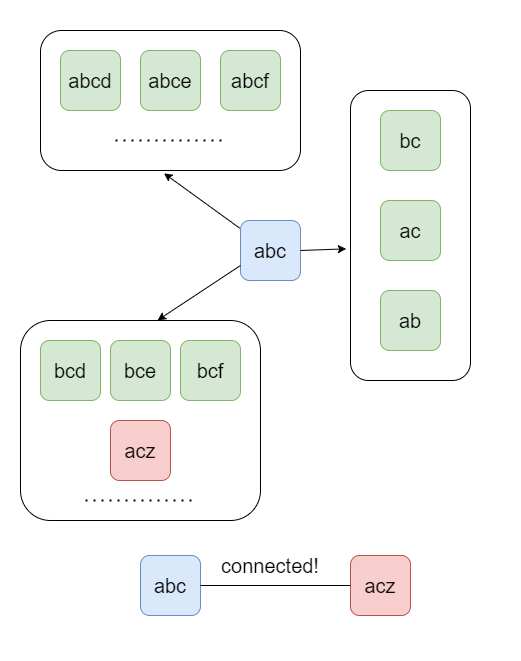
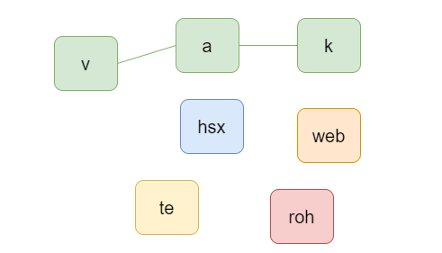

# [Python] Explanation with pictures, bitmask + UF

**Author:** Bakerston
**Votes:** 16
**Link:** [https://leetcode.com/problems/groups-of-strings/solutions/1732413/](https://leetcode.com/problems/groups-of-strings/solutions/1732413/)

---

Use Union-Find to connect two words, if they are connected based on these three operations.

For example, 
- by operation **add**, string **a** can be transformed to **ab**, **ac**, ... , **az**.
- by operation **delete**, string **abc** can be transformed to **ab**, **ac**, **bc**.
- by operation **replace**, string **abc** can be transformed to **bce**, **bcf**, ... , **acz**.


More specifically, **replace** equals **delete** + **add**.



Therefore, a current word **abc** can be potentially connected to all those words (As shown below). 
Imagine we also have **acz** in the string list, thus **abc** and **acz** are connected! 




Therefore, we can count the number of groups and the group size. However, I 

>For example, given the input:
 **["web","a","te","hsx","v","k","a","roh"]**
 we group them like below.



Notice that there might be duplicated words, thus we can use a counter for the number of occurrence of each word, and calculate the group size based on the frequency of each word.

For example: The size of green group is: 1 + 1 + 2 = 4


**Python**
```
class DSU:
    def __init__(self, n):
        self.root = list(range(n))
    def find(self, x):
        if self.root[x] != x:
            self.root[x] = self.find(self.root[x])
        return self.root[x]
    def union(self, x, y):
        self.root[self.find(x)] = self.find(y)

class Solution:
    def groupStrings(self, A: List[str]) -> List[int]:        
        c = collections.defaultdict(int)
        for a in A: 
			c["".join(sorted(a))] += 1
    
        A = list(set(["".join(sorted(a)) for a in A]))
        n = len(A)
                
        idx = collections.defaultdict(int)    # (binary representation -> index)
		dsu = DSU(n)                          # dsu 

        def add(base):
            for i in range(26):
                if not base & 1 << i:
                    yield base ^ 1 << i
        def dele(base):
            for i in range(26):
                if base & 1 << i:
                    if base - (1 << i) != 0:
                        yield base - (1 << i)        
        def rep(base):
            pre, new = [], []
            for i in range(26):
                if base & 1 << i: pre.append(i)
                else: new.append(i)
            for p in pre:
                for n in new:
                    yield base - (1 << p) + (1 << n)                
        
        for i, a in enumerate(A):
            base = 0
            for ch in a:
                base += 1 << ord(ch) - ord('a')
            idx[base] = i

        for base in idx.keys():
            for new in add(base):
                if new in idx:
                    dsu.union(idx[base], idx[new])
            for new in dele(base):
                if new in idx:
                    dsu.union(idx[base], idx[new])
            for new in rep(base):
                if new in idx:
                    dsu.union(idx[base], idx[new])
        
        group = collections.defaultdict(int)
        for a in A:
            base = 0
            for ch in a:
                base += 1 << ord(ch) - ord('a')
            cnum = c[a]
            group[dsu.find(idx[base])] += cnum
        
        return [len(group), max(group.values())]
        
```