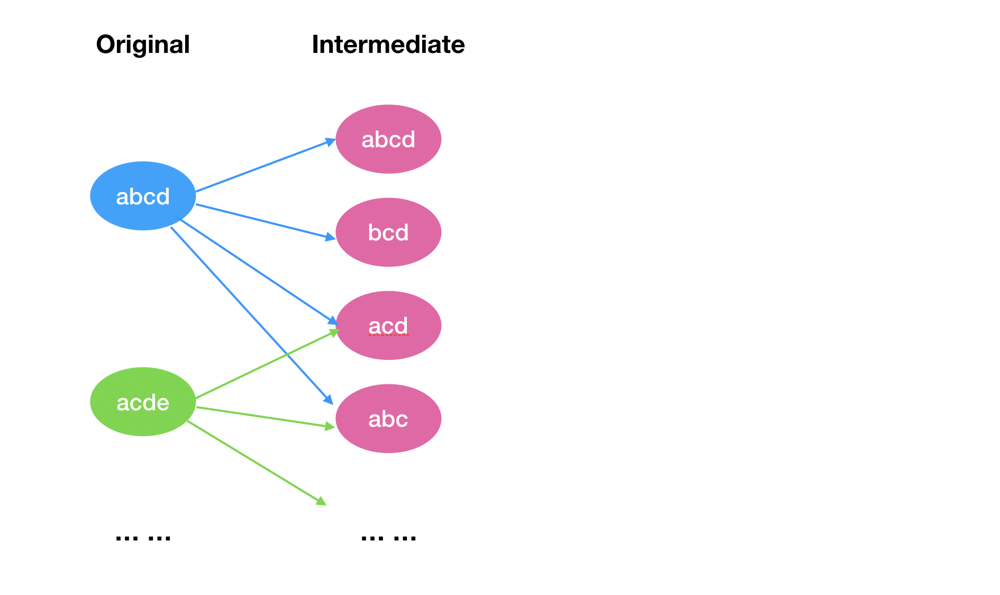

# Scala Intermediate Graph + Bitmask + Disjoint Set

**Author:** HeavenWatcher
**Votes:** 0
**Link:** [https://leetcode.com/problems/groups-of-strings/solutions/3126193/](https://leetcode.com/problems/groups-of-strings/solutions/3126193/)

---

If we compare the strings trivially to build the connecting graph, it takes O(26 * n * n) Char comparison operations. Even if by using a bitmap, it will take O(n * n) Int comparison.

The trick is that we can build some intermediate nodes in the graph to avoid comparing the original strings (or bitmaps) one by one.



For a string `s` and each of its characters `c`, we substract `c` from `s` to create a new intermediate string `t`. We also add `s` itself as an intermediate string. Connect `s` and all its generated strings. It can be shown that `s1` can be transformed to `s2`, if and only if there is an intermediate string `t` between them.

For each intermediate string, all its `n` original strings are granted to be connected. If we use disjoint set to union them, it only takes `n - 1` union operations.

One original string will has at most 27 intermediate string. It will totally take less than O(27 * n) union operations.

Based on this, we can also continue to play some bitmap and disjoint set tricks to save even more time.

```Scala
object Solution {
    def groupStrings(words: Array[String]): Array[Int] = {
        def str2int(s: String) = s.foldLeft(0)((i, c) => i | (1 << c - 'a'))
        val masks = (0 to 26).map(1 << _).map(~_)

        val adj = words.map(str2int).zipWithIndex.foldLeft(Map[Int, Vector[Int]]().withDefaultValue(Vector())) {
            case (m, (s, i)) =>
                masks.map(s & _).toSet.foldLeft(m)((mm, sss) => mm + (sss -> (mm(sss) :+ i)))
        }.values

        def find(p: Vector[Int])(x: Int): (Int, Vector[Int]) = if (p(x) == x) (x, p) else {
            val (rx, pp) = find(p)(p(x))
            (rx, pp.updated(x, rx))
        }
        def union(p: Vector[Int])(x: Int, y: Int) = {
            val (rx, px) = find(p)(x)
            val (ry, py) = find(px)(y)
            py.updated(rx, ry)
        }

        val parents = adj.foldLeft(Vector.tabulate(words.size)(i => i))((p, v) => {
            v.sliding(2).foldLeft(p) {
                case (pp, Vector(i, j)) => union(pp)(i, j)
                case (pp, _) => pp
            }
        })

        val roots = words.indices.scanLeft(0, parents){case ((_, p), x) => find(p)(x)}
            .map(_._1).drop(1).groupBy(x => x).mapValues(_.size)
        Array(roots.size, roots.values.max)
    }
}

```