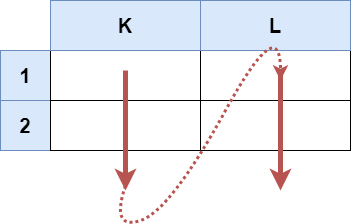
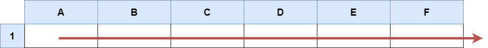

# [2194. Cells in a Range on an Excel Sheet](https://leetcode.com/problems/cells-in-a-range-on-an-excel-sheet/)

| Category | Difficulty | Likes | Dislikes |
| :------: | :--------: | :---: | :------: |
| Algorithms | Easy | 642 | 100 |

**Tags:** [`string`](https://leetcode.com/tag/string)


## Description

A cell `(r, c)` of an excel sheet is represented as a string `""` where:

	- `` denotes the column number `c` of the cell. It is represented by **alphabetical letters**.

	
		For example, the `1^st` column is denoted by `'A'`, the `2^nd` by `'B'`, the `3^rd` by `'C'`, and so on.

	
	
	- `` is the row number `r` of the cell. The `r^th` row is represented by the **integer** `r`.

You are given a string `s` in the format `":"`, where `` represents the column `c1`, `` represents the row `r1`, `` represents the column `c2`, and `` represents the row `r2`, such that `r1 <= r2` and `c1 <= c2`.

Return *the **list of cells*** `(x, y)` *such that* `r1 <= x <= r2` *and* `c1 <= y <= c2`. The cells should be represented as **strings** in the format mentioned above and be sorted in **non-decreasing** order first by columns and then by rows.

 

**Example 1:**


```

Input: s = &quot;K1:L2&quot;
Output: [&quot;K1&quot;,&quot;K2&quot;,&quot;L1&quot;,&quot;L2&quot;]
Explanation:
The above diagram shows the cells which should be present in the list.
The red arrows denote the order in which the cells should be presented.

```

**Example 2:**


```

Input: s = &quot;A1:F1&quot;
Output: [&quot;A1&quot;,&quot;B1&quot;,&quot;C1&quot;,&quot;D1&quot;,&quot;E1&quot;,&quot;F1&quot;]
Explanation:
The above diagram shows the cells which should be present in the list.
The red arrow denotes the order in which the cells should be presented.

```

 

**Constraints:**

	- `s.length == 5`

	- `'A' <= s[0] <= s[3] <= 'Z'`

	- `'1' <= s[1] <= s[4] <= '9'`

	- `s` consists of uppercase English letters, digits and `':'`.

---

**Links:** [Submissions](https://leetcode.com/problems/cells-in-a-range-on-an-excel-sheet/) | [Solutions](https://leetcode.com/problems/cells-in-a-range-on-an-excel-sheet/)
