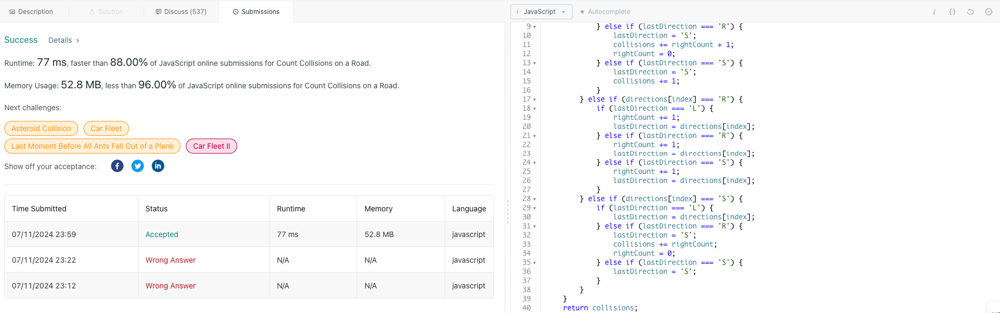

# ❇ count-collisions-on-a-road Images👌 🏆O(1)🚗 Javascript🎯 Memory👀96%🕕 ++Explanation✍️🔴🔥✅💪�

**Author:** anurag-sindhu
**Votes:** 2
**Link:** [https://leetcode.com/problems/count-collisions-on-a-road/solutions/5462426/](https://leetcode.com/problems/count-collisions-on-a-road/solutions/5462426/)

---

Time Complexity: O(N)
Space Complexity: O(1)

\uD83D\uDE0AExplanation: \uD83D\uDE97\uD83D\uDCA5
1. collisions keeps track of the total number of collisions.\uD83E\uDDEE
2. lastDirection stores the direction of the last car processed.\uD83E\uDDEE
3. rightCount counts the number of cars moving to the right.\uD83E\uDDEE
4. Then loop starts from the second car (index 1) and goes through each car in the array.\uD83D\uDD04
5. If the current car is moving left ('L'):\uD83D\uDE97\uD83D\uDCA5
	1. If the last car was also moving left ('L'), there's no collision.
	2. If the last car was moving right ('R'), a collision occurs:
		1. Update lastDirection to 'S' (stationary).
		2. Increase collisions by rightCount + 1.
		3. Reset rightCount.
	3. If the last car was stationary ('S'), a collision occurs:
		1. Increase collisions by 1.
6. If the current car is moving right ('R'):\uD83D\uDE97\uD83D\uDCA5
	1. Increase rightCount by 1.
	2. Update lastDirection to 'R'.
7. If the current car is stationary ('S'):\uD83D\uDE97\uD83D\uDCA5
	1. If the last car was moving left ('L'), there's no collision.
	2. If the last car was moving right ('R'), a collision occurs:
		1. Update lastDirection to 'S'.
		2. Increase collisions by rightCount.
		3. Reset rightCount.
	4. If the last car was stationary ('S'), there's no collision.


```

var countCollisions = function (directions) {
    let collisions = 0;
    let lastDirection = directions[0];
    let rightCount = directions[0] === 'R' ? 1 : 0;
    for (let index = 1; index < directions.length; index++) {
        if (directions[index] === 'L') {
            if (lastDirection === 'L') {
                lastDirection = directions[index];
            } else if (lastDirection === 'R') {
                lastDirection = 'S';
                collisions += rightCount + 1;
                rightCount = 0;
            } else if (lastDirection === 'S') {
                lastDirection = 'S';
                collisions += 1;
            }
        } else if (directions[index] === 'R') {
            rightCount += 1;
            lastDirection = directions[index];
        } else if (directions[index] === 'S') {
            if (lastDirection === 'L') {
                lastDirection = directions[index];
            } else if (lastDirection === 'R') {
                lastDirection = 'S';
                collisions += rightCount;
                rightCount = 0;
            } else if (lastDirection === 'S') {
                lastDirection = 'S';
            }
        }
    }
    return collisions;
};

```

