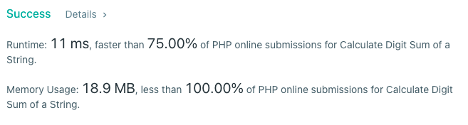

# PHP  | simple | 100 mem beat

**Author:** stuu
**Votes:** 1
**Link:** [https://leetcode.com/problems/calculate-digit-sum-of-a-string/solutions/1988849/](https://leetcode.com/problems/calculate-digit-sum-of-a-string/solutions/1988849/)

---


```
class Solution
{

  /**
   * @param string $s
   * @param int $k
   *
   * @return String
   */
    public function digitSum($s, $k)
    {
        if(strlen($s) <= $k) return $s;
        $chunks = array_chunk(str_split($s), $k);

        $ds = '';
        foreach ($chunks as $chunk) {
            $ds .= array_sum($chunk);
        }

        return $this->digitSum($ds, $k);
    }
}