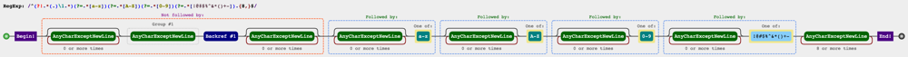

# [Python/Java/C++/C#/JavaScript/PHP] Regex

**Author:** i-i
**Votes:** 6
**Link:** [https://leetcode.com/problems/strong-password-checker-ii/solutions/2139347/](https://leetcode.com/problems/strong-password-checker-ii/solutions/2139347/)

---

### Just for fun ( \u02C6_\u02C6 ) \u2013 [don't do regex](https://softwareengineering.stackexchange.com/questions/113237/when-you-should-not-use-regular-expressions) for interviews! 

1. Hyphen or minus sign `-` has to be placed at the end or at the begining of the character class (`[]`), for special chars (i.e., `[!@#$%^&*()+-]` or `[-!@#$%^&*()+]`). Otherwise, `[!@#$%^&*()-+]` will not work, because `-` in the middle is a reserved meta char for ranges (i.e., `[d-y]`).

### First readable version

```
^ # start
(?!.*([0-9])\\1) # 2 same consecutive digits not allowed
(?!.*([a-z])\\2) # 2 same consecutive lowercase letters not allowed
(?!.*([A-Z])\\3) # 2 same consecutive uppercase letters not allowed
(?!.*([!@#$%^&*()+-])\\4) # 2 same consecutive special chars not allowed
(?=.*[a-z])\\ # must have at least one lowercase letter
(?=.*[A-Z])\\ # must have at least one uppercase letter
(?=.*[0-9])\\ # must have at least one digit
(?=.*[!@#$%^&*()+-])  # must have at least one special char
[A-Za-z0-9!@#$%^&*()+-]{8,} # allowed chars \u2013 8 or more times (using {8,})
$ # end

```

2. We can further simplify that to:

```
^ # start
(?!.*(.)\\1) # 2 same consecutive chars not allowed
(?=.*[a-z])\\ # must have at least one lowercase letter
(?=.*[A-Z])\\ # must have at least one uppercase letter
(?=.*[0-9])\\ # must have at least one digit
(?=.*[!@#$%^&*()+-])  # must have at least one special char
.{8,} # any char \u2013 8 or more times (using {8,})
$ # end

```


### Python:

```
class Solution:
    def strongPasswordCheckerII(self, password):
        return re.match(r'^(?!.*(.)\\1)(?=.*[a-z])(?=.*[A-Z])(?=.*[0-9])(?=.*[!@#$%^&*()+-]).{8,}$', password)
```

### Java:

```
import java.util.regex.Matcher;
import java.util.regex.Pattern;

class Solution {
    public boolean strongPasswordCheckerII(String password) {
        final String regex = "^(?!.*(.)\\\\1)(?=.*[a-z])(?=.*[A-Z])(?=.*[0-9])(?=.*[!@#$%^&*()+-]).{8,}$";
        final Pattern pattern = Pattern.compile(regex);
        final Matcher matcher = pattern.matcher(password);
        return matcher.find();
    }
}
```

### C#

```
using System.Text.RegularExpressions;

public class Solution {
    public bool StrongPasswordCheckerII(string password) {
        string pattern = @"^(?!.*(.)\\1)(?=.*[a-z])(?=.*[A-Z])(?=.*[0-9])(?=.*[!@#$%^&*()+-]).{8,}$";
        
        return Regex.Match(password, pattern).Success;
    }
}
```

### C++:

```
#include <regex>

class Solution {
public:
    bool strongPasswordCheckerII(string password) {
        string pattern = "^(?!.*(.)\\\\1)(?=.*[a-z])(?=.*[A-Z])(?=.*[0-9])(?=.*[!@#$%^&*()+-]).{8,}$";
        return regex_match (password, regex(pattern));
    }
};
```

### JavaScript:

```
const strongPasswordCheckerII = function(password) {
  const regex = new RegExp("^(?!.*(.)\\\\1)(?=.*[a-z])(?=.*[A-Z])(?=.*[0-9])(?=.*[!@#$%^&*()+-]).{8,}$", 'g')
  return regex.exec(password) !== null
};
```

### PHP:

```
class Solution {

    /**
     * @param String $password
     * @return Boolean
     */
    function strongPasswordCheckerII($password) {
        $re = '/^(?!.*(.)\\1)(?=.*[a-z])(?=.*[A-Z])(?=.*[0-9])(?=.*[!@#$%^&*()+-]).{8,}$/s';

        return preg_match($re, $password);
    }
}
```

### TypeScript

```
function strongPasswordCheckerII(password: string): boolean {
  const regex = new RegExp("^(?!.*(.)\\\\1)(?=.*[a-z])(?=.*[A-Z])(?=.*[0-9])(?=.*[!@#$%^&*()+-]).{8,}$", 'g')
  return regex.exec(password) !== null
};

```

### RegEx Visualizer

[jex.im](https://jex.im/regulex/#!flags=&re=%5E(a%7Cb)*%3F%24) visualizes regular expressions:





---------

If you wish to simplify/update/explore the expression, it's been explained on the top right panel of [regex101.com](https://regex101.com/r/1Lvfla/1/). You can watch the matching steps or modify them in [this debugger link](https://regex101.com/r/1Lvfla/1/debugger), if you'd be interested. The debugger demonstrates that how [a RegEx engine](https://en.wikipedia.org/wiki/Comparison_of_regular_expression_engines) might step by step consume some sample input strings and would perform the matching process.

---------