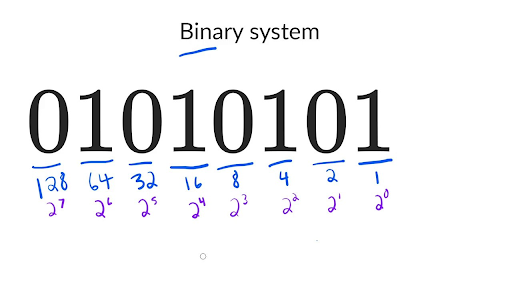

# Javascript solution, Easy to understand, Liner O(n).

**Author:** user1452y
**Votes:** 3
**Link:** [https://leetcode.com/problems/longest-binary-subsequence-less-than-or-equal-to-k/solutions/2168150/](https://leetcode.com/problems/longest-binary-subsequence-less-than-or-equal-to-k/solutions/2168150/)

---

Reminder for binary number counting.


Starting from the last position. Each time when the accumulated number is smaller than the number count++;

```
/**
 * @param {string} s
 * @param {number} k
 * @return {number}
 */

var longestSubsequence = function(s, k) {
    let count = 0;
    let j = s.length - 1; // starting from the last digit
    let i = 0; // binary number position
    let acc = 0;
    
    while(j >= 0){
        let positionNumber = Number(s[j]) * Math.pow(2, i);
        j--;
        i++;
        if(acc + positionNumber > k) continue;

		acc += positionNumber;
		count++;
    }

    return count;
};


```
**Please upvote if you like the solution**