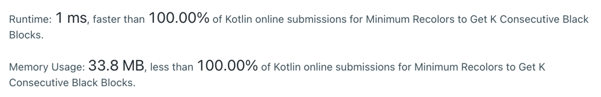

# Kotlin Sliding window - Single loop

**Author:** Abhimanyu14
**Votes:** 0
**Link:** [https://leetcode.com/problems/minimum-recolors-to-get-k-consecutive-black-blocks/solutions/6062293/](https://leetcode.com/problems/minimum-recolors-to-get-k-consecutive-black-blocks/solutions/6062293/)

---



```
fun minimumRecolors(blocks: String, k: Int): Int {
    var result = k
    var current = 0
    var index = 0
    while (index < k) {
        if (blocks[index] == 'W') {
            current++
        }
        index++
    }
    result = min(result, current)
    while (index < blocks.length) {
        if (blocks[index] == 'W') {
            current++
        }
        if (blocks[index - k] == 'W') {
            current--
        }
        index++
        result = min(result, current)
    }
    return result
}
```

Time Complexity - O(N)
Space Complexity - O(1)