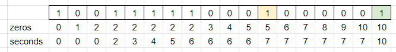

# DP vs. Brute-Force

**Author:** votrubac
**Votes:** 196
**Link:** [https://leetcode.com/problems/time-needed-to-rearrange-a-binary-string/solutions/2454262/](https://leetcode.com/problems/time-needed-to-rearrange-a-binary-string/solutions/2454262/)

---

DP is O(n) but could be tricky to figure out; Brute-Force is good enough for the contest since `n <= 1,000`.

#### DP

We count "zeros" so far. If we have a string `00001`, we need `4` seconds (as we have `4` zeros) to make it `10000`.

We also track `seconds` we need to rearrange first `i` letters.

If `i + 1` letter is `1`, we need at least `seconds + 1` seconds, but not less than `zero` seconds.

Here is calculation for the `"100111110001000001"` test case:
- For `i == 11` (yellow), the result is `7` as we need `6` seconds for `i - 1`.
- For `i == 17` (green), the result is `10` as we have `10` zeros, even though we need `7` seconds for `i - 1`.



**Java**
```java
public int secondsToRemoveOccurrences(String s) {
    int zeros = 0, seconds = 0;
    for (int i = 0; i < s.length(); ++i) {
        zeros += s.charAt(i) == '0' ? 1 : 0;
        if (s.charAt(i) == '1' && zeros > 0)
            seconds = Math.max(seconds + 1, zeros);
    }
    return seconds;        
}
```
**C++**
```cpp
int secondsToRemoveOccurrences(string s) {
    int zeros = 0, seconds = 0;
    for (int i = 0; i < s.size(); ++i) {
        zeros += s[i] == '0';
        if (s[i] == '1' && zeros)
            seconds = max(seconds + 1, zeros);
    }
    return seconds;
}
```
**Complexity Analysis**
- Time: O(n)
- Memory: O(1)

#### Brute-Force
**C++**
```cpp
int secondsToRemoveOccurrences(string s) {
    int seconds = 0, changed = true;
    while(changed) {
        changed = false;
        for (int i = 0; i < s.size() - 1; ++i) {
            if (s[i] == '0' && s[i + 1] == '1') {
                swap(s[i], s[i + 1]);
                ++i;
                changed = true;
            }
        }
        seconds += changed;
    }
    return seconds;
}
```
**Complexity Analysis**
- Time: O(n * n) - OK for n <= 1,000. We process `n` characters in the string `n` times in the worst case (`0111...1`).
- Memory: O(n) to store an interim string.