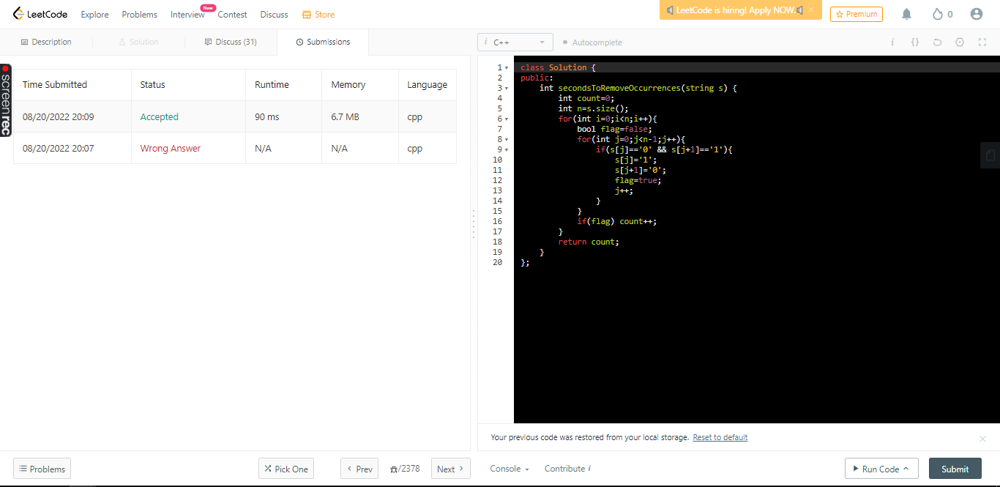

# ✅C++ || Straightforward && EASY || SHORT

**Author:** abhinav_0107
**Votes:** 7
**Link:** [https://leetcode.com/problems/time-needed-to-rearrange-a-binary-string/solutions/2454388/](https://leetcode.com/problems/time-needed-to-rearrange-a-binary-string/solutions/2454388/)

---

	class Solution {
	public:
		int secondsToRemoveOccurrences(string s) {
			int count=0;
			int n=s.size();
			for(int i=0;i<n;i++){
				bool flag=false;
				for(int j=0;j<n-1;j++){
					if(s[j]=='0' && s[j+1]=='1'){
						s[j]='1';
						s[j+1]='0';
						flag=true;
						j++;
					}
				}
				if(flag) count++;
			}
			return count;
		}
	};