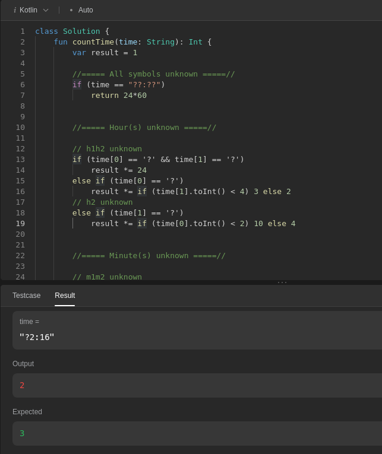

# Simple solution in Kotlin. With notes and simplifications

**Author:** Finnever
**Votes:** 1
**Link:** [https://leetcode.com/problems/number-of-valid-clock-times/solutions/3471204/](https://leetcode.com/problems/number-of-valid-clock-times/solutions/3471204/)

---

# Description
 - **Code works great**
# Code
```
class Solution {
    fun countTime(time: String): Int {
        var result = 1

        //===== All symbols unknown =====//
        if (time == "??:??")
            return 24*60


        //===== Hour(s) unknown =====//
        
        // h1h2 unknown
        if (time[0] == '?' && time[1] == '?')
            result *= 24
        // h1 unknown
        else if (time[0] == '?')
            result *= if (time[1] == '0'
                    || time[1] == '1'
                    || time[1] == '2'
                    || time[1] == '3') 3 else 2
        // h2 unknown
        else if (time[1] == '?')
            result *= if (time[0] == '0' || time[0] == '1') 10 else 4 


        //===== Minute(s) unknown =====//
        
        // m1m2 unknown
        if (time[3] == '?' && time[4] == '?')
            result *= 60
        // m1 unknown
        else if (time[3] == '?')
            result *= 6
        // m2 unknown
        else if (time[4] == '?')
            result *= 10
        

        // Result
        return result
    }
}
```

---

# Offtop:
(The code above works! The text below is about an unsuccessful option)
There is one solution that doesn't work. Can you explain why?

Look at part of my true beautiful code version:
```
// h1 unknown
        else if (time[0] == '?')
            result *= if (time[1].toInt() < 4) 3 else 2
// h2 unknown
else if (time[1] == '?')
            result *= if (time[0].toInt() < 2) 10 else 4 
```
**Idk why e.g. in case "?2:54"  this code don't work in h1 part**
But if compare over each char (time[1] == '1' etc.) - it's work   xD
In h2 part the same stupidity  ^_^

Actually, for this, I wrote a comparison with each symbol and now the solution is 100% correct, "surprise"
```
// h2 unknown
        else if (time[1] == '?')
            result *= if (time[0] == '0' || time[0] == '1') 10 else 4 
```
---


Maybe the tests are stupid?
**If you can explain to me what is wrong, I will be grateful!**  \u2764\uFE0F