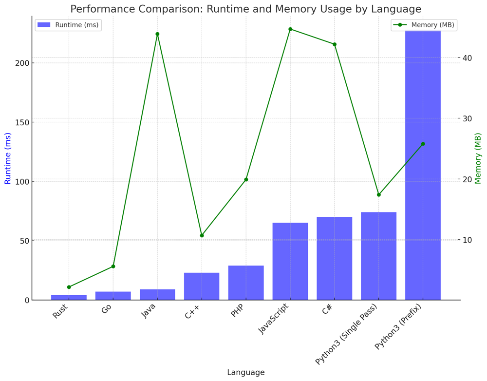

# ✅ 99.70% 2-Approach Single Pass & Prefix Sum

**Author:** vanAmsen
**Votes:** 142
**Link:** [https://leetcode.com/problems/minimum-penalty-for-a-shop/solutions/3973809/](https://leetcode.com/problems/minimum-penalty-for-a-shop/solutions/3973809/)

---

# Interview Guide: Minimum Penalty for a Shop

## Problem Understanding

**Description**:  
So, you're ramping up for coding interviews or just looking to sharpen your algorithmic skills, right? Well, the "Minimum Penalty for a Shop" problem is a perfect starting point. Imagine owning a shop and you need to decide when to close it. You have a log of 'Y's and 'N's, indicating customer visits and no-shows. Your goal? Find that sweet spot\u2014the earliest time to close and minimize penalties.

## Interview Preparation Tips & Considerations

### 1. **Don't Skim Over Constraints**  
  - First, note that the log can be lengthy, up to $$10^5$$ characters. This tells you that your solution must be optimized to handle large inputs efficiently.
  - Secondly, the log contains only 'Y' and 'N'. This simplicity is deceptive; the challenge lies in optimizing your approach.

### 2. **Approach Selection: Your First Critical Decision**
  - **Single Pass**: If time complexity is your main concern, this approach should be your go-to. It runs in $$O(n)$$ time and uses a minuscule $$O(1)$$ space. This is ideal for interviews where time is of the essence.
  
  - **Prefix-Suffix Sums**: Opt for this if you have more freedom with space. It also operates in $$O(n)$$ time but uses $$O(n)$$ space. This approach provides a more in-depth understanding of the log.

### How to Start Coding?  
1. **Understand the Problem**: Before you even touch the keyboard, make sure you understand what the problem is asking. Do a dry run with a sample input.
  
2. **Choose Your Approach**: Based on the problem constraints and what you're comfortable with, select an approach. Each has its merits and demerits.

3. **Pseudocode First**: Write down a quick pseudocode to outline your thoughts. It helps to see the logic on paper before coding.

4. **Code and Test**: Now, dive into the code. Keep testing at every significant step to ensure you're on the right track.

5. **Edge Cases**: Don't forget them; they're the Achilles heel in coding interviews. Make sure your solution handles all edge cases.

6. **Review**: Before saying you're done, review the code for any possible optimizations or errors. 

---

# More than Live Coding:
https://youtu.be/Za91oxv7uls?si=VYY0Fxj9NxpY1WkF

---

# Single Pass Approach

## Explanation

The logic behind the Single Pass Approach is to efficiently iterate through the customer visit log string once, while keeping track of the penalty score. This way, we can find the optimal time to close the shop with minimal computational overhead. Here's a detailed explanation:

### 1. **Initialization**:  
We start by initializing three variables: `max_score`, `score`, and `best_hour` to 0. 
- `max_score`: To keep track of the highest score seen so far.
- `score`: To hold the current penalty score.
- `best_hour`: To remember the hour where `max_score` occurred.

```python
max_score = score = 0
best_hour = -1
```

### 2. **Iterate through the String**:  
Here comes the main part. We loop through each character `c` in the customer visit log string. We use a single variable `score` to keep track of the penalty.

- If `c` is 'Y':  
  This means a customer is visiting the shop at this hour, so we increment `score` by 1. This is because if the shop were closed at this hour, it would incur a penalty.

- If `c` is 'N':  
  No customer is visiting, so we decrement `score` by 1. This implies that keeping the shop open at this hour would be wasteful and result in a penalty.

```python
for i, c in enumerate(customers):
    score += 1 if c == 'Y' else -1
```

### 3. **Track Max Score and Best Hour**:  
At each iteration, we compare `score` with `max_score`. If `score` is greater, it means we've found a new optimal time to close the shop. So, we update `max_score` and set `best_hour` to the current index `i`.

```python
    if score > max_score:
        max_score, best_hour = score, i
```

### 4. **Return Result**:  
Finally, we've iterated through the entire string and found the optimal time to close the shop, which is stored in `best_hour`. We return `best_hour + 1` (because the question is 0-indexed).

```python
return best_hour + 1
```

## Complexity

### Time Complexity:  
The algorithm runs in $$ O(n) $$ time since we go through the string once.

### Space Complexity:  
The space complexity is $$ O(1) $$, as we use constant extra space.

# Prefix-Suffix Sums Approach

### Explanation

1. **Initialization**:  
  Initialize two empty arrays `prefixN` and `suffixY` with a leading zero. Initialize counters `cntN` and `cntY` to zero.

2. **Compute Prefix Sums for 'N'**:  
  Traverse the string and update `prefixN` with the count of 'N's until the current index.

3. **Compute Suffix Sums for 'Y'**:  
  Traverse the string in reverse and update `suffixY` with the count of 'Y's from the current index to the end.

4. **Calculate Penalties**:  
  Compute the penalty for each hour as `prefixN[i] + suffixY[i]`.

5. **Find Minimum Penalty**:  
  Identify the index with the minimum penalty.

6. **Return Result**:  
  Return the index as the best time to close the shop.

### Complexity

- **Time Complexity**: $$O(n)$$
- **Space Complexity**: $$O(n)$$

## Conclusion

Both approaches solve the problem effectively, each with its own advantages. The Single Pass approach is more space-efficient, while the Prefix-Suffix Sums approach is more intuitive. The choice between the two depends on whether space efficiency or ease of understanding is a higher priority.

---

# Performance Table 

## Single Pass

| Language           | Runtime (ms) | Memory (MB) |
|--------------------|--------------|-------------|
| Rust               | 4            | 2.2         |
| Go                 | 7            | 5.6         |
| Java               | 9            | 43.9        |
| C++                | 23           | 10.7        |
| PHP                | 29           | 19.9        |
| Python3 (Single Pass) | 74       | 17.4        |
| JavaScript         | 65           | 44.7        |
| C#                 | 70           | 42.2        |
| Python3 (Prefix)   | 228          | 25.8        |

The table reveals how the Single Pass approach in Python significantly outperforms the Prefix approach, underscoring the importance of algorithmic optimization. It also offers a fascinating look at the performance variations across different programming languages.



---

# Code Single Pass
``` Python []
class Solution:
    def bestClosingTime(self, customers: str) -> int:
        max_score = score = 0
        best_hour = -1

        for i, c in enumerate(customers):
            score += 1 if c == 'Y' else -1
            if score > max_score:
                max_score, best_hour = score, i
                
        return best_hour + 1

```
``` C++ []
class Solution {
public:
    int bestClosingTime(string customers) {
        int max_score = 0, score = 0, best_hour = -1;
        for(int i = 0; i < customers.size(); ++i) {
            score += (customers[i] == 'Y') ? 1 : -1;
            if(score > max_score) {
                max_score = score;
                best_hour = i;
            }
        }
        return best_hour + 1;
    }
};
```
``` Go []
func bestClosingTime(customers string) int {
    max_score, score, best_hour := 0, 0, -1
    for i := 0; i < len(customers); i++ {
        if customers[i] == 'Y' {
            score++
        } else {
            score--
        }
        if score > max_score {
            max_score = score
            best_hour = i
        }
    }
    return best_hour + 1
}
```
``` Rust []
impl Solution {
    pub fn best_closing_time(customers: String) -> i32 {
        let mut max_score = 0;
        let mut score = 0;
        let mut best_hour = -1;
        
        for (i, c) in customers.chars().enumerate() {
            if c == 'Y' {
                score += 1;
            } else {
                score -= 1;
            }
            
            if score > max_score {
                max_score = score;
                best_hour = i as i32;
            }
        }
        
        best_hour + 1
    }
}
```
``` Java []
public class Solution {
    public int bestClosingTime(String customers) {
        int max_score = 0, score = 0, best_hour = -1;
        for(int i = 0; i < customers.length(); ++i) {
            score += (customers.charAt(i) == 'Y') ? 1 : -1;
            if(score > max_score) {
                max_score = score;
                best_hour = i;
            }
        }
        return best_hour + 1;
    }
}
```
``` JavaScript []
/**
 * @param {string} customers
 * @return {number}
 */
var bestClosingTime = function(customers) {
    let max_score = 0, score = 0, best_hour = -1;
    for(let i = 0; i < customers.length; ++i) {
        score += (customers[i] === 'Y') ? 1 : -1;
        if(score > max_score) {
            max_score = score;
            best_hour = i;
        }
    }
    return best_hour + 1;
};
```
``` PHP []
class Solution {
    public function bestClosingTime($customers) {
        $max_score = $score = 0;
        $best_hour = -1;
        
        for($i = 0; $i < strlen($customers); ++$i) {
            $score += ($customers[$i] === 'Y') ? 1 : -1;
            if($score > $max_score) {
                $max_score = $score;
                $best_hour = $i;
            }
        }
        
        return $best_hour + 1;
    }
}
```
``` C# []
public class Solution {
    public int BestClosingTime(string customers) {
        int max_score = 0, score = 0, best_hour = -1;
        for(int i = 0; i < customers.Length; ++i) {
            score += (customers[i] == 'Y') ? 1 : -1;
            if(score > max_score) {
                max_score = score;
                best_hour = i;
            }
        }
        return best_hour + 1;
    }
}
```

# Code  Prefix Sums
``` Python []
class Solution:
    def bestClosingTime(self, customers: str) -> int:
        n, cntN, cntY = len(customers), 0, 0
        prefixN, suffixY = [0], [0]
        
        for c in customers:
            cntN += (c == 'N')
            prefixN.append(cntN)
        
        for c in reversed(customers):
            cntY += (c == 'Y')
            suffixY.append(cntY)
        
        suffixY.reverse()
        
        best_hour, _ = min(enumerate(a + b for a, b in zip(prefixN, suffixY)), key=lambda x: x[1])
        
        return best_hour
```

Every line of code you write brings you one step closer to becoming an expert. Both brevity and clarity have their merits in coding. So keep exploring and don't hesitate to share your unique perspective. You never know, your insight might just be the 'aha' moment someone else needs. Happy Coding! \uD83D\uDE80\uD83D\uDCA1