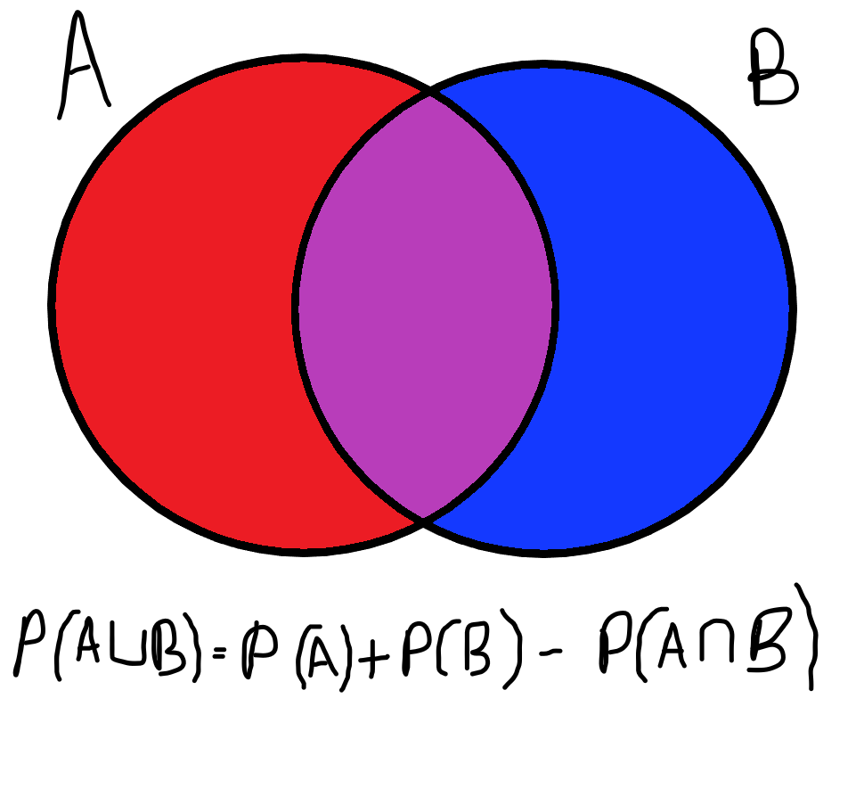

# This took me several hours hopefully this can help you

**Author:** jmucc314
**Votes:** 0
**Link:** [https://leetcode.com/problems/count-palindromic-subsequences/solutions/6048459/](https://leetcode.com/problems/count-palindromic-subsequences/solutions/6048459/)

---

# Intuition
<!-- Describe your first thoughts on how to solve this problem. -->
My idea was that we can frame this as a recursive problem by considering the answer to a smaller problem (substring of the original string). Since there ought to be a lot of repeated computation a dynamic programmming approach will be necessary to achieve a reasonable time complexity. 

# Approach
<!-- Describe your approach to solving the problem. -->
So use an array which is the answer to the problem assuming the string starts at index i, and as we loop we gradually solve the problem and make the length of the string that starts at index i longer. The main update is to set the current answer to the sum of the previous answers at i and i + 1 and subtract the answer of the previous previous answer at i + 1. We subtract to avoid double counting the middle segment, much like the venndiagram formula shown below. 

We also need to be sure to add the amount of smaller palindromes (e.g. length 3 if we are looking for length 5) contained inside the endpoints if the endpoints are equal (because this creates larger palindromes).

For a practical example consider the string 103301 as given in the test cases. Suppose we want to calculate the amount of length 3 palindrome subsequences for the entire string. First we get the  answer from index 1 to the end of the string. This is 2. Then we get the answer from index 0 to index 4, this is also 2. We add those and subtract the answer from index 1 to index 4 which is once again 2. Indeed, in all cases the same 2 answers occurred, so hopefully this explains the double counting principle and it is also a good sign that our final answer after this part is 2. Now, since the endpoints are equal, we add the substring palindromes of length 1 (the goal length - 2) from index 1 to 4, which is of course 4. Finally, our answer is 6: 101, 131, 131, 101, 030, and 030.


# Complexity
- Time complexity:
<!-- Add your time complexity here, e.g. $$O(n)$$ -->
$$O(n^2)$$ since we have a double nested loop and operations inside are constant time

- Space complexity:
<!-- Add your space complexity here, e.g. $$O(n)$$ -->
$$O(n)$$ since the only variable dimension in our 3D array is n

# Code
```csharp []
public class Solution {
    public int CountPalindromes(string s) {
        if(s.Length < 5)
            return 0;

        // Consider a length gap
        // int[,] prevPrevCounts = new int[s.Length,3]; // ppc[i][j] is the number of palindromes of length 2j+1 you can make from the substring that starts at i with length gap-2
        // int[,] prevCounts = new int[s.Length,3];     //  pc[i][j] is the number of palindromes of length 2j+1 you can make from the substring that starts at i with length gap-1
        // int[,] curCounts = new int[s.Length,3];      //  cc[i][j] is the number of palindromes of length 2j+1 you can make from the substring that starts at i with length gap
        // Same idea but im gonna try putting it in one 3D array to avoid copying because I am still getting TLE...
        // prevPrevCount is (index + 1) % 3
        // prevCounts is (index + 2) % 3
        // curCounts is index % 3
        int[,,] counts = new int[3,s.Length,3];
        int index = 0;

        for(int gap = 0; gap < s.Length; gap++) {
            for(int i = 0; i + gap < s.Length; i++) {
                if(gap == 0)
                    counts[index%3,i,0] = 1; // You can make one palindrome of length 1 from a single character
                else {
                    // GENERAL APPROACH
                    // The number of palindrome subsequences from substrings starting at i of length gap is equal to... 
                    // The number of palindrome subsequences from substrings starting at i+1 of length gap-1 PLUS
                    // The number of palindrome subsequences from substrings starting at i of length gap-1 MINUS
                    // The number of palindrome subsequences from substrings starting at i+1 of length gap-2 
                    // If the endpoint digits are the same we also add
                    // The number of palindrome subsequences OF SHORTER LENGTH from substrings starting at i+1 of length gap-2

                    // Update length 1
                    counts[index%3,i,0] = ModuloSubtraction(ModuloAddition(counts[(index+2)%3,i+1,0], counts[(index+2)%3,i,0]), counts[(index+1)%3,i+1,0]);

                    // Update length 3
                    counts[index%3,i,1] = ModuloSubtraction(ModuloAddition(counts[(index+2)%3,i+1,1], counts[(index+2)%3,i,1]), counts[(index+1)%3,i+1,1]);
                    if(s[i] == s[i+gap])
                        counts[index%3,i,1] = ModuloAddition(counts[index%3,i,1], counts[(index+1)%3,i+1,0]);

                    // Update length 5
                    counts[index%3,i,2] = ModuloSubtraction(ModuloAddition(counts[(index+2)%3,i+1,2], counts[(index+2)%3,i,2]), counts[(index+1) % 3,i+1,2]);
                    if(s[i] == s[i+gap])
                        counts[index%3,i,2] = ModuloAddition(counts[index%3,i,2], counts[(index+1)%3,i+1,1]);
                }
            }
            index++;
        }

        // Once the loop is done curCounts[0, 2] holds the amount of subsequences of the entire string that are length 5 palindromes
        return counts[(index - 1)%3,0,2];
    }

    public int ModuloAddition(int a, int b) {
        return (a + b) >= 1000000007 ? a + b - 1000000007 : a + b;
    }

    public int ModuloSubtraction(int a, int b) {
        return (a - b) < 0 ? a - b + 1000000007 : a - b;
    }
}
```