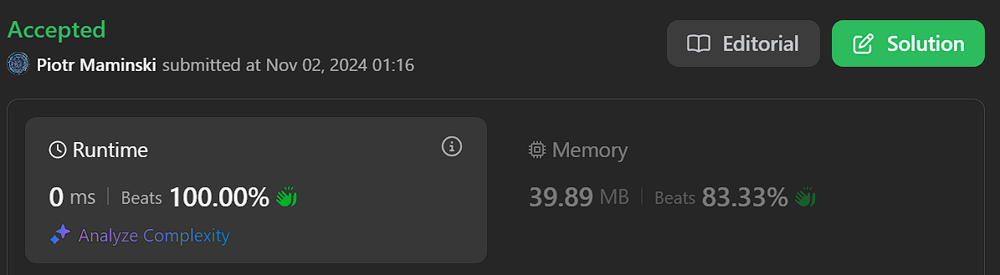

# ✅Beats 100% | Working 02.11.2024 | Explained step by step | Most common Interview String

**Author:** Piotr_Maminski
**Votes:** 90
**Link:** [https://leetcode.com/problems/circular-sentence/solutions/5995054/](https://leetcode.com/problems/circular-sentence/solutions/5995054/)

---

# Code (all beats 100%)
```python3 []
class Solution:
    def isCircularSentence(self, sentence: str) -> bool:
        # Get the length of the sentence
        n = len(sentence)
        
        # First check: Compare first and last character of sentence
        # For a circular sentence, they must match
        if sentence[0] != sentence[n-1]:
            return False
            
        # Iterate through the sentence, starting from index 1 to n-2
        # We don't need to check first and last characters again
        for i in range(1, n-1):
            # When we find a space character
            if sentence[i] == ' ':
                # Check if the character before space (last char of current word)
                # matches the character after space (first char of next word)
                if sentence[i-1] != sentence[i+1]:
                    return False
                    
        # If we made it through all checks, the sentence is circular
        return True
```
```cpp []
class Solution {
public:
    bool isCircularSentence(string sentence) {
        // Get the length of the sentence
        int n = sentence.size();

        // First check: Compare first and last character of sentence
        // For a circular sentence, they must match
        if(sentence[0] != sentence[n-1]) return false;

        // Iterate through the sentence, starting from index 1 to n-2
        // We don't need to check first and last characters again
        for(int i=1; i<n-1; i++){
            // When we find a space character
            if(sentence[i] == ' '){
                // Check if the character before space (last char of current word)
                // matches the character after space (first char of next word)
                if(sentence[i-1] != sentence[i+1]) return false;
            }
        }

        // If we made it through all checks, the sentence is circular
        return true;
    }
};
```
```java []
class Solution {
    // This method checks if a sentence is circular - where each word's last letter
    // matches the next word's first letter, and the last word's last letter matches
    // the first word's first letter
    public boolean isCircularSentence(String sentence) {
        // First check: verify if the first and last characters of the entire string match
        // This handles the requirement that the sentence should be circular
        if (sentence.charAt(0) != sentence.charAt(sentence.length() - 1))
            return false;

        // Find the first space in the string
        int k = sentence.indexOf(" ");
        
        // If there are no spaces, it means there's only one word
        // In this case, we already checked if first and last letters match
        if (k == -1)
            return true;

        // Iterate through all spaces in the string
        while (k != -1) {
            // For each space found:
            // Check if the character before the space (last letter of current word)
            // matches the character after the space (first letter of next word)
            if (sentence.charAt(k - 1) != sentence.charAt(k + 1)) {
                return false;
            }

            // Find the next space in the string, starting from position after current space
            k = sentence.indexOf(" ", k+1);
        }
        
        // If we've made it through all checks, the sentence is circular
        return true;
    }
}
```
```csharp []
public class Solution {
    public bool IsCircularSentence(string sentence) {
        // Get the length of the sentence
        int n = sentence.Length;
        
        // First check: Compare first and last character of sentence
        // For a circular sentence, they must match
        if (sentence[0] != sentence[n-1]) return false;
        
        // Iterate through the sentence, starting from index 1 to n-2
        // We don't need to check first and last characters again
        for (int i = 1; i < n-1; i++) {
            // When we find a space character
            if (sentence[i] == ' ') {
                // Check if the character before space (last char of current word)
                // matches the character after space (first char of next word)
                if (sentence[i-1] != sentence[i+1]) return false;
            }
        }
        
        // If we made it through all checks, the sentence is circular
        return true;
    }
}
```
```golang []
func isCircularSentence(sentence string) bool {
    // Get the length of the sentence
    n := len(sentence)

    // First check: Compare first and last character of sentence
    if sentence[0] != sentence[n-1] {
        return false
    }

    // Iterate through the sentence, starting from index 1 to n-2
    for i := 1; i < n-1; i++ {
        // When we find a space character
        if sentence[i] == ' ' {
            // Check if the character before space matches the character after space
            if sentence[i-1] != sentence[i+1] {
                return false
            }
        }
    }

    // If we made it through all checks, the sentence is circular
    return true
}
```
```swift []
class Solution {
    func isCircularSentence(_ sentence: String) -> Bool {
        // Handle empty string case
        guard !sentence.isEmpty else { return true }
        
        let chars = Array(sentence)
        let n = chars.count
        
        // Handle single character case
        guard n > 1 else { return true }
        
        // First check: Compare first and last character
        if chars[0] != chars[n-1] {
            return false
        }
        
        // Check characters around spaces
        for i in 1..<(n-1) {
            if chars[i] == " " {
                // Ensure we're not accessing out of bounds
                let prevChar = chars[i-1]
                let nextChar = chars[i+1]
                if prevChar != nextChar {
                    return false
                }
            }
        }
        
        return true
    }
}
```
```javascript [JS]
// JavaScript

var isCircularSentence = function(sentence) {
    // Get the length of the sentence
    const n = sentence.length;
    
    // First check: Compare first and last character of sentence
    if (sentence[0] !== sentence[n-1]) return false;
    
    // Iterate through the sentence, starting from index 1 to n-2
    for (let i = 1; i < n-1; i++) {
        // When we find a space character
        if (sentence[i] === ' ') {
            // Check if the character before space matches the character after space
            if (sentence[i-1] !== sentence[i+1]) return false;
        }
    }
    
    // If we made it through all checks, the sentence is circular
    return true;
};
```
```typescript [TS]
// Typescript

function isCircularSentence(sentence: string): boolean {
    // Get the length of the sentence
    const n: number = sentence.length;
    
    // First check: Compare first and last character of sentence
    // For a circular sentence, they must match
    if (sentence[0] !== sentence[n-1]) return false;
    
    // Iterate through the sentence, starting from index 1 to n-2
    // We don't need to check first and last characters again
    for (let i = 1; i < n-1; i++) {
        // When we find a space character
        if (sentence[i] === ' ') {
            // Check if the character before space (last char of current word)
            // matches the character after space (first char of next word)
            if (sentence[i-1] !== sentence[i+1]) return false;
        }
    }
    
    // If we made it through all checks, the sentence is circular
    return true;
}
```
```rust []
impl Solution {
    pub fn is_circular_sentence(sentence: String) -> bool {
        let chars: Vec<char> = sentence.chars().collect();
        let n = chars.len();
        
        // Check first and last character
        if chars[0] != chars[n - 1] {
            return false;
        }
        
        // Check characters around spaces
        for i in 1..n-1 {
            if chars[i] == ' ' && chars[i-1] != chars[i+1] {
                return false;
            }
        }
        
        true
    }
}
```
```ruby []
def is_circular_sentence(sentence)
  # Get the length of the sentence
  n = sentence.length
  
  # First check: Compare first and last character of sentence
  return false if sentence[0] != sentence[n-1]
  
  # Iterate through the sentence, starting from index 1 to n-2
  (1..n-2).each do |i|
    # When we find a space character
    if sentence[i] == ' '
      # Check if the character before space matches the character after space
      return false if sentence[i-1] != sentence[i+1]
    end
  end
  
  # If we made it through all checks, the sentence is circular
  true
end
```


# Without comments
```python3 []
class Solution:
    def isCircularSentence(self, sentence: str) -> bool:
        n = len(sentence)
        
        if sentence[0] != sentence[n-1]:
            return False
            
        for i in range(1, n-1):
            if sentence[i] == ' ':
                if sentence[i-1] != sentence[i+1]:
                    return False
                    
        return True
```
```cpp []
class Solution {
public:
    bool isCircularSentence(string sentence) {
        int n = sentence.size();
        if(sentence[0] != sentence[n-1]) return false;

        for(int i=1; i<n-1; i++){
            if(sentence[i] == ' '){
                if(sentence[i-1] != sentence[i+1]) return false;
            }
        }
        return true;
    }
};
```
```java []
class Solution {
    public boolean isCircularSentence(String sentence) {
        if (sentence.charAt(0) != sentence.charAt(sentence.length() - 1))
            return false;

        int k = sentence.indexOf(" ");
        if (k == -1)
            return true;

        while (k != -1) {
            if (sentence.charAt(k - 1) != sentence.charAt(k + 1)) {
                return false;
            }

            k = sentence.indexOf(" ", k+1);
        }
        return true;
    }
}
```
```csharp []
public class Solution {
    public bool IsCircularSentence(string sentence) {
        int n = sentence.Length;
        
        if (sentence[0] != sentence[n-1]) return false;
        
        for (int i = 1; i < n-1; i++) {
            if (sentence[i] == ' ') {
                if (sentence[i-1] != sentence[i+1]) return false;
            }
        }
        
        return true;
    }
}
```
```golang []
func isCircularSentence(sentence string) bool {
    n := len(sentence)
    
    if sentence[0] != sentence[n-1] {
        return false
    }

    for i := 1; i < n-1; i++ {
        if sentence[i] == ' ' {
            if sentence[i-1] != sentence[i+1] {
                return false
            }
        }
    }
    
    return true
}
```
```swift []
class Solution {
    func isCircularSentence(_ sentence: String) -> Bool {
        guard !sentence.isEmpty else { return true }
        
        let chars = Array(sentence)
        let n = chars.count
        
        guard n > 1 else { return true }
        
        if chars[0] != chars[n-1] {
            return false
        }
        
        for i in 1..<(n-1) {
            if chars[i] == " " {
                let prevChar = chars[i-1]
                let nextChar = chars[i+1]
                if prevChar != nextChar {
                    return false
                }
            }
        }
        
        return true
    }
}
```
```javascript [JS]
// JavaScript

var isCircularSentence = function(sentence) {
    const n = sentence.length;
    
    if (sentence[0] !== sentence[n-1]) return false;
    
    for (let i = 1; i < n-1; i++) {
        if (sentence[i] === ' ') {
            if (sentence[i-1] !== sentence[i+1]) return false;
        }
    }
    
    return true;
};
```
```typescript [TS]
// TypeScript

function isCircularSentence(sentence: string): boolean {
    const n: number = sentence.length;
    
    if (sentence[0] !== sentence[n-1]) return false;
    
    for (let i = 1; i < n-1; i++) {
        if (sentence[i] === ' ') {
            if (sentence[i-1] !== sentence[i+1]) return false;
        }
    }
    
    return true;
}
```
```rust []
impl Solution {
    pub fn is_circular_sentence(sentence: String) -> bool {
        let chars: Vec<char> = sentence.chars().collect();
        let n = chars.len();

        if chars[0] != chars[n - 1] {
            return false;
        }

        for i in 1..n-1 {
            if chars[i] == ' ' && chars[i-1] != chars[i+1] {
                return false;
            }
        }
        
        true
    }
}
```
```ruby []
def is_circular_sentence(sentence)
  n = sentence.length
  return false if sentence[0] != sentence[n-1]
  
  (1..n-2).each do |i|
    if sentence[i] == ' '
      return false if sentence[i-1] != sentence[i+1]
    end
  end
  
  true
end
```


### Complexity 
- Time complexity: O(n)

- Space complexity: O(1)

# Intuition
A circular sentence has two key properties:

1. The first character of the first word matches the last character of the last word
2. For any two consecutive words, the last character of the first word matches the first character of the second word

# Approach

1. First Character-Last Character Check:
- Compare sentence[0] with sentence[n-1] to verify the circular property between first and last characters
- This handles the "wrap-around" requirement efficiently
2. Adjacent Words Check:
- Look for space characters as they indicate word boundaries
- When a space is found at position i:
    - sentence[i-1] is the last character of current word
    - sentence[i+1] is the first character of next word
    - These must match for the sentence to be circular

- Avoids splitting the string into words, making it memory efficient
- Handles the checks in-place using character comparisons

### Example

For "leetcode exercises sound"

- First-Last check: 'l' matches 'd' **\u2713**
- At first space: 'e' matches 'e' **\u2713**
- At second space: 's' matches 's' **\u2713** Therefore, it's a circular sentence!

# Still dont understand string/array/pointers

**Video with IMO best explained:** google "Pointers in C / C++ [Full Course]"
(leetscode flag video in solution :)


# Most common/key Interview String Problems


[[3. Longest Substring Without Repeating Characters]](https://leetcode.com/problems/longest-substring-without-repeating-characters) [[76. Minimum Window Substring]](https://leetcode.com/problems/minimum-window-substring) [[10. Regular Expression Matching]](https://leetcode.com/problems/regular-expression-matching) [[72. Edit Distance]](https://leetcode.com/problems/edit-distance) [[8. String to Integer (atoi)]](https://leetcode.com/problems/string-to-integer-atoi) [[49. Group Anagrams]](https://leetcode.com/problems/group-anagrams) [[5. Longest Palindromic Substring]](https://leetcode.com/problems/longest-palindromic-substring) [[6. ZigZag Conversion]](https://leetcode.com/problems/zigzag-conversion) [[20. Valid Parentheses]](https://leetcode.com/problems/valid-parentheses) [[443. String Compression]](https://leetcode.com/problems/string-compression)


####  [Interview Questions and Answers Repository](https://github.com/RooTinfinite/Interview-questions-and-answers)

# Interview Priorities

| Patterns                | Difficulty | Interview Frequently           |
|----------------------|---------------------|----------------------|
| **Basic [Array](https://leetcode.com/problems/two-sum/solutions/5999466/beats-100-explained-step-by-step-list-most-common-array-inverview) / String**                 | **Easy**              | **Very High**               |
| **Two Pointers**         | **Easy**                | **High**                 |
| **Sliding Window**       | **Easy**                | **High**                 |
| **Breadth-First Search** | **Easy**                | **High**                 |
| **Depth-First Search**   | **Medium**              | **High**                 |
| **[Backtracking](https://leetcode.com/problems/letter-combinations-of-a-phone-number/solutions/5976064/complex-backtracking-interview-prepare-list-of-backtracking-questions-beats-100)**         | **High**                | **High**                 |
| Heap                 | Medium              | Medium               |
| Binary Search        | Easy                | Medium               |
| [Dynamic Programming](https://leetcode.com/problem-list/atwflvk7/)  | High                | Medium               |
| Divide and Conquer   | Medium              | Low                  |
| Trie                 | Medium              | Low                  |
| Union Find           | Medium              | Low                  |
| Greedy               | High                | Low                  |





