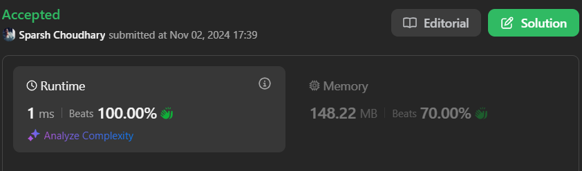

# 🔥BEATS 💯 % 🎯 |✨SUPER EASY BEGINNERS 👏

**Author:** CodeWithSparsh
**Votes:** 2
**Link:** [https://leetcode.com/problems/circular-sentence/solutions/5997649/](https://leetcode.com/problems/circular-sentence/solutions/5997649/)

---




---

### Intuition
The problem checks if the sentence has a circular pattern where the last character of each word matches the first character of the next word. For a single word, this implies that its first and last characters must be the same.

### Approach
1. Split the sentence into words by spaces.
2. If there's only one word, check if its first and last characters match.
3. For multiple words, check that the last character of each word matches the first character of the next word, looping back to the first word for the last word.
4. If any pair doesn\u2019t match, return `false`; otherwise, return `true`.

### Complexity
- **Time Complexity**: \\(O(n)\\), where \\(n\\) is the number of words.
- **Space Complexity**: \\(O(n)\\), for storing words in a list.

---

### Code Implementations

```dart []
class Solution {
  bool isCircularSentence(String statement) {
    List<String> words = statement.split(" ");
    
    // Single word case: check if the first and last characters are the same
    if (words.length == 1) {
      return words[0][0] == words[0][words[0].length - 1];
    }

    // Check circular condition for each word with the next one
    for (int i = 0; i < words.length; i++) {
      String lastChar = words[i][words[i].length - 1];
      String nextFirstChar = words[(i + 1) % words.length][0];
      
      if (lastChar != nextFirstChar) return false;
    }

    return true;
  }
}
```

```java []
class Solution {
    public boolean isCircularSentence(String statement) {
        String[] words = statement.split(" ");
        
        if (words.length == 1) {
            return words[0].charAt(0) == words[0].charAt(words[0].length() - 1);
        }

        for (int i = 0; i < words.length; i++) {
            char lastChar = words[i].charAt(words[i].length() - 1);
            char nextFirstChar = words[(i + 1) % words.length].charAt(0);

            if (lastChar != nextFirstChar) return false;
        }

        return true;
    }
}
```

```javascript []
function isCircularSentence(statement) {
    const words = statement.split(" ");

    if (words.length === 1) {
        return words[0][0] === words[0][words[0].length - 1];
    }

    for (let i = 0; i < words.length; i++) {
        const lastChar = words[i][words[i].length - 1];
        const nextFirstChar = words[(i + 1) % words.length][0];

        if (lastChar !== nextFirstChar) return false;
    }

    return true;
}
```

```python []
class Solution:
    def isCircularSentence(self, statement: str) -> bool:
        words = statement.split(" ")

        if len(words) == 1:
            return words[0][0] == words[0][-1]

        for i in range(len(words)):
            last_char = words[i][-1]
            next_first_char = words[(i + 1) % len(words)][0]

            if last_char != next_first_char:
                return False

        return True
```

```cpp []
#include <string>
#include <vector>
#include <sstream>

class Solution {
public:
    bool isCircularSentence(const std::string& statement) {
        std::istringstream ss(statement);
        std::vector<std::string> words;
        std::string word;
        
        while (ss >> word) {
            words.push_back(word);
        }

        if (words.size() == 1) {
            return words[0][0] == words[0].back();
        }

        for (int i = 0; i < words.size(); i++) {
            char lastChar = words[i].back();
            char nextFirstChar = words[(i + 1) % words.size()][0];

            if (lastChar != nextFirstChar) return false;
        }

        return true;
    }
};
```

```c []
#include <stdbool.h>
#include <string.h>
#include <stdlib.h>

bool isCircularSentence(const char* statement) {
    int n = strlen(statement);
    char** words = malloc(n * sizeof(char*));
    int count = 0;
    char* token = strtok(strdup(statement), " ");

    while (token) {
        words[count++] = token;
        token = strtok(NULL, " ");
    }

    if (count == 1) {
        return words[0][0] == words[0][strlen(words[0]) - 1];
    }

    for (int i = 0; i < count; i++) {
        char lastChar = words[i][strlen(words[i]) - 1];
        char nextFirstChar = words[(i + 1) % count][0];

        if (lastChar != nextFirstChar) {
            return false;
        }
    }

    free(words);
    return true;
}
```

```go []
package main

import (
	"strings"
)

func isCircularSentence(statement string) bool {
	words := strings.Split(statement, " ")

	if len(words) == 1 {
		return words[0][0] == words[0][len(words[0])-1]
	}

	for i := 0; i < len(words); i++ {
		lastChar := words[i][len(words[i])-1]
		nextFirstChar := words[(i+1)%len(words)][0]

		if lastChar != nextFirstChar {
			return false
		}
	}

	return true
}
```

---


 {:style='width:250px'}