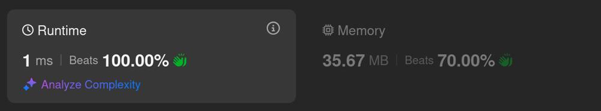
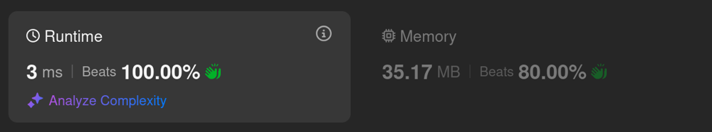
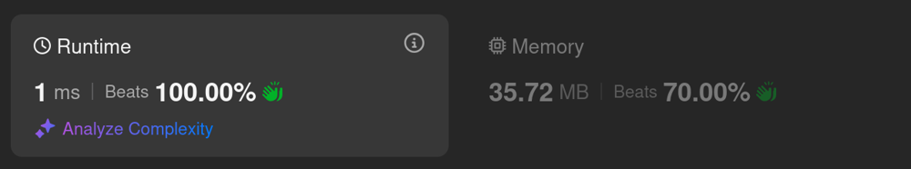

# Kotlin. Beats 100% (1 ms). Single var solution (bitwise math)

**Author:** mobdev778
**Votes:** 2
**Link:** [https://leetcode.com/problems/circular-sentence/solutions/5997252/](https://leetcode.com/problems/circular-sentence/solutions/5997252/)

---


# Code
```kotlin []
class Solution {
    fun isCircularSentence(sentence: String): Boolean {
        if (sentence[0] != sentence[sentence.length - 1]) return false

        var buffer = 0
        for (c in sentence) {
            if (buffer and 0xFFFF == 32 && c.code != buffer shr 16) return false
            buffer = buffer shl 16 or c.code
        }

        return true
    }
}
```

# Approach

We can use "int" variable to store last 2 characters.
When reading new character we will just shift buffer to the left by 16 bits and add new character.

The search should return "false" only if the last character was " " and the penultimate character does not match the current one:

```
// case 1:
leetcod[e] [i]s 
[e] != [i] // bad combination, abort the search

// case 2:
leetcod[e] [e]etcode 
[e] == [e] // good combination, continue the search.
```

# Alternative approach

1. An attempt to reduce the number of calls to "c.code":



```
class Solution {
    fun isCircularSentence(sentence: String): Boolean {
        if (sentence[0] != sentence[sentence.length - 1]) return false

        var buffer = 0
        for (c in sentence) {
            buffer = buffer shl 8 or c.code
            if (buffer and 0xFF00 == 0x2000 && (buffer shr 16 xor buffer) and 0xFF != 0) return false
        }

        return true
    }
}
```

2. Caching symmetric masks:



```
class Solution {
    fun isCircularSentence(sentence: String): Boolean {
        if (sentence[0] != sentence[sentence.length - 1]) return false

        var buffer = 0
        for (c in sentence) {
            buffer = (buffer shl 8 or c.code) and 0xFFFFFF
            if (buffer and 0xFF00 == 0x2000 && !MASKS.contains(buffer)) return false
        }

        return true
    }

    companion object {
        val MASKS = HashSet<Int>()
        init {
            for (c in 'A'..'Z') {
                MASKS.add((c.code shl 16) or 0x2000 or c.code)
            }
            for (c in 'a'..'z') {
                MASKS.add((c.code shl 16) or 0x2000 or c.code)
            }
        }
    }
}
```

3. Simple loop solution



```
class Solution {
    fun isCircularSentence(sentence: String): Boolean {
        if (sentence[0] != sentence[sentence.length - 1]) return false
        for (i in 0 until sentence.length) {
            if (sentence[i] == ' ' && sentence[i - 1] != sentence[i + 1]) return false
        }
        return true
    }
}
```