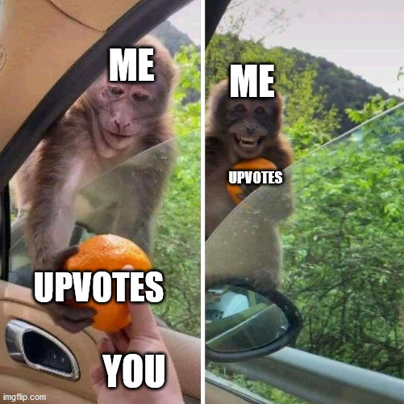

# Didn't realise that 1 has so much power 💪|| Easy Approach explained💡 ||

**Author:** JainWinn
**Votes:** 1
**Link:** [https://leetcode.com/problems/apply-bitwise-operations-to-make-strings-equal/solutions/3084763/](https://leetcode.com/problems/apply-bitwise-operations-to-make-strings-equal/solutions/3084763/)

---

# Approach\uD83E\uDDE0
<!-- Describe your approach to solving the problem. -->
- Case 1 :'1' in s and '0' in target

1.If we have '1' in s and '0' in target we can take help from another '1' in s to place '0' .
```
i.e (1^1=0) & (1|1=1) .
```

2.If there is no '1' available we can create an additional '1' by using '0' as below
```
i.e (1^0=1) & (1|0=1) .
```
and then using that '1' as in first point .
Here if the target is string containing all '0' then we cannot make s and target equal as there would always be one '1' in s .


- Case 2 :'0' in s and '1' in target

1.If we have '0' in s and '1' in target we can take help from a '1' in s to place '1'  .
```
i.e (0^1=1) & (0|1=1) .
```
2.If there is no '1' available we cannot make s and target equal .
because : (0^0=0) && (0|0=0) .(s is string containing all '0' in this situation)


#### \uD83C\uDF1FSo only thing we need to check is either number of '1' in both s and target is 0 
'OR' 
#### both s and target should have atleast one '1'.

----

# Complexity\u231B
## - Time complexity: O(n)
<!-- Add your time complexity here, e.g. $$O(n)$$ -->

## - Space complexity: O(1)
<!-- Add your space complexity here, e.g. $$O(n)$$ -->
----
# Code 
## *C++ :*
```
class Solution {
public:
    bool makeStringsEqual(string s, string target) {
        int n=s.size();
        bool chk1=0,chk2=0;
        for(int i=0 ; i<n; i++){
            if(s[i]&1){
                chk1=true;
                break;
            }
        }
        for(int i=0 ; i<n; i++){
            if(target[i]&1){
                chk2=true;
                break;
            }
        }
        return (chk1==chk2);
    }
};
```

# Code 
## *Python3 :*
```
class Solution:
    def makeStringsEqual(self, s: str, target: str) -> bool:
        c1=False
        c2=False
        for i in s :
            if(i=='1') :
                c1=True
                break
        for i in target :
            if(i=='1') :
                c2=True
                break
        return c1==c2
```
# Code 
## *Javascript :*
```
/**
 * @param {string} s
 * @param {string} target
 * @return {boolean}
 */
var makeStringsEqual = function(s, target) {
    let n=s.length;
    let c1=false,c2=false;
    for(let i=0 ; i<n;  i++){
        if(s[i]&1){
            c1=true;
            break;
        }
    }
    for(let i=0 ; i<n;  i++){
        if(target[i]&1){
            c2=true;
            break;
        }
    }
    return c1==c2;
};
```
### DO UPOTE if it helped you .

