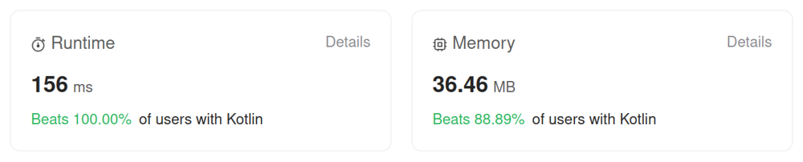

# Kotlin. Beats 100% (156 ms). Two seq counters + one simple loop

**Author:** mobdev778
**Votes:** 0
**Link:** [https://leetcode.com/problems/find-the-longest-balanced-substring-of-a-binary-string/solutions/4437620/](https://leetcode.com/problems/find-the-longest-balanced-substring-of-a-binary-string/solutions/4437620/)

---



# Code
```
class Solution {
    fun findTheLongestBalancedSubstring(s: String): Int {
        var max = 0

        var lastSeq = 0

        var current = s[0]
        var i = 1
        var seq = 1
        while (i < s.length) {
            val c = s[i]
            when {
                c == current -> seq++
                c == '0' -> {
                    max = Math.max(max, Math.min(seq, lastSeq))
                    current = '0'
                    lastSeq = seq
                    seq = 1
                }
                else -> {
                    current = '1'
                    lastSeq = seq
                    seq = 1
                }
            }
            i++
        }
        if (current == '1') {
            max = Math.max(max, Math.min(seq, lastSeq))
        }
        return max shl 1
    }
}
```

# Complexity
- Time complexity: O(N)
- Space complexity: O(N)

