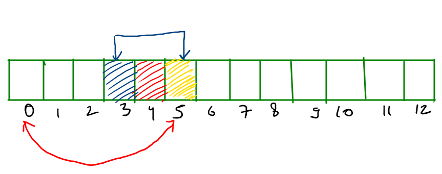
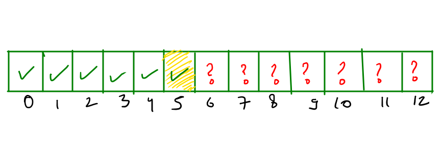

# c++ linear solution✔✔✔✔

**Author:** shivam565
**Votes:** 6
**Link:** [https://leetcode.com/problems/lexicographically-smallest-beautiful-string/solutions/3488519/](https://leetcode.com/problems/lexicographically-smallest-beautiful-string/solutions/3488519/)

---

what is given to us
* a beautiful string, means **all the substrings of length >= 2 are not palindrom**

what to find
* lexicographically smallest string of length n, which is larger than the given string and is beautiful.

**Intution**
1. As the given string is beautiful and we need to find the string which is lexicographically greater than the given string and beautiful so we will start from right to left.
2. And what all values we can put at index (i) while coming from R to L will range from ( s[i] , k+'a' ) **not inclusive**
3. As we can see in the example, Let say we are at index 5, we have to make sure that the element at previous two indexes is not equal to the value that we are going to write ar index 5.
i.e. &nbsp;&nbsp; ele != arr[4] &nbsp;&nbsp;&nbsp; && ele != arr[3]

	**why we are saying this ?**
	
	length 2 string ending at the 5th char : [4.5], what if arr[4] == arr[5] ? 
	length 3 string ending at the 5th char : [3,5], what if arr[3] == arr[5] ?
	length 4 string ending at the 5th char : [2,5] let say arr[2] == arr[5] but substring [3,4] is not palidrom, as given string was beautiful.
	length 5 string ending at the 5th char : [1,5] let say arr[1] == arr[5] but substring [2,4] is not palidrom, as given string was beautiful.

	we can prove that while taking any substring that if ***arr[i] && arr[i-1] and arr[i-2] are three different values than all the substring of length >= 2 won't be palindrom.*** 



**if no such index found answer won't exist and we will simply return ""**
now,
the string is currently looking like this, we have to fill those question marks in such a manner that we get the lexicographically smallest string (as we have put a gretater value at index 5 so the resultant string will definately be greater than the original string).


as we have discussed above for **the string to become beautiful arr[i] ,arr[i-1] and arr[i-1] should be three different values**
but we have to take these two things in mind in prior
* for index 6 the values will be from ['a',arr[i]-1] because we want the string to be lexicographically smaller.
* and for rest of the indexes values will be from ['a','a'+k-1].

**Time Complexity** : O(n) 
**Space Complexity** : O(1) 
in case we are using new string because in interviews changing in the actual input is not allowed in that case space complexity : O(n)

Here is the code in c++.
```
class Solution {
public:
    void calculation(string &s,int I,int k){
        int n = s.size();
        for(int i = I ; i < n ; i++){
            for(char j = 'a' ; j < k+'a' ; j++){
                if(i == I && j >= s[i]) break;
                int left = max(0,i-2);
                bool ok = true;
                for(int k_ = left ; k_ < i ; k_++){
                    if(s[k_] == j) {
                        ok = false;
                        break;
                    }
                }
                if(ok){
                    s[i] = j;
                    break;
                }
            }
        }
    }
    string smallestBeautifulString(string s, int k) {
        int n = s.size();        
        for(int i = n-1 ; i >= 0 ; i--){
            for(char j = s[i] + 1 ; j < k+'a' ; j++){
                int left = max(0,i-2);
                bool ok = true;
                for(int k_ = left ; k_ < i ; k_++){
                    if(s[k_] == j){
                        ok = false;
                        break;
                    }
                }
                if(ok){
                    s[i] = j;
                    calculation(s,i+1,k);
                    return s;
                }
            }
        }
        return "";
    }
};
```