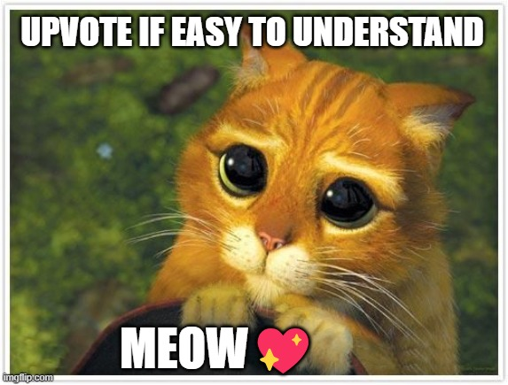

# Easy Stack Solution 🧠 Python | Java | C++ O(N), O(N)

**Author:** violet_6
**Votes:** 179
**Link:** [https://leetcode.com/problems/minimum-string-length-after-removing-substrings/solutions/5879675/](https://leetcode.com/problems/minimum-string-length-after-removing-substrings/solutions/5879675/)

---

# Intuition
We aim to either remove characters that match specific patterns or retain them if no match is found.

This process is efficiently handled using a `stack`, where we `pop` characters when a pattern is detected and `append` them when no pattern is formed.

# Approach

Reading the string from left to right, we evaluate each character, deciding whether to add it to the stack or remove a prior character. 
- `if`: If the stack isn\u2019t empty, we compare the current character with the one at the top of the stack. 
- `else if`: If they form a pattern like "AB" or "CD," we pop the stack and skip pushing the current character, effectively removing both. 
- `else`: If no pattern is formed, we simply push the current character onto the stack.

At the end of this process, the characters left in the stack represent the shortest possible version of the string after all removable patterns have been eliminated.


# Complexity
- Time complexity: `O(N)`

- Space complexity: `O(N)`

# Code
```python3 []
class Solution:
    def minLength(self, s: str) -> int:
        stack = []
        for c in s:
            if not stack:
                stack.append(c)
                continue
            if c == "B" and stack[-1] == "A":
                stack.pop()
            elif c == "D" and stack[-1] == "C":
                stack.pop()
            else:
                stack.append(c)
        return len(stack)
```

```java []
class Solution {
    public int minLength(String s) {
        Stack<Character> stack = new Stack<>();

        for (int i = 0; i < s.length(); i++) {
            char cur_char = s.charAt(i);

            if (stack.isEmpty()) {
                stack.push(cur_char);
                continue;
            }
      
            if (cur_char == 'B' && stack.peek() == 'A') {
                stack.pop();
            }
            else if (cur_char == 'D' && stack.peek() == 'C') {
                stack.pop();
            }
            else {
                stack.push(cur_char);
            }
        }

        return stack.size();
    }
}
```
```C++ []
class Solution {
public:
    int minLength(string s) {
        stack<char> stack;

        for (int i = 0; i < s.length(); i++) {
            char cur_char = s[i];

            if (stack.empty()) {
                stack.push(cur_char);
                continue;
            }

            if (cur_char == 'B' && stack.top() == 'A') {
                stack.pop();
            }
            else if (cur_char == 'D' && stack.top() == 'C') {
                stack.pop();
            }
            else {
                stack.push(cur_char);
            }
        }

        return stack.size();
    }
};
```



