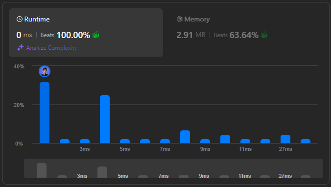

# 🌟 Step-by-Step Guide to Minimizing Strings in C++, JavaScript, Java, Python, Go 🔥💯

**Author:** withaarzoo
**Votes:** 4
**Link:** [https://leetcode.com/problems/minimum-string-length-after-removing-substrings/solutions/5879680/](https://leetcode.com/problems/minimum-string-length-after-removing-substrings/solutions/5879680/)

---


Explore a collection of solutions to LeetCode problems in multiple programming languages. Each solution includes a detailed explanation and step-by-step approach to solving the problem efficiently. Whether you're a beginner looking to learn or an experienced coder seeking optimized solutions, this repository aims to provide clear and insightful approaches to tackling challenging LeetCode problems.

### **Access daily LeetCode Solutions Repo :** [click here](https://github.com/withaarzoo/LeetCode-Solutions)

---



---

# Intuition
To solve this problem, the goal is to minimize the length of the string by removing all occurrences of the substrings `"AB"` or `"CD"`. This operation can be done repeatedly, as the string will concatenate after each removal, potentially forming new occurrences of `"AB"` or `"CD"`.

The best approach is to traverse the string while simulating these removals efficiently. A **stack** can help us keep track of characters, and whenever we encounter an "AB" or "CD", we simply pop from the stack, effectively removing the substring. This way, each character is only processed once, making the solution efficient.

---

# Approach
1. **Use a Stack**: Traverse through each character of the string. If the top of the stack forms a pair with the current character (`"AB"` or `"CD"`), pop the stack (i.e., remove the pair). Otherwise, push the current character onto the stack.
   
2. **Final Stack Size**: After processing all characters, the size of the stack will represent the minimum possible length of the string, as only the characters that couldn't be paired and removed will remain.

---

# Complexity
- **Time complexity**:  
  $$O(n)$$, where \\(n\\) is the length of the string. Each character is processed once, either pushed or popped from the stack, which makes the approach linear in time.

- **Space complexity**:  
  $$O(n)$$, in the worst case, if no substrings are removed, the stack will store all characters.

---

# Code
```C++ []
class Solution {
public:
    int minLength(string s) {
        stack<char> stk; // Stack to store characters
        
        // Traverse through each character in the string
        for (char ch : s) {
            // Check if the top of the stack forms "AB" or "CD" with current character
            if (!stk.empty() && ((stk.top() == 'A' && ch == 'B') || (stk.top() == 'C' && ch == 'D'))) {
                stk.pop(); // Pop if pair is found and remove the substring
            } else {
                stk.push(ch); // Otherwise, push the character onto the stack
            }
        }
        
        return stk.size(); // The size of the stack is the minimum length
    }
};

```
```Java []
import java.util.Stack;

class Solution {
    public int minLength(String s) {
        Stack<Character> stack = new Stack<>();
        
        // Traverse through each character in the string
        for (char ch : s.toCharArray()) {
            // If the top of the stack forms "AB" or "CD" with the current character, pop the stack
            if (!stack.isEmpty() && ((stack.peek() == 'A' && ch == 'B') || (stack.peek() == 'C' && ch == 'D'))) {
                stack.pop(); // Remove the substring
            } else {
                stack.push(ch); // Push character onto the stack if no pair is found
            }
        }
        
        return stack.size(); // The size of the stack is the minimum length of the string
    }
}

```
```JavaScript []
/**
 * @param {string} s
 * @return {number}
 */
var minLength = function(s) {
    let stack = [];
    
    // Traverse through each character in the string
    for (let ch of s) {
        // Check if top of the stack forms "AB" or "CD" with current character
        if (stack.length > 0 && ((stack[stack.length - 1] === 'A' && ch === 'B') || 
                                 (stack[stack.length - 1] === 'C' && ch === 'D'))) {
            stack.pop(); // Pop to remove the pair
        } else {
            stack.push(ch); // Push current character onto the stack if no match
        }
    }
    
    return stack.length; // Remaining stack size is the minimum length of the string
};

```
```Python []
class Solution:
    def minLength(self, s: str) -> int:
        stack = []
        
        # Traverse through each character in the string
        for ch in s:
            # If top of the stack forms "AB" or "CD" with the current character, pop the stack
            if stack and ((stack[-1] == 'A' and ch == 'B') or (stack[-1] == 'C' and ch == 'D')):
                stack.pop()  # Remove the substring
            else:
                stack.append(ch)  # Push current character onto the stack if no pair
        
        return len(stack)  # The size of the stack is the minimum length

```
```Go []
package main

func minLength(s string) int {
    stack := []rune{} // Stack to store characters
    
    // Traverse through each character in the string
    for _, ch := range s {
        // If top of the stack forms "AB" or "CD" with the current character, pop the stack
        if len(stack) > 0 && ((stack[len(stack)-1] == 'A' && ch == 'B') || 
                              (stack[len(stack)-1] == 'C' && ch == 'D')) {
            stack = stack[:len(stack)-1]  // Remove the substring
        } else {
            stack = append(stack, ch)  // Push current character onto the stack if no pair
        }
    }
    
    return len(stack)  // The size of the stack is the minimum length of the string
}

```

---

# Step-by-Step Detailed Explanation
1. **Initialization**:
   - We use a **stack** data structure to help us track characters in the string.
   
2. **Traversal**:
   - As we traverse the string:
     - **If** the current character along with the top of the stack forms either the substring "AB" or "CD", we **pop** the top of the stack (removing the pair).
     - **Else**, we **push** the current character onto the stack, indicating that no pair was formed.

3. **Final Result**:
   - After processing all characters, the **remaining characters** in the stack represent the final string that couldn't be reduced further.
   - The **size of the stack** gives us the length of this minimized string.

---

# Visualization

Consider the string `s = "ABFCACDB"`. Here's a step-by-step breakdown of how the solution would work:

1. Start with an **empty stack**: `[]`
   
2. Traverse through the string:

   - **'A'**: No pair yet, so push 'A' onto the stack.
     - Stack: `['A']`

   - **'B'**: The top of the stack is 'A', so we have the substring "AB". Pop 'A' from the stack to remove the "AB" pair.
     - Stack: `[]`
   
   - **'F'**: No pair, so push 'F' onto the stack.
     - Stack: `['F']`

   - **'C'**: No pair, so push 'C' onto the stack.
     - Stack: `['F', 'C']`
   
   - **'A'**: No pair, so push 'A' onto the stack.
     - Stack: `['F', 'C', 'A']`

   - **'C'**: No pair, so push 'C' onto the stack.
     - Stack: `['F', 'C', 'A', 'C']`

   - **'D'**: The top of the stack is 'C', so we have the substring "CD". Pop 'C' from the stack to remove the "CD" pair.
     - Stack: `['F', 'C', 'A']`
   
   - **'B'**: The top of the stack is 'A', so we have the substring "AB". Pop 'A' from the stack to remove the "AB" pair.
     - Stack: `['F', 'C']`

3. After processing the entire string, the remaining characters in the stack are `"FC"`. The length of this minimized string is 2.

---


