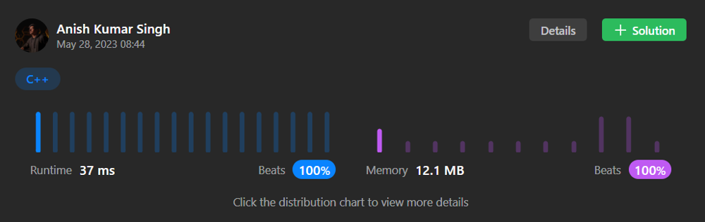

# 🔥Fastest Beats 100%🔥 || 0ms || O(N)💯 ✅🔥|| C++ || Java || Python ||

**Author:** AnishKrSingh
**Votes:** 15
**Link:** [https://leetcode.com/problems/minimum-cost-to-make-all-characters-equal/solutions/3570321/](https://leetcode.com/problems/minimum-cost-to-make-all-characters-equal/solutions/3570321/)

---

# Intuition
**```Standing at any particular index check what can be minimum cost to make it equal to the next character \u2705.```**



# Approach
**```Since we need to minimize the cost, standing at any particular find out what is the minimum number of steps required to make char at the index equal to next character.```**

**Lets say in 010101
at index 0 : 
if ```s[0] != s[1] ```
then there 2 ways to make ```s[0] == s[1]```
either by reversing all the characters from 0 ... i 
or by reversing all the character from i + 1 ... n**

**After perform operating till ith index the elements in the left half become equal 
i.e if at i = 4 
the elements would now be 
1 1 1 1 0 1**

# Complexity
- Time complexity:
```**Since it requires just to traverse the entire string only once the time complexity is: O(N)**```

- Space complexity:
**```Cost variable is used to store the cost so the space complexity is O(1)```**

# Code (C++)
```
class Solution {
public:
    long long minimumCost(string s) {
        long long ans = 0, n = s.size();
        for (int i = 0; i < s.size() - 1; ++i)
        {
            if (s[i] != s[i + 1])
            {
                if (i + 1 <= n - i - 1)
                    ans += i + 1;
                else
                    ans += n - i - 1;
            }
        }
        return ans;
    }
};
```
# Code(Java)
``` public class Solution
{
public
    long minimumCost(String s)
    {
        long ans = 0;
        int n = s.length();
        for (int i = 0; i < s.length() - 1; ++i)
        {
            if (s.charAt(i) != s.charAt(i + 1))
            {
                if (i + 1 <= n - i - 1)
                    ans += i + 1;
                else
                    ans += n - i - 1;
            }
        }
        return ans;
    }
}

```
# Code(Python)
```
class Solution:
    def minimumCost(self, s: str) -> int:
        ans = 0
        n = len(s)
        for i in range(n - 1):
            if s[i] != s[i + 1]:
                if i + 1 <= n - i - 1:
                    ans += i + 1
                else:
                    ans += n - i - 1
        return ans
```