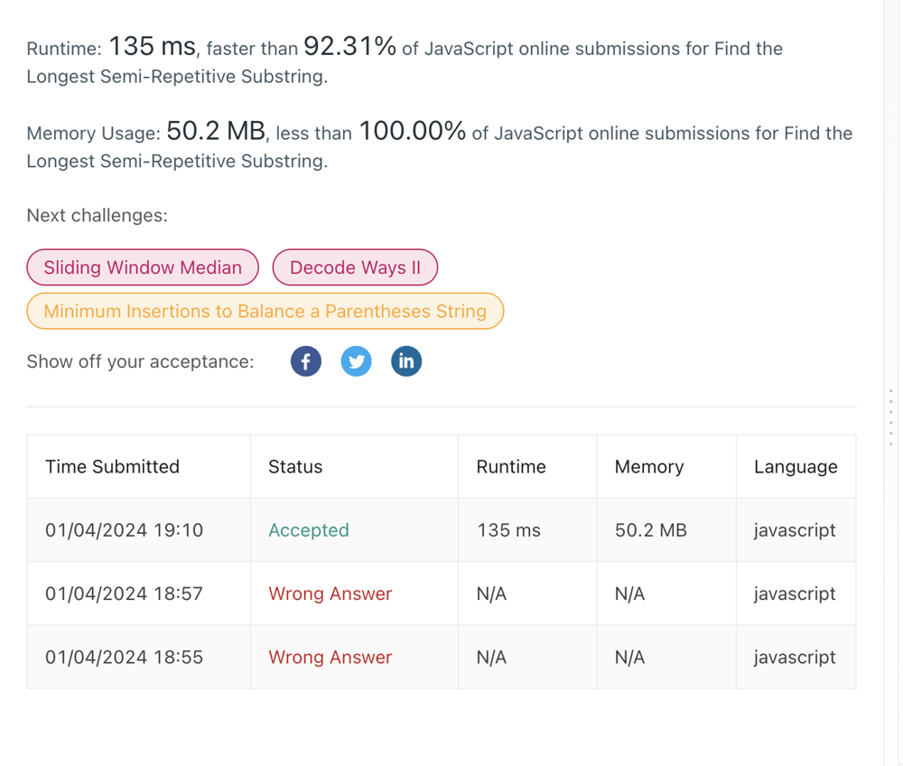

# ❇ find-longest-semi-repetitive-substring👌 🏆O(N)❤️ Javascript🎯 Memory👀95.45%🕕 ++Explanation✍️

**Author:** anurag-sindhu
**Votes:** 3
**Link:** [https://leetcode.com/problems/find-the-longest-semi-repetitive-substring/solutions/4506268/](https://leetcode.com/problems/find-the-longest-semi-repetitive-substring/solutions/4506268/)

---

```
var longestSemiRepetitiveSubstring = function (s) {
    let maxLen = 0;
    let len = 0
    let hasConsecutiveArrived = 0
    let lastConsecutiveEndIndex = 0
    for (let index = 0; index < s.length; index++) {
        if (s[index] === s[index - 1]) {
            if (hasConsecutiveArrived++) { // Used just as a boolean
                len = index - lastConsecutiveEndIndex
            }
            lastConsecutiveEndIndex = index
        }
        maxLen = Math.max(maxLen, ++len)
    }
    return maxLen
};
```

