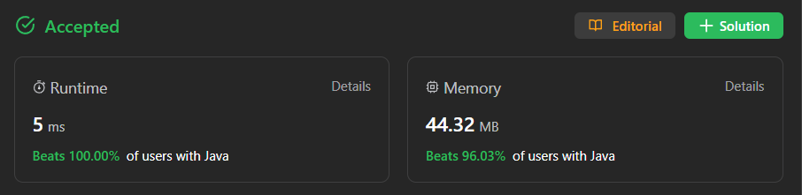

# ✅ Beats 100% -Explained with [ Video ] - Modified Counting Sort

**Author:** millenium103
**Votes:** 44
**Link:** [https://leetcode.com/problems/sort-vowels-in-a-string/solutions/4281564/](https://leetcode.com/problems/sort-vowels-in-a-string/solutions/4281564/)

---




# YouTube Video Explanation
[https://youtu.be/5OK2Kqlfo0o](https://youtu.be/5OK2Kqlfo0o)

**\uD83D\uDD25 Please like, share, and subscribe to support our channel's mission of making complex concepts easy to understand.**

Subscribe Link: https://www.youtube.com/@leetlogics/?sub_confirmation=1

*Current Subscribers: 237*
*Subscribe Goal: 250 Subscribers*

# Example Explanation
Let's break down the solution step by step using tables to visualize the process:

### Example:

Given String: "lEetcOde"

#### Initialization:

| Char | ASCII | Vowel Count | Count Index Map |
|------|-------|-------------|-----------------|
| 'A'  | 65    | 0           | 1               |
| 'E'  | 69    | 0           | 2               |
| 'I'  | 73    | 0           | 3               |
| 'O'  | 79    | 0           | 4               |
| 'U'  | 85    | 0           | 5               |
| 'a'  | 97    | 0           | 6               |
| 'e'  | 101   | 0           | 7               |
| 'i'  | 105   | 0           | 8               |
| 'o'  | 111   | 0           | 9               |
| 'u'  | 117   | 0           | 10              |

#### Iteration through String 'lEetcOde':

| Char | ASCII | Vowel Count | Count Index Map |
|------|-------|-------------|-----------------|
| 'l'  | 108   | 0           | 0               |
| 'E'  | 69    | 1           | 2               |
| 'e'  | 101   | 1           | 7               |
| 't'  | 116   | 0           | 0               |
| 'c'  | 99    | 0           | 0               |
| 'O'  | 79    | 1           | 4               |
| 'd'  | 100   | 0           | 0               |
| 'e'  | 101   | 2           | 7               |

#### Rearranging Vowels in Result:

| Char | ASCII | Vowel Count | Count Index Map |
|------|-------|-------------|-----------------|
| 'l'  | 108   | 0           | 0               |
| 'E'  | 69    | 0           | 2               |
| 'O'  | 79    | 0           | 4               |
| 'e'  | 101   | 0           | 7               |
| 't'  | 116   | 0           | 0               |
| 'c'  | 99    | 0           | 0               |
| 'd'  | 100   | 0           | 0               |
| 'e'  | 101   | 0           | 7               |

#### Resultant String:

"lEOtcede"


# Intuition
The problem involves rearranging the characters of the given string `s` based on specific rules related to vowels and consonants. Vowels must be sorted in non-decreasing order of their ASCII values, while consonants remain in their original places. The solution likely employs a counting and mapping approach to achieve the desired rearrangement.

# Approach

1. Initialize arrays to count the occurrences of vowels (`vowelCount`) and to map the ASCII values of characters (`countIndexMap`). These arrays help in determining the positions of vowels in the rearranged string.

2. Iterate through the characters of the input string `s`:
   - For each vowel encountered, update the `vowelCount` array.
   - Populate the `countIndexMap` array to map each character to its ASCII value.

3. Iterate through the `vowelCount` array to rearrange the vowels in the result string (`result`). Update the characters in the `result` array based on the count of each vowel, ensuring they are sorted according to their ASCII values.

4. Return the final string obtained after rearranging both vowels and consonants.


- Time Complexity: O(N)
  - The algorithm iterates through the input string `s` once, and the subsequent iteration through the `vowelCount` array takes constant time.
  
- Space Complexity: O(1)
  - The additional space used is independent of the input size, making it constant space. The arrays (`vowelCount` and `countIndexMap`) have fixed sizes.


# Code
## Java
```
public class Solution {
    public String sortVowels(String s) {
        int[] vowelCount = new int[11];
        int[] countIndexMap = new int[128];
        char[] result = s.toCharArray();
        char[] charMap = "AEIOUaeiou".toCharArray();

        for (int i = 0; i < charMap.length; i++) 
            countIndexMap[charMap[i]] = i + 1;

        for (char c : result) 
            vowelCount[countIndexMap[c]]++;
        int j = 1;
        int i = 0;

        while (j < vowelCount.length) {
            if (vowelCount[j] > 0)
                while (i < result.length) {
                    if (countIndexMap[result[i]] == 0) {
                        i++;
                        continue;
                    }
                    vowelCount[j]--;
                    result[i++] = charMap[j - 1];
                    break;
                }
            else
                j++;  
        }
        return new String(result);
    }
}
```
## C++
```
class Solution {
public:
    bool isVowel(char ch){
        if(ch=='a' || ch=='e' || ch=='i' || ch=='o' || ch=='u' ||
        ch=='A' || ch=='E' || ch=='I' || ch=='O' || ch=='U')return true;

        return false;
    }
    string sortVowels(string s) {
        int freq[128]={0};

        for(int i=0;i<s.size();i++){
            if(isVowel(s[i]))freq[(int)s[i]]++;
        }

        int idx=0;
        for(int i=0;i<s.size();i++){
            if(isVowel(s[i])){
                while(freq[idx]==0)idx++;
                s[i]=(char)idx;
                freq[idx]--;
            }
        }

        return s;
    }
};
```
## Python3
```
class Solution:
    def sortVowels(self, s: str) -> str:
        vowels = ['A', 'E', 'I', 'O', 'U', 'a', 'e', 'i', 'o', 'u']
        count_char = Counter(s)
        s_vowels = []
        for char in count_char.keys():
            if char in vowels:
                s_vowels.append(char)                
                s = s.replace(char, '_')                              
        s_vowels.sort()
        for char in s_vowels:
            s = s.replace('_', char, count_char[char])
        return s
```
## JavaScript
```
var sortVowels = function(s) {
    const vowels = "AEIOUaeiou"
    const count = new Array(vowels.length).fill(0)
    for (let char of s) {
        const index = vowels.indexOf(char)
        if (index !== -1) {
            count[index]++
        }
    }
    let str = ""
    let curr = 0
    for (let char of s) {
        if (vowels.includes(char)) {
            while (count[curr] === 0) {
                curr++
            }

            str += vowels[curr]
            count[curr]--
        } else {
            str += char
        }
    }
    return str
};
```
