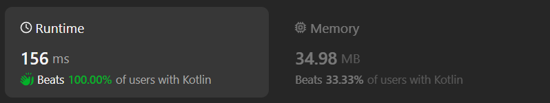

# Kotlin simple solution

**Author:** chayangkoon
**Votes:** 0
**Link:** [https://leetcode.com/problems/remove-adjacent-almost-equal-characters/solutions/4910664/](https://leetcode.com/problems/remove-adjacent-almost-equal-characters/solutions/4910664/)

---




# Complexity
- Time complexity:
O(n)

- Space complexity:
O(1)

# Code
```
class Solution {
    fun removeAlmostEqualCharacters(word: String): Int {
        var operationsCount = 0
        var i = 1
        while(i < word.length) {
            val previousChar = word[i - 1]
            val currentChar = word[i]
            if(abs(currentChar - previousChar) <= 1) {
                operationsCount++
                i += 2
            } else {
                i++
            }
        }

        return operationsCount
    }
}
```