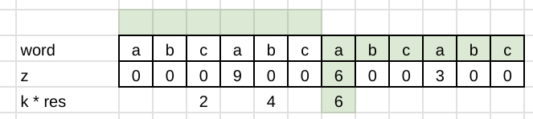

# Z-function

**Author:** votrubac
**Votes:** 47
**Link:** [https://leetcode.com/problems/minimum-time-to-revert-word-to-initial-state-ii/solutions/4673954/](https://leetcode.com/problems/minimum-time-to-revert-word-to-initial-state-ii/solutions/4673954/)

---

> Funny thing, a brute-force solution is also accepted for this problem. A lot of folks finished the contest sub-20 minutes becase of that.

Z-function for a string returns an array `z` of the same size.

`z[i]` tells us how many characters, starting from the position `i`, \u200Amatch with the first characters of \u200Athe string\u200A.
    
We can compute the z-function in O(n). I borrowed the implementation from a well-known CP algorithms web site.
    
Thus, we just need to find a position `k * res`, where it matches at least `n - k * res` first characters of the string.

This is how this looks for `["abcabcabcabc", 2]` test case:



**C++**
```cpp
int minimumTimeToInitialState(const string &word, int k) {
    int res = 1, n = word.size();
    auto z = z_function(word);
    for (; k * res < n; ++res)
        if (z[k * res] >= n - k * res)
            break;
    return res;
}
vector<int> z_function(const string &s) {
    int n = s.size(), l = 0, r = 0;
    vector<int> z(n);
    for(int i = 1; i < n; i++) {
        if(i < r)
            z[i] = min(r - i, z[i - l]);
        while(i + z[i] < n && s[z[i]] == s[i + z[i]])
            z[i]++;
        if(i + z[i] > r) {
            l = i;
            r = i + z[i];
        }
    }
    return z;
}
```