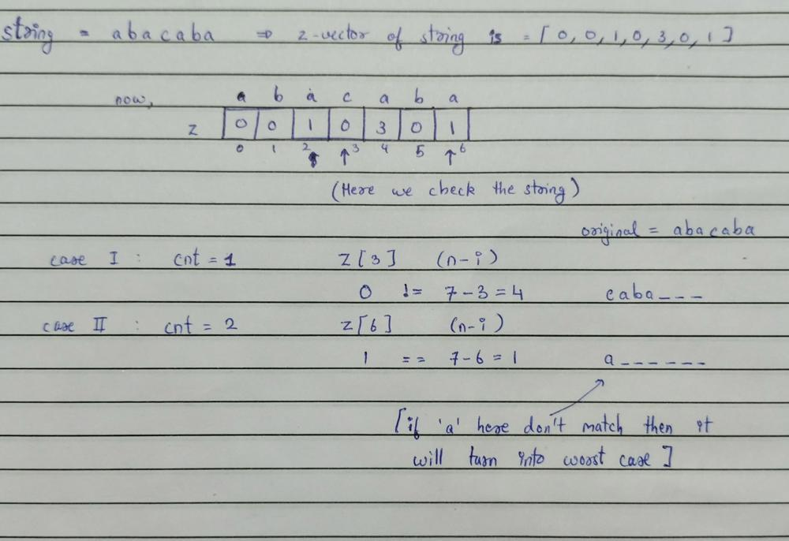

# Agr Concept smjhna hain toh Read | C++

**Author:** Rarma
**Votes:** 43
**Link:** [https://leetcode.com/problems/minimum-time-to-revert-word-to-initial-state-ii/solutions/4676198/](https://leetcode.com/problems/minimum-time-to-revert-word-to-initial-state-ii/solutions/4676198/)

---

# Intuition & Approach

Toh bhaiyo smjhte hain concept or logic behind the question

Toh dekho ek cheez smjhte hain joh prefix wala part hata rhe ho 
then usko change krke suffix me jodh rhe ho thik..
ab yha is question pr fasoge ki yrr kya string choose kre and add
kre suffix me jissse apna answer optimal rhe...
or tum log usi string ke piche bhag rhe ho..What to add in suffix ?

Ab dhyan se suno question me bola hain joh string suffix me add krenge voh
apne hisab se kuch bhi ho sakti hain thik toh apn kuch string characters 
add krne se accha khali string add kr de toh.. *kuch chmka !!?*

for example in given testcase `string = "abacaba"` , `k=3`
ab here prefix is `"aba"` so remove it : `string = "c a b a _ _ _"`

Similarly ab dekho ki possible hain to get original string, 
toh yr abhi toh nhi dikh rhi bnti koi na or hatado prefix,
`string = "a _ _ _ _ _ _"` removed `"cab"`
ab string dekho is it possible to form the given string so, 
han yr ab possible toh hain kyuki blank space pr toh koi sa bhi
character according to u we can select.
[We have used total of 2 moves so answer is 2]

Toh han bhai iss question me prefix remove krke suffix me kya add krna iska koi tension nhi lena tha... \uD83D\uDE2D

# Algorithm
Toh ab baat krte hain algorithm pr toh dekho pattern match algorithm iss question
me bhot imprtant role play kregi agr voh sikh li toh yeh question tumko easy~medium around lgega,

*okay bakwaas bnd krte hain algo. pr aate hain,*
[Can skip if you know about pattern matching algo.]
<-------------------------------------------------------------------------------------------------->
**Pattern matching algorithms** - ko hum samajh sakte hain ek tarah se jigsaw puzzles ke roop mein. Jaise puzzle mein har piece ko sahi jagah fit karna hota hai, waise hi pattern matching mein bhi humein ek specific pattern ko dhundhna hota hai.

Socho ki tumhe ek specific design ya sequence dhundhni hai, jise hum pattern kehte hain. Ab imagine karo ki tumhare paas ek set of pieces hai, jise hum data kehte hain. Pattern matching algorithm ka kaam yeh hai ki woh data mein se wohi sequence ya design dhunde jo hume chahiye.

Algorithm basically ek step-by-step process hoti hai, jisme har step mein hum dekhte hain ki kya woh current piece hamare pattern se match hoti hai ya nahi. Agar hoti hai, toh hum use sahi jagah fit karte jaate hain, aur agar nahi, toh hum next piece check karte hain.

Is tarah se, pattern matching algorithms help karte hain hume specific patterns ya sequences ko large sets of data mein dhoondhne mein. Jigsaw puzzle solve karna jaise, yeh algorithms bhi help karte hain hume apne target pattern ko sahi jagah fit karne mein.
<-------------------------------------------------------------------------------------------------->

Toh we have generally lots of pattern match algo. but important or mostly used one are :
**i) Z - Algorithm
ii) Knuth\u2013Morris\u2013Pratt algorithm [Kmp - Algorithm]**

```C++ []
// Z-algo implementation -> 01
vector<int> Z_func(string s)
{
    int n = s.size(), l = 0, r = 0;
    vector<int> z(n);

    for (int i = 1; i < n; i++)
    {
        if (i < r)
        {
            z[i] = min(r - i, z[i - l]);
        }
        while (i + z[i] < n and s[z[i]] == s[i + z[i]])
        {
            z[i]++;
        }
        if (i + z[i] > r)
        {
            l = i;
            r = i + z[i];
        }
    }
    for (auto val : z)
    {
        cout << val << " ";
    }
    cout << endl;

    return z;
}
```
```C++ []
// Z-algo implementation -> 02
vector<int> z_fn(string &s)
{
    int n = s.size(), l = 0, r = 0;
    vector<int> z(n);
    for (int i = 1; i < n; i++)
    {
        if (i > r)
        {
            l = r = i;
            while (r < n && s[r] == s[r - l])
                r++;
            z[i] = r - l;
            r--;
        }
        else
        {
            int cur = i - l;
            if (z[cur] + i < r + 1)
                z[i] = z[cur];
            else
            {
                l = i;
                while (r < n && s[r] == s[r - l])
                    r++;
                z[i] = r - l;
                r--;
            }
        }
    }
    return z;
}
```
```C++ []
// Kmp - Algo. implementation -> 01
void KMPSearch(char* pat, char* txt) 
{ 
    int M = strlen(pat); 
    int N = strlen(txt); 
  
    // create lps[] that will hold the longest prefix suffix 
    // values for pattern 
    int lps[M]; 
  
    // Preprocess the pattern (calculate lps[] array) 
    computeLPSArray(pat, M, lps); 
  
    int i = 0; // index for txt[] 
    int j = 0; // index for pat[] 
    while ((N - i) >= (M - j)) { 
        if (pat[j] == txt[i]) { 
            j++; 
            i++; 
        } 
  
        if (j == M) { 
            printf("Found pattern at index %d ", i - j); 
            j = lps[j - 1]; 
        } 
  
        // mismatch after j matches 
        else if (i < N && pat[j] != txt[i]) { 
            // Do not match lps[0..lps[j-1]] characters, 
            // they will match anyway 
            if (j != 0) 
                j = lps[j - 1]; 
            else
                i = i + 1; 
        } 
    } 
} 
  
// Fills lps[] for given pattern pat[0..M-1] 
void computeLPSArray(char* pat, int M, int* lps) 
{ 
    // length of the previous longest prefix suffix 
    int len = 0; 
  
    lps[0] = 0; // lps[0] is always 0 
  
    // the loop calculates lps[i] for i = 1 to M-1 
    int i = 1; 
    while (i < M) { 
        if (pat[i] == pat[len]) { 
            len++; 
            lps[i] = len; 
            i++; 
        } 
        else // (pat[i] != pat[len]) 
        { 
            // This is tricky. Consider the example. 
            // AAACAAAA and i = 7. The idea is similar 
            // to search step. 
            if (len != 0) { 
                len = lps[len - 1]; 
  
                // Also, note that we do not increment 
                // i here 
            } 
            else // if (len == 0) 
            { 
                lps[i] = 0; 
                i++; 
            } 
        } 
    } 
} 

int main() 
{ 
    char txt[] = "ABABDABACDABABCABAB"; 
    char pat[] = "ABABCABAB"; 
    KMPSearch(pat, txt); 
    return 0; 
} 
```

***Daro mat code dekh kr new cheeze hain smjho thodha tough lgega starting me 
but you can do it**

Ab sari algo krne ki jarurat nhi koi bhi ek pakad lo, or han abhi youtube pr jao or algorithm ko diagramatically smj kr aao. 
As Likh kr possible nhi smjhna.\uD83E\uDD72




# Complexity
- Time complexity: in algo. ki complexity **O(n)** hain

- Space complexity: **O(n)**

# Accepted Code 
```
class Solution {
public:
    // ab yha apn ne sidde algo use kri hain koi smjhnae ki jarurat nhi
    vector<int> Z_func(string s)
    {
        int n = s.size(), l = 0, r = 0;
        vector<int> z(n);

        for (int i = 1; i < n; i++)
        {
            if (i < r)
            {
                z[i] = min(r - i, z[i - l]);
            }
            while (i + z[i] < n and s[z[i]] == s[i + z[i]])
            {
                z[i]++;
            }
            if (i + z[i] > r)
            {
                l = i;
                r = i + z[i];
            }
        }
        // for (auto val : z)
        // {
        //     cout << val << " ";
        // }
        // cout << endl;

        return z;
    }

    // yha smjhte hain cheezo ko
    int minimumTimeToInitialState(string s,int k) {
        // z me store krenge returned vector
        vector<int> z = Z_func(s);

        // cnt apna answer rhene wala hain
        // joki store krega kitni baar prefix htaya hain apn ne
        int cnt=0;

        // dekho start kra hain k se as we considering ki 'k' length
        // ki substring phele hi out kr di hain (shuru wali)
        // agr hatenge nhi toh string hmesha hi same rhegi without 
        // any operation answer will always be 0
        // 'i' ko 'k' se increase krr rhe hain as prefix length
        // will be given and utni length always nikalna hain
        // string se
        for (int i = k;i < z.size(); i+=k)
        {
            // joh prefix string nikali thi uska count badhaya
            cnt++;

            // ab yeh condition smjho 
            // apnko z vector me integers milenge joh ki represent kr
            // rhe honge ki repeated wali string ki length from 
            // that position
            // ab apn dekhenge kya possible hain to take current 
            // string which will be equal to the prefix of original
            // string 
            if (z[i] == s.size() - i)
            {
                return cnt;
            }
        }

        // worst case me puri string hi rebuilt krna pdega apn ko
        // isiliye count + 1 return kra,
        // isko ese bhi soch sakte hain 
        //                      =>( n/k + if(n%k !=0){add + 1} )
        return cnt+1;
    }
};
```