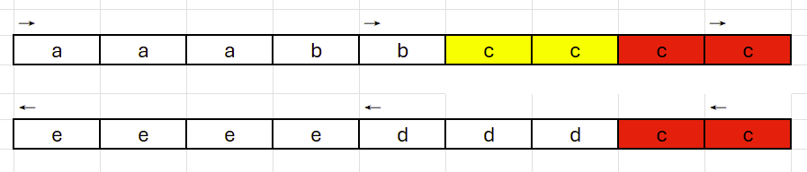
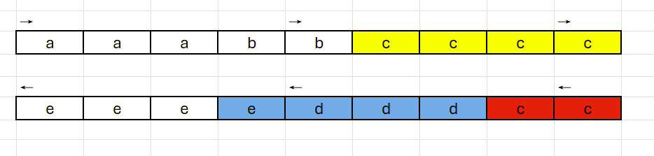
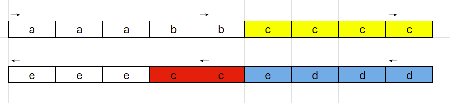
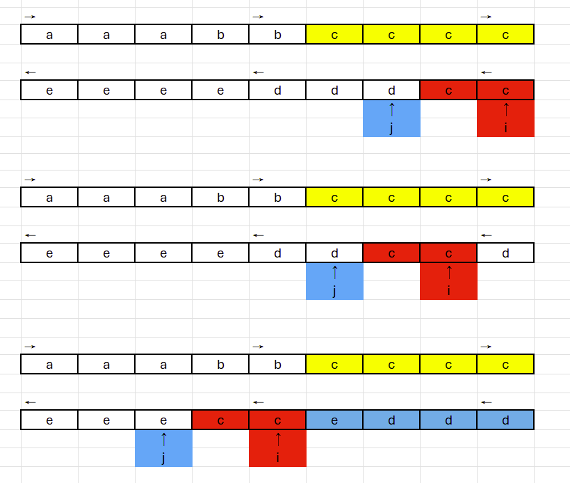

# [Python 3] Greed swap with detailed explanation

**Author:** cy171
**Votes:** 4
**Link:** [https://leetcode.com/problems/make-string-anti-palindrome/solutions/4904771/](https://leetcode.com/problems/make-string-anti-palindrome/solutions/4904771/)

---

# Intuition
<!-- Describe your first thoughts on how to solve this problem. -->
we can swap the letter any number of time, so we can reorder the string to whatever we like, since it ask for the lexicographically smallest. so we sort the string and start with the possible smallest string.

first we think in what condition that it can't be made into an anti-palindrome, if one of the letter's fequancy over half of the string, there is no way we can do it in anti-palindrome.

# Approach
<!-- Describe your approach to solving the problem. -->
start with the possible smallest string, modify it to anti-palindrome.
To maintain the lexicographically smallest structure, we refrain from changing the first half of the string. This approach ensures that the initial portion of the string remains in its original order, allowing us to focus on modifying the latter half to meet the anti-palindrome condition.
see below string after sort:
[a,a,a,b,b,c,c,c,c,c,c,d,d,d,e,e,e,e]

we fold the string from middle.



we can see the "c" in red has conflit, we have no choice but move those two "c" in second half, and we want to move it as far as it need to be and keep the order of rest letters unchange.



we can switch the red part and blue part to get the answer. 



we can find two pointer i and j, as shown below, we swap the letter in two pointer and move them together like a sliding window, unit no conflit in pointer i, if the j pointer out of range it mean no solution. 



# Complexity
- Time complexity: O(n) 
  I could be wrong but I think sort the string is O(n)
<!-- Add your time complexity here, e.g. $$O(n)$$ -->

- Space complexity: O(n)
<!-- Add your space complexity here, e.g. $$O(n)$$ -->

# Code
```
class Solution:
    def makeAntiPalindrome(self, s: str) -> str:
        n = len(s)
        res = sorted(ch for ch in s)
        i = j = (n+1)//2
        while j < n and (res[j] == res[i]):
            j += 1 
        while res[i] == res[n-i-1]:
            if j == n:
                return "-1"
            res[i] , res[j] = res[j], res[i]
            i += 1
            j += 1
        return "".join(res)

```