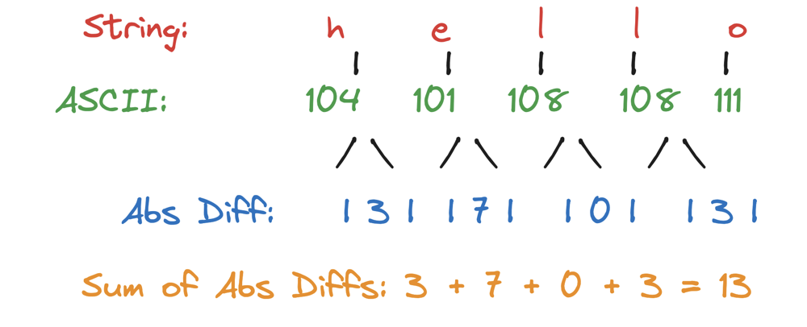

# One line Solution 😱😱

**Author:** hi-malik
**Votes:** 40
**Link:** [https://leetcode.com/problems/score-of-a-string/solutions/5237624/](https://leetcode.com/problems/score-of-a-string/solutions/5237624/)

---

It's a pretty simple problem! You just take a character and subtract the next character. If we convert them into integers, they get converted into their ASCII values. So, if we subtract two characters, they are actually subtracted based on their ASCII values!

Therefore, it's quite simple: you just subtract two adjacent characters and take the absolute difference. Then, you add up all these absolute differences for each pair of adjacent characters. As shown in the diagram, it's nothing too complicated.



Let me explain you the code first :

1. **Initialization**: The variable `total` is initialized to 0.
2. **Loop**: The `for` loop runs from the first character (`i = 0`) to the second last character (`i < s.length() - 1`).
3. **Calculation**: Inside the loop, `Math.abs(s.charAt(i) - s.charAt(i + 1))` calculates the absolute difference between the ASCII values of the current character (`s.charAt(i)`) and the next character (`s.charAt(i + 1)`). This value is added to `total`.
4. **Return**: The function returns the total score after the loop finishes.

**Let\\s code it UP**

### C++ Code
```cpp
class Solution {
public:
    int scoreOfString(string s) {
        int total = 0;
        for(int i = 0; i < s.size() - 1; i++) {
            total += abs(s[i] - s[i + 1]);
        }
        return total;
    }
};
```

### Java Code
```java
class Solution {
    public int scoreOfString(String s) {
        int total = 0;
        for(int i = 0; i < s.length() - 1; i++) {
            total += Math.abs(s.charAt(i) - s.charAt(i + 1));
        }
        return total;
    }
}
```

### Python Code
```python
class Solution:
    def scoreOfString(self, s: str) -> int:
        total = 0
        for i in range(len(s) - 1):
            total += abs(ord(s[i]) - ord(s[i + 1]))
        return total
```

___
Complexity Analysis 
___

* **Time Complexity :-** BigO(n)
* **Space Complexity :-** BigO(1)

___
___

**One Line Solution**


**C++**

```cpp
class Solution {
public:
    int scoreOfString(string s) {
        return accumulate(next(s.begin()), s.end(), 0, [&s](int total, char c, size_t i = 0) mutable {
            return total + abs(s[i++] - c);
        });
    }
};
```

**JAVA**

```java
public class Solution {
    public int scoreOfString(String s) {
        return java.util.stream.IntStream.range(0, s.length() - 1).map(i -> Math.abs(s.charAt(i) - s.charAt(i + 1))).sum();
    }
}
```

**PYTHON**

```python
class Solution:
    def scoreOfString(self, s: str) -> int:
        return sum(abs(ord(s[i]) - ord(s[i + 1])) for i in range(len(s) - 1))
```
