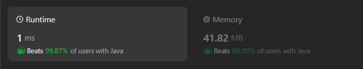
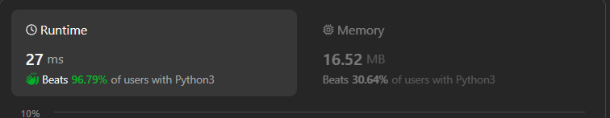

# ✅Detailed Explanation💯Beginner Friendly🔥Super Easy and Simple🔥Beats 99%🔥4 lines code🔥Strings🔥

**Author:** Saketh3011
**Votes:** 8
**Link:** [https://leetcode.com/problems/score-of-a-string/solutions/5237642/](https://leetcode.com/problems/score-of-a-string/solutions/5237642/)

---




**Submission Link:** [Python-96.79%](https://leetcode.com/problems/score-of-a-string/submissions/1273707818?envType=daily-question&envId=2024-06-01), [Java-99.87%](https://leetcode.com/problems/score-of-a-string/submissions/1273713616?envType=daily-question&envId=2024-06-01), [C++ - 100%](https://leetcode.com/problems/score-of-a-string/submissions/1273715136?envType=daily-question&envId=2024-06-01)

# \uD83C\uDFAF Problem Explanation
We are given a string `s` and we need to calculate the score of this string. 
The score is defined as the sum of the absolute differences between the ASCII values of each pair of adjacent/side-by-side characters in the string. Essentially, for each pair of characters next to each other, we find the difference in their ASCII values, take the absolute value of that difference, and sum all these values to get the final score. 


# \uD83E\uDD14 Intuition:
The intuition is straightforward: iterate through the string from index 0 to n-2(last 2nd character) and compute the absolute difference between each consecutive pair of characters.
### What do you need to know before?
- Absolute difference is modules/positive difference between two numbers.
  - We perform this |a-b| with `abs()` or `Math.abs()` method according to language.
- ASCII values are the numerical representations of characters in the ASCII (American Standard Code for Information Interchange) encoding system, where each character is assigned a unique integer between **0** and **127**. 
    - Lower case alphabets starts from `97`(a) to `122`(z).
    - In some languages like Java & C++ we can directly subtract string, internally ASCII values are subtracted. 
    - For other languages which doesn't support operation between character, first we have to get ASCII values then subtract. We can use `ord()` method to get character's ASCII value.
> We can use `chr()` function to do the reverse. ASCII value to character.

# \u2699\uFE0F Dry Run:
Input: s = "hello"
Initialize: res = 0
|Iteration|s[i]|s[i+1]|\u2503s[i] - s[i+1]\u2503|res|
|:-:|:------:|:------:|:--:|:----:|
| 0 | h->104 | e->101 | 3 | 3 (+3) |
| 1 | e->101 | l->108 | -7 | 10 (+7) |
| 2 | l->108 | l->108 | 0 | 10 (+0) |
| 3 | l->108 | o->111 | -3 | 13 (+3) |


# \uD83E\uDDE0 Approach:
1. **Initialize a Variable for the Score**:
   - Start with a variable `res` initialized to 0 to keep track of the total score.
2. **Iterate Through the String**:
   - Use a loop to go through each character in the string except the last one.
   - For each character, calculate the absolute difference between its ASCII value and the ASCII value of the next character.
   - Add this difference to `res`.
3. **Return the Result**:
   - After processing all the characters, return the total score stored in `res`.

# \uD83D\uDCD2 Complexity:
- \u23F0 Time complexity: $$O(n)$$. We iterate through the string once, so the time complexity is linear.
- \uD83E\uDDFA Space complexity: $$O(1)$$. We only use a few extra variables for the computation, so the space complexity is constant.


# \uD83E\uDDD1\u200D\uD83D\uDCBB Code
``` python []
class Solution:
    def scoreOfString(self, s: str) -> int:
        res = 0
        for i in range(0, len(s)-1):
            res += abs(ord(s[i]) - ord(s[i+1]))
        return res    
```
``` java []
class Solution {
    public int scoreOfString(String s) {
        int res = 0;
        for (int i = 0; i < s.length() - 1; i++) {
            res += Math.abs(s.charAt(i) - s.charAt(i + 1));
        }
        return res;
    }
}
```
``` cpp []
class Solution {
public:
    int scoreOfString(string s) {
        int res = 0;
        for (int i = 0; i < s.length() - 1; i++) {
            res += abs(s[i] - s[i + 1]);
        }
        return res;
    }
};
```
``` javascript []
var scoreOfString = function(s) {
    let res = 0;
    for (let i = 0; i < s.length - 1; i++) {
        res += Math.abs(s.charCodeAt(i) - s.charCodeAt(i + 1));
    }
    return res;
};
```
``` csharp []
public class Solution {
    public int ScoreOfString(string s) {
        int res = 0;
        for (int i = 0; i < s.Length - 1; i++) {
            res += Math.Abs(s[i] - s[i + 1]);
        }
        return res;
    }
}
```
``` kotlin []
class Solution {
    fun scoreOfString(s: String): Int {
        var res = 0
        for (i in 0 until s.length - 1) {
            res += Math.abs(s[i] - s[i + 1])
        }
        return res
    }
}
```
``` rust []
impl Solution {
    pub fn score_of_string(s: String) -> i32 {
        let bytes = s.as_bytes();
        let mut res = 0;
        for i in 0..bytes.len() - 1 {
            res += (bytes[i] as i32 - bytes[i + 1] as i32).abs();
        }
        res
    }
}
```
``` ruby []
def score_of_string(s)
    res = 0
        for i in 0...s.length - 1
            res += (s[i].ord - s[i + 1].ord).abs
        end
    res
end
```


---

# \uD83C\uDF93 Bonus Pro level Python Code:
``` python
# from itertools import pairwise

class Solution:
    def scoreOfString(self, s: str) -> int:
        return sum(abs(ord(ch1) - ord(ch2)) for ch1, ch2 in pairwise(s))

```

---
# Please consider giving me an Upvote!


