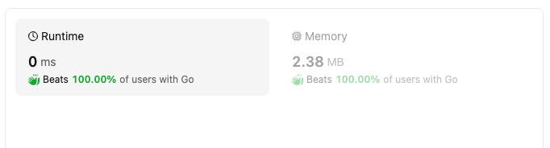

# Poorly Worded Description. Let me Explain in Detailed Manner

**Author:** muhammadfarhankt
**Votes:** 2
**Link:** [https://leetcode.com/problems/valid-word/solutions/5119147/](https://leetcode.com/problems/valid-word/solutions/5119147/)

---

# Intuition
- When looking at this problem, the first thought might be to iterate through each character in the word and check if it's a vowel, consonant, or invalid character. However, this wouldn't be very efficient for checking vowels. We can optimize this by creating a data structure to quickly identify vowels.



# Approach
1. Minimum Length Check: First, we can check if the word length is less than 3. If so, it automatically fails the minimum character requirement.
2. Vowel Lookup: We can create a data structure (like a map, set, or dictionary) to store all valid vowels (uppercase and lowercase). This allows for constant time lookup when checking if a character is a vowel.
3. Iterate and Track Vowel/Consonant: Iterate through each character in the word.
    - If the character is found in the vowel lookup structure, mark a flag indicating a vowel is encountered.
    - If the character is an alphabet (using language-specific functions) and not a vowel, mark a flag indicating a consonant is encountered.
    - If the character is a digit, it's allowed but doesn't contribute to vowel/consonant checks, so we can simply continue the loop.
    - If the character is none of the above (e.g., special symbols), it's considered an invalid character, and the word fails the validation.
4. Return Based on Flags: Finally, after iterating through the word, we check if both the vowel and consonant flags are set. If both flags are true, it means the word contains at least one vowel and one consonant, satisfying the condition. Otherwise, the word fails the validation.

# Complexity
- Time complexity: O(n), where n is the length of the word. This is because we iterate through each character in the word once. The vowel lookup using a data structure like a map/set has a constant time complexity (O(1)).

- Space complexity: O(1). The space complexity remains constant regardless of the word length. We use a fixed amount of extra space for variables like flags and the vowel lookup data structure, which doesn't grow with the input size.

# Code

```javascript []
/**
 * @param {string} word
 * @return {boolean}
 */
var isValid = function(word) {
  if (word.length < 3) {
    return false;
  }

  const vowelMap = {
    'a': true, 'e': true, 'i': true, 'o': true, 'u': true,
    'A': true, 'E': true, 'I': true, 'O': true, 'U': true
  };
  let vowel = false, consonant = false;

  for (const char of word) {
    if (vowelMap[char]) {
      vowel = true;
    } else if (/[a-zA-Z]/.test(char)) { // Check for alphabets
      consonant = true;
    } else if (/\\d/.test(char)) { // Check for digits
      continue;
    } else {
      return false;
    }
  }

  return vowel && consonant;
};
```
```python []
class Solution:
  def isValid(self, word: str) -> bool:
    if len(word) < 3:
      return False

    vowel_map = {'a', 'e', 'i', 'o', 'u', 'A', 'E', 'I', 'O', 'U'}
    vowel, consonant = False, False

    for char in word:
      if char in vowel_map:
        vowel = True
      elif char.isalpha():  # Check for alphabets
        consonant = True
      elif char.isdigit():  # Check for digits
        continue
      else:
        return False

    return vowel and consonant
```
```Dart []
class Solution {
  bool isValid(String word) {
    if (word.length < 3) return false;

    final vowelMap = {'a': true, 'e': true, 'i': true, 'o': true, 'u': true, 
                      'A': true, 'E': true, 'I': true, 'O': true, 'U': true};
    bool vowel = false, consonant = false;

    for (final char in word.split('')) {
      if (vowelMap[char] != null) {
        vowel = true;
      } else if (char.toLowerCase().contains(RegExp(r'[a-z]'))) { // Check for alphabets
        consonant = true;
      } else if (char.contains(RegExp(r'[0-9]'))) { // Check for digits
        continue;
      } else {
        return false;
      }
    }

    return vowel && consonant;
  }
}
```
```Java []
class Solution {
  public boolean isValid(String word) {
    if (word.length() < 3) {
      return false;
    }

    Set<Character> vowels = new HashSet<>(Arrays.asList('a', 'e', 'i', 'o', 'u', 'A', 'E', 'I', 'O', 'U'));
    boolean vowel = false, consonant = false;

    for (char ch : word.toCharArray()) {
      if (vowels.contains(ch)) {
        vowel = true;
      } else if (Character.isLetter(ch)) { // Check for alphabets
        consonant = true;
      } else if (Character.isDigit(ch)) { // Check for digits
        continue;
      } else {
        return false;
      }
    }

    return vowel && consonant;
  }
}
```
```Go []
func isValid(word string) bool {
    if len(word) < 3 {
        return false
    }
    vowelMap := map[rune]bool{'a': true, 'e': true, 'i': true, 'o': true, 'u': true, 'A': true, 'E': true, 'I': true, 'O': true, 'U': true}
    vowel, consonant := false, false
    for _, char := range word {
        if vowelMap[char] {
            vowel = true
        } else if char >= 'a' && char <= 'z' || char >= 'A' && char <= 'Z' {
            consonant = true
        } else if char >= '0' && char <= '9' {
            continue
        } else {
            return false
        }
    }
    if vowel && consonant {
        return true
    }
    return false
}
```
```C++ []
class Solution {
public:
  bool isValid(string word) {
    if (word.length() < 3) {
      return false;
    }

    const unordered_set<char> vowels = {'a', 'e', 'i', 'o', 'u', 'A', 'E', 'I', 'O', 'U'};
    bool vowel = false, consonant = false;

    for (char ch : word) {
      if (vowels.count(ch)) {
        vowel = true;
      } else if (isalpha(ch)) { // Check for alphabets
        consonant = true;
      } else if (isdigit(ch)) { // Check for digits
        continue;
      } else {
        return false;
      }
    }
    return vowel && consonant;
  }
};
```