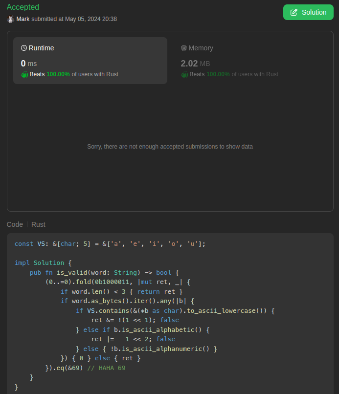

# One liner 0ms beats 100% bit manitpultions & my solution vs. other ones

**Author:** marktyrkba
**Votes:** 2
**Link:** [https://leetcode.com/problems/valid-word/solutions/5116626/](https://leetcode.com/problems/valid-word/solutions/5116626/)

---

# Complexity
- Time complexity:
$$O(n)$$

- Space complexity:
$$O(1)$$

# Code
```
const VS: &[char; 5] = &['a', 'e', 'i', 'o', 'u'];

impl Solution {
    fn is_valid(word: String) -> bool {
        (0..=0).fold(0b1000011, |mut ret, _| {
            if word.len() < 3 { return ret }
            if word.as_bytes().iter().any(|b| {
                if VS.contains(&(*b as char).to_ascii_lowercase()) {
                    ret &= !(1 << 1); false
                } else if b.is_ascii_alphabetic() {
                    ret |=   1 << 2; false
                } else { !b.is_ascii_alphanumeric() }
            }) { 0 } else { ret }
        }).eq(&69) // HAHA 69
    }
}
```

# My solution vs. other ones:
```
Leet code thingies/Solution 1/Random Words
                        time:   [1.2473 ms 1.2511 ms 1.2549 ms]
                        thrpt:  [15.564 KiB/s 15.611 KiB/s 15.659 KiB/s]
                 change:
                        time:   [+2.4034% +5.9006% +10.231%] (p = 0.00 < 0.05)
                        thrpt:  [-9.2813% -5.5718% -2.3470%]
                        Performance has regressed.
Found 2 outliers among 50 measurements (4.00%)
  1 (2.00%) low mild
  1 (2.00%) high mild
Leet code thingies/Solution 2/Random Words
                        time:   [12.904 ms 13.252 ms 13.572 ms]
                        thrpt:  [1.4391 KiB/s 1.4738 KiB/s 1.5136 KiB/s]
                 change:
                        time:   [-6.4175% -3.0397% +0.2319%] (p = 0.09 > 0.05)
                        thrpt:  [-0.2314% +3.1350% +6.8575%]
                        No change in performance detected.
Found 1 outliers among 50 measurements (2.00%)
  1 (2.00%) low mild
Leet code thingies/Solution 3/Random Words
                        time:   [18.012 ms 18.833 ms 19.588 ms]
                        thrpt:  [1021.1   B/s 1.0371 KiB/s 1.0843 KiB/s]
                 change:
                        time:   [-11.818% -7.2585% -2.5162%] (p = 0.00 < 0.05)
                        thrpt:  [+2.5812% +7.8266% +13.402%]
                        Performance has improved.
Found 7 outliers among 50 measurements (14.00%)
  7 (14.00%) low mild

```

## Source code of the tests:
```
use rand::{Rng, SeedableRng, rngs::StdRng};
use criterion::{criterion_group, criterion_main, Criterion, SamplingMode, Throughput, BenchmarkId};

use std::{iter, time::Duration, collections::HashSet};

const VS: &[char; 5] = &['a', 'e', 'i', 'o', 'u'];

// https://leetcode.com/problems/valid-word/solutions/5116626/one-liner-0ms-beats-100-bit-manitpultions
fn is_valid_mine(word: String) -> bool {
    (0..=0).fold(0b1000011, |mut ret, _| {
        if word.len() < 3 { return ret }
        if word.as_bytes().iter().any(|b| {
            if VS.contains(&(*b as char).to_ascii_lowercase()) {
                ret &= !(1 << 1); false
            } else if b.is_ascii_alphabetic() {
                ret |=   1 << 2; false
            } else { !b.is_ascii_alphanumeric() }
        }) { 0 } else { ret }
    }).eq(&69) // HAHA 69
}

// not mine: https://leetcode.com/problems/valid-word/solutions/5113975/just-a-runnable-solution
fn is_valid_not_mine_1(word: String) -> bool {
    let n = word.len();
    if n < 3 { return false }
    let word = word.to_lowercase();
    let v = word.matches(|c: char| "aeiou".contains(c)).count();
    let c = word.chars().filter(|c| c.is_alphabetic() && !"aeiou".contains(*c)).count();
    let non_alphanumeric = word.chars().any(|c| !c.is_alphabetic() && !c.is_ascii_digit());
    v >= 1 && c >= 1 && !non_alphanumeric
}

// not mine: https://leetcode.com/problems/valid-word/solutions/5117127/a-few-solutions
fn is_valid_not_mine_2(s: String) -> bool {
    let v = vec!['a','e','i','o','u','A','E','I','O','U'].drain(..).collect::<HashSet<char>>();
    let a = s.chars().collect::<Vec<char>>();
    let length = |a: &Vec<char>| 3 <= a.len();
    let chars = |a: &Vec<char>| a.iter().all(|c| c.is_alphanumeric());
    let vowel = |a: &Vec<char>| a.iter().any(|c| v.contains(&c));
    let non_vowel = |a: &Vec<char>| a.iter().any(|c| c.is_alphabetic() && !v.contains(&c));
    length(&a) && chars(&a) && vowel(&a) && non_vowel(&a)
}

fn generate_random_words(rng: &mut StdRng, count: usize, min_len: usize, max_len: usize, valid: bool) -> Vec<String> {
    (0..count).map(|_| {
        let len = rng.gen_range(min_len..=max_len);
        let vowels = "aeiouAEIOU";
        let consonants = "bcdfghjklmnpqrstvwxyzBCDFGHJKLMNPQRSTVWXYZ";

        let mut word: String = iter::repeat_with(|| {
            let valid_chars = if valid { format!("{vowels}{consonants}") } else { format!("{vowels}{consonants}@#$") };
            valid_chars.chars().nth(rng.gen_range(0..valid_chars.len())).unwrap()
        }).take(len).collect();

        if valid {
            word.replace_range(0..1, &vowels.chars().nth(rng.gen_range(0..vowels.len())).unwrap().to_string());
            word.replace_range(1..2, &consonants.chars().nth(rng.gen_range(0..consonants.len())).unwrap().to_string());
        }  word
    }).collect()
}

fn benchmark_solutions(c: &mut Criterion) {
    let mut rng = StdRng::seed_from_u64(42);
    let words = generate_random_words(&mut rng, 50000, 3, 20, true);

    let mut group = c.benchmark_group("Leet code thingies");
    group.sampling_mode(SamplingMode::Flat);

    group.throughput(Throughput::Bytes(20));

    group.bench_function(BenchmarkId::new("Solution 1", "Random Words"), |b| {
        b.iter(|| words.iter().for_each(|word| { is_valid_mine(word.clone()); }));
    });

    group.bench_function(BenchmarkId::new("Solution 2", "Random Words"), |b| {
        b.iter(|| words.iter().for_each(|word| { is_valid_not_mine_1(word.clone()); }));
    });

    group.bench_function(BenchmarkId::new("Solution 3", "Random Words"), |b| {
        b.iter(|| words.iter().for_each(|word| { is_valid_not_mine_2(word.clone()); }));
    });
}

criterion_group! {
    name = benches;
    config = Criterion::default()
        .warm_up_time(Duration::from_secs(10))
        .measurement_time(Duration::from_secs(100))
        .sample_size(50);

    targets = benchmark_solutions
}
criterion_main!(benches);

```

## Therefore:
I'm not sure how accurate the tests are, because they're written by Chat Skibidi(GPT), but they show that my solution is 13 times faster than average. To get this result, I took the average speed of the first and second solutions from other people solutions (links in the code), then compared it to the speed of my solution:
$$(1$$st $$ sol.'s $$ avg.  $$ speed + 2$$st $$ sol.'s $$ avg. $$speed) / 2 => (18 + 13) / 2 => 15.5 => 15.5 / 1.2 = 12.91$$.



