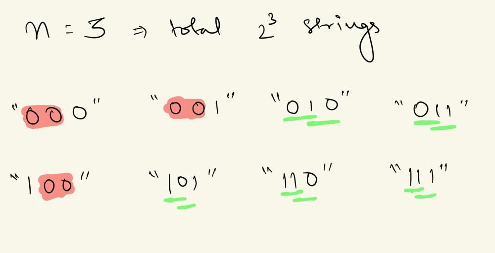

# Pick, not pick with condition

**Author:** fahad_Mubeen
**Votes:** 13
**Link:** [https://leetcode.com/problems/generate-binary-strings-without-adjacent-zeros/solutions/5432107/](https://leetcode.com/problems/generate-binary-strings-without-adjacent-zeros/solutions/5432107/)

---

# Intuition
- The statement `All substrings of length 2 in \uD835\uDC65 must contain at least one '1' `simply means that there cannot be any consecutive '0's. For example, '100' is invalid, but '010' is valid.
- There are two ways to add a new character to the string: '0' or '1'. Since we need to ensure that there is at least one '1' in every substring of length 2, we must keep track of the previously added character. So that, we don't have two consecutive zeros.
- Thus we append "0" to our string only when the previous character is "1".


- `All substrings of length greater than 2 must contain at least one '1'. The invalid substrings (marked in red) do not meet this requirement.`

- `In one recursive call, we set the first index to '0' and generate all possible combinations starting from it. 
In another recursive call, we set the first index to '1' and generate all possible combinations starting from there.`
- For additional space optimization, we use backtracking.
<!-- Describe your first thoughts on how to solve this problem. -->

<!-- # Approach -->
<!-- Describe your approach to solving the problem. -->

# Complexity
- Time complexity: $$O(2^n)$$ `since there can be 2^n combinations`
<!-- Add your time complexity here, e.g. $$O(n)$$ -->

- Space complexity: $$O(n)$$ `The depth of the recursion is at most n, so the space required for the call stack is O(n).`
<!-- Add your space complexity here, e.g. $$O(n)$$ -->

# Code
```C++ []
class Solution {
public:
    vector<string> ans;
    void f(int prev, string &str, int n){
        if(str.length() == n){
            ans.push_back(str);
            return;
        }
        str.push_back('1');
        f(1, str, n);
        str.pop_back();
        if(prev == 1){
            str.push_back('0');
            f(0, str, n);
            str.pop_back();
        } 
    }
    vector<string> validStrings(int n) {
        string a = "0", b = "1";
        ans.clear();
        f(0, a, n);
        f(1, b, n);
        return ans;
    }
};
```
```Java []
class Solution {
    private List<String> ans;

    private void f(int prev, StringBuilder str, int n) {
        if (str.length() == n) {
            ans.add(str.toString());
            return;
        }
        str.append('1');
        f(1, str, n);
        str.deleteCharAt(str.length() - 1);
        if (prev == 1) {
            str.append('0');
            f(0, str, n);
            str.deleteCharAt(str.length() - 1);
        } 
    }
```
```Python3 []
class Solution:
    def __init__(self):
        self.ans = []

    def f(self, prev: int, str_: str, n: int):
        if len(str_) == n:
            self.ans.append(str_)
            return
        self.f(1, str_ + '1', n)
        if prev == 1:
            self.f(0, str_ + '0', n)

    def validStrings(self, n: int) -> List[str]:
        self.ans = []
        self.f(0, "0", n)
        self.f(1, "1", n)
        return self.ans
```
