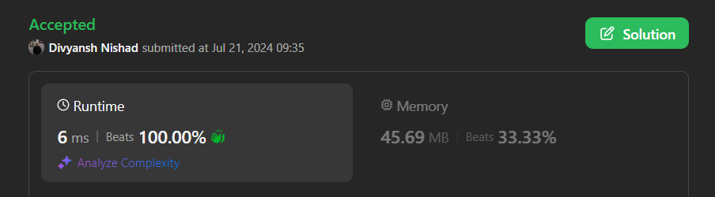

# ✅Beats 100% -Explained with [ Video ] -C++/Java/Python/JS - Single Pass - Explained in Detail

**Author:** millenium103
**Votes:** 27
**Link:** [https://leetcode.com/problems/maximum-number-of-operations-to-move-ones-to-the-end/solutions/5509454/](https://leetcode.com/problems/maximum-number-of-operations-to-move-ones-to-the-end/solutions/5509454/)

---



# Intuition
<!-- Describe your first thoughts on how to solve this problem. -->
The problem requires finding the maximum number of operations we can perform on a binary string where each operation involves moving a '1' to the right until it hits another '1' or the end of the string. The key insight is to count how many valid moves can be made by tracking the number of '1's that can be moved past '0's.

# Approach
<!-- Describe your approach to solving the problem. -->
1. **Initialize Counters**:
   - `result`: This will store the total number of valid moves we can perform.
   - `ones`: This will count the number of '1's encountered as we traverse the string.
   - `use`: A flag to indicate when we have encountered a '0' that allows moves.

2. **Traverse the String**:
   - For each character in the string:
     - **If the character is '0'**:
       - Set the `use` flag to `true` to indicate that we can use this '0' to move the '1's that come after it.
     - **If the character is '1'**:
       - If the `use` flag is `true`, it means that there are some '0's before this '1' that we can use to move all the preceding '1's.
       - Add the count of '1's (`ones`) to the `result` because each '1' can be moved past each '0' before it.
       - Increment the `ones` counter as this '1' can be moved in future operations.
       - Reset the `use` flag to `false` as the current '1' will be processed.

3. **Final Check**:
   - If there are any remaining '0's at the end of the string, add the count of remaining '1's (`ones`) to the `result`.

# Complexity
- **Time Complexity**: \\(O(n)\\)
  - The algorithm iterates through the string once, where \\(n\\) is the length of the string. This makes the time complexity linear.

- **Space Complexity**: \\(O(1)\\)
  - The algorithm uses a constant amount of space to store the `result`, `ones`, and `use` variables.


# Step By Step Explanation

To explain the approach with tables, we can illustrate the state transitions as follows:

#### Example: Input `"1001101"`

| Index | Character | `ones` | `use` | `result` | Explanation                                    |
|-------|-----------|--------|-------|----------|------------------------------------------------|
| 0     | 1         | 1      | false | 0        | Start with `ones = 1`. No '0' yet, no moves.   |
| 1     | 0         | 1      | true  | 0        | We can use this '0' to move the previous '1'. |
| 2     | 0         | 1      | true  | 1        | Move the '1' from index 1 to the end.         |
| 3     | 1         | 2      | false | 1        | Previous '0' can move the '1's from indices 1, 2. |
| 4     | 1         | 3      | false | 1        | Move the '1' from index 3 to the end.         |
| 5     | 0         | 3      | true  | 4        | Move the '1's from previous indices.          |
| 6     | 1         | 4      | false | 4        | Add the remaining '1's from the previous '0's. |

Final result is `4` operations.


# Code
```java []
class Solution {
    public int maxOperations(String s) {
        int result = 0;
        
        int ones = 0;
        
        boolean use = false;
        
        for (char c : s.toCharArray()) {
            if (c == '0') {
                use = true;
            } else {
                if (use) {
                    result += ones;
                }
                
                ones++;
                use = false;
            }    
        }
        
        if (use) {
            result += ones;
        }
        
        return result;
    }
}
```
```C++ []
class Solution {
public:
    int maxOperations(string s) {
        int result = 0;
        int ones = 0;
        bool use = false;
        
        for (char c : s) {
            if (c == '0') {
                use = true;
            } else {
                if (use) {
                    result += ones;
                }
                ones++;
                use = false;
            }
        }
        
        if (use) {
            result += ones;
        }
        
        return result;
    }
};
```
```Python []
class Solution(object):
    def maxOperations(self, s):
        result = 0
        ones = 0
        use = False
        
        for c in s:
            if c == '0':
                use = True
            else:
                if use:
                    result += ones
                ones += 1
                use = False
        
        if use:
            result += ones
        
        return result
        
```
```JavaScript []
/**
 * @param {string} s
 * @return {number}
 */
var maxOperations = function(s) {
    let result = 0;
    let ones = 0;
    let use = false;
    
    for (let c of s) {
        if (c === '0') {
            use = true;
        } else {
            if (use) {
                result += ones;
            }
            ones++;
            use = false;
        }
    }
    
    if (use) {
        result += ones;
    }
    
    return result;
};
```

