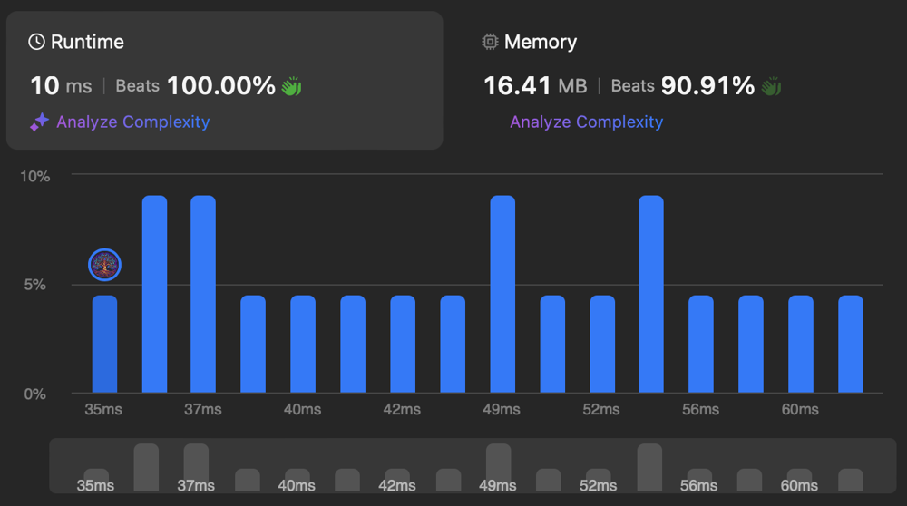

# ✅ O(n) Linear Scan

**Author:** eleev
**Votes:** 1
**Link:** [https://leetcode.com/problems/maximum-number-of-operations-to-move-ones-to-the-end/solutions/5539771/](https://leetcode.com/problems/maximum-number-of-operations-to-move-ones-to-the-end/solutions/5539771/)

---



# Solution
```swift
struct Solution {
    @_optimize(speed)
    consuming func maxOperations(_ s: String) -> Int {
        guard !s.isEmpty else { return 0 }
        let s = s.utf8CString.dropLast()
        let d = s.indices[1...].reduce((shifts: 0, result: 0)) { d, i in
            var d = d
            if s[i-1] == 49 { d.shifts += 1 }
            if s[i-1] == 48, s[i] == 49 { d.result += d.shifts }
            return d
        }
        return s[s.count - 1] == 48 ? d.result + d.shifts : d.result
    }
}
```