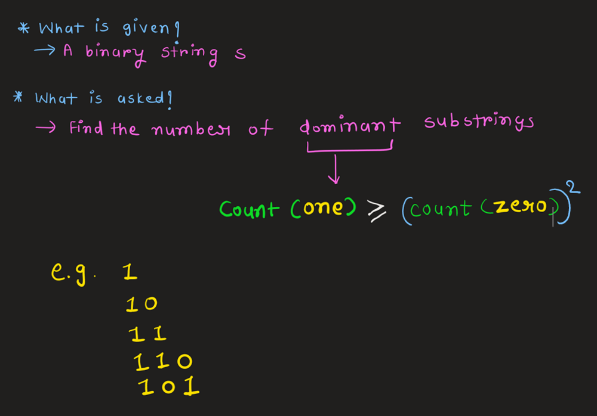
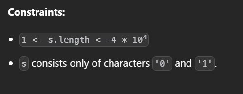
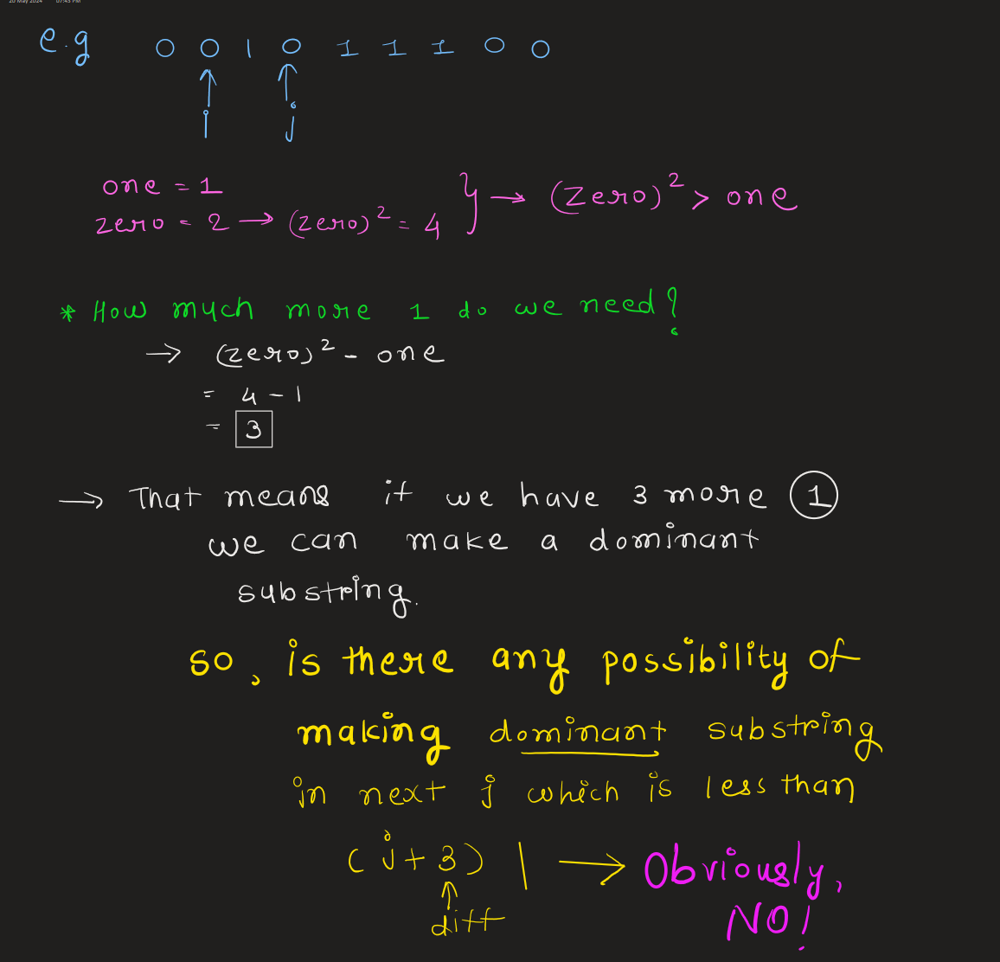
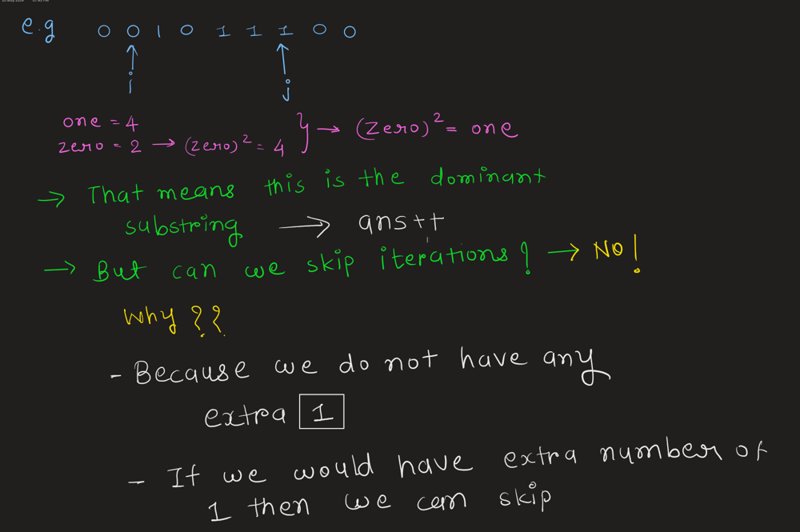
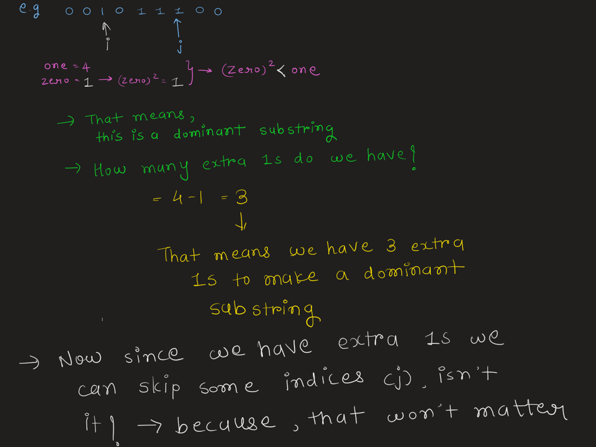
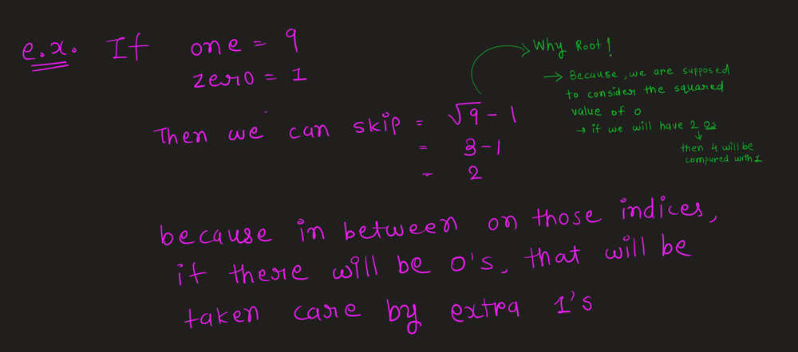
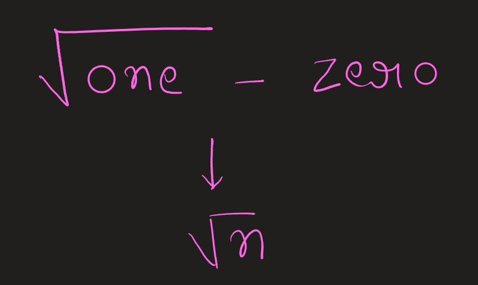

# Well Explained | Very Easy | Java

**Author:** Px_07
**Votes:** 70
**Link:** [https://leetcode.com/problems/count-the-number-of-substrings-with-dominant-ones/solutions/5548547/](https://leetcode.com/problems/count-the-number-of-substrings-with-dominant-ones/solutions/5548547/)

---

# Intuition
<!-- Describe your first thoughts on how to solve this problem. -->





**According to constraints , we must write an algorithm which runs in less than $$O(n^2)$$ time complexity , that means we can not use brute force in which we would have gone through each and every substring causing  $$O(n^2)$$ time complexity** 


## **Answer these questions:**

1. **Do we need to go through each and every ending index if we have fixed the starting index?**
   - No.

2. **What do we need at each index to find the answer?**
   - The number of zeros and ones.

3. **How do we efficiently calculate the number of zeros and ones in a substring?**
   - By using a prefix sum array for the number of ones, we can quickly determine the count of ones and zeros in any substring.

4. **What conditions determine if a substring is dominant?**
   - A substring is dominant if the square of the number of zeros is less than or equal to the number of ones.

5. **How can we optimize the inner loop to avoid unnecessary checks?**
   - By skipping forward based on the conditions, we can avoid checking every possible ending index, thus reducing the number of iterations.


**6. Skipping Logic**

- There are three possible conditions:
  - `If (zero * zero) > one: The substring is not dominant.`
  

```
 if ((zero * zero) > one) { // Not dominant
        j += (zero * zero - one - 1);
 } 
```

***Although this might seem basic, let's clarify why we decrement by 1. The reason is that the loop itself will increment the index by 1, so we adjust for this in our skip calculation.***

  - `If (zero * zero) == one: Only this substring is dominant.`
  

  - `If (zero * zero) < one: This substring is dominant, and there is a possibility of making further substrings and reducing iterations.`
  




# Approach
<!-- Describe your approach to solving the problem. -->

# Complexity
- Time complexity: $$O(n \\sqrt{n})$$
<!-- Add your time complexity here, e.g. $$O(n)$$ -->
### Explanation of Time Complexity:

1. **Outer Loop:**
   - The outer loop runs from `i = 0` to `i = n-1`, iterating `n` times.

2. **Inner Loop:**
   - In the worst case, the inner loop runs from `j = i` to `j = n-1`. 
   - However, due to the skipping logic when `(zero * zero) > one`, the inner loop doesn't always iterate through each element linearly.

3. **Skipping Logic:**
   - The key part is the skipping logic where `j` can jump forward by multiple steps. 
   - This skipping is proportional to the difference between the square of the number of zeros and the number of ones in the substring, which can be roughly approximated by the square root operation in terms of complexity.

- ***For each i, the inner loop effectively doesn't just move one step at a time but it alsp skips multiple steps when the condition (zero * zero) > one is met or (zero*zero) < one is met.**



- Space complexity: $$O(n)$$ ***( prefixarray )***
<!-- Add your space complexity here, e.g. $$O(n)$$ -->

***(Please consider upvotting if you find this helpful :) )***
# Code
```
class Solution {
    public int numberOfSubstrings(String s) {
        int n = s.length(); 
        int[] prefix = new int[n]; //array to store prefix sums of '1's

        prefix[0] = ((int)(s.charAt(0) - '0')) == 1 ? 1 : 0;
        for (int i = 1; i < n; i++) {
            prefix[i] = prefix[i - 1] + (((int)(s.charAt(i) - '0')) == 1 ? 1 : 0);
        }

        int ans = 0;

        
        for (int i = 0; i < n; i++) { //i => starting index of substring

            int one = 0; // Count of '1's in the current substring
            int zero = 0; // Count of '0's in the current substring

            for (int j = i; j < n; j++) { // j=> ending index of current substring

                one = prefix[j] - (i == 0 ? 0 : prefix[i - 1]);
                zero = (j - i + 1) - one;
              
                //CASE->1
                if ((zero * zero) > one) { // Not dominant
                    j += (zero * zero - one - 1);
                } 
                //CASE->2
                else if ((zero * zero) == one) { //just this one is dominant
                    ans++; 
                } 
                //CASE->3
                else if ((zero * zero) < one) { 
                    ans++; 
                    // Calculate the difference to determine how far to skip forward
                    int diff = (int) Math.sqrt(one) - zero;
                    int nextj = j + diff; // Determine the next position to skip to

                    if (nextj >= n) {
                        ans += (n - j - 1);
                    } else {
                        ans += diff; 
                    }

                    j = nextj; // Update j to the next position
                }
            }
        }
        return ans; // Return the final answer
    }
}

```