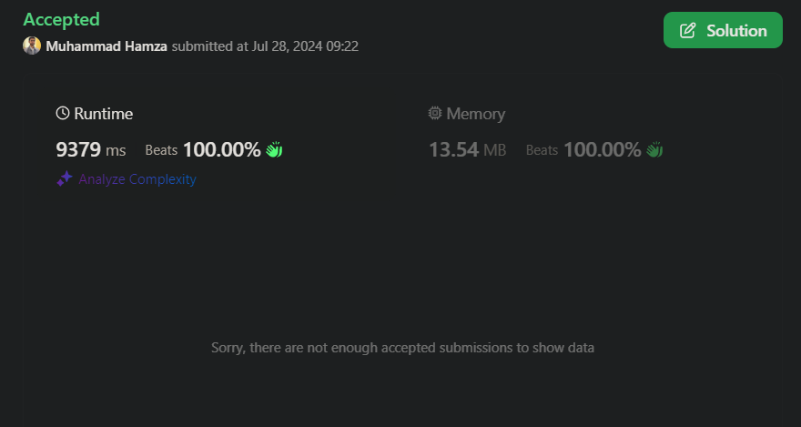

# It works guys, it works | Python solution | TLE test cases barely passed 😅

**Author:** Hamza_the_codar_786
**Votes:** 5
**Link:** [https://leetcode.com/problems/count-the-number-of-substrings-with-dominant-ones/solutions/5546522/](https://leetcode.com/problems/count-the-number-of-substrings-with-dominant-ones/solutions/5546522/)

---

# Result:


# \uD83C\uDFAF Problem Description
You need to count the number of substrings in a given string s such that the number of '1's in each substring is greater than the square of the number of '0's plus one.

## \uD83D\uDCE5\u2935\uFE0F Input:
- A string s consisting of characters '0' and '1'.

## \uD83D\uDCE4\u2934\uFE0F Output:
The number of substrings that satisfy the condition described above.

# \uD83C\uDFC6 Approach: Iterative Calculation with Index Tracking
## \uD83E\uDD14 Intuition:
To solve this problem, we'll iterate through the string while keeping track of the indices of '0's encountered so far. For each character, we'll calculate possible substrings that meet the criteria and update our result accordingly.

## \uD83D\uDC69\uD83C\uDFFB\u200D\uD83D\uDCBB Coding:

1. **Initialization:**
- Initialize result to store the final count of valid substrings.
- Initialize last_zero_indices with -1 to track indices of '0's encountered in the string.

2. **Loop Through String:**

- Iterate through each character in the string using a loop.
- For each character, initialize count_ones and count_zeros to zero.
- If the character is '1', increment count_ones.
- If the character is '0', increment count_zeros.

3. **Update and Check Substrings:**

- Initialize p to the current index i.
- Iterate in reverse through last_zero_indices:
    - Update count_ones by adding the difference between the current index and the last zero index.
    - Calculate the possible substring contribution to result using the formula max(0, min(p - v, count_ones - count_zeros**2 + 1)).
    - Update p to the last zero index v.
    - Increment count_zeros.
    - Break the loop if the square of count_zeros exceeds the current index i.

4. Track Zero Indices:
- Append the current index to last_zero_indices if the character is '0'.

# \uD83D\uDCD7 Complexity Analysis:
## \u23F0 Time Complexity: $$O(n^2)$$
Where n is the length of the string. The inner loop runs in O(n) time in the worst case.

## \uD83E\uDDFA Space Complexity: $$O(n)$$ 
Where n is the length of the string. The list last_zero_indices can grow up to the length of the string.

# \uD83D\uDCBBCode:
``` Python []
class Solution(object):
    def numberOfSubstrings(self, s):
        result = 0
        last_zero_indices = [-1]
        n = len(s)

        for i in range(n):
            ch = s[i]
            count_ones = count_zeros = 0
            
            if ch == '1':
                count_ones += 1
            else:
                count_zeros += 1
            
            p = i
            
            for v in reversed(last_zero_indices):
                count_ones += p - v - 1
                result += max(0, min(p - v, count_ones - count_zeros**2 + 1))
                p = v
                count_zeros += 1
                if count_zeros**2 > i:
                    break
            
            if ch == '0':
                last_zero_indices.append(i)
        
        return result
```

