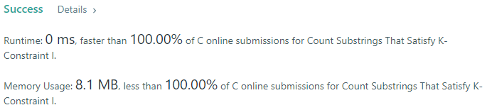
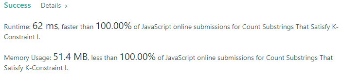
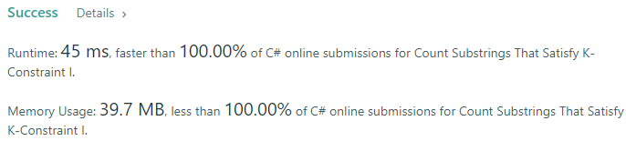
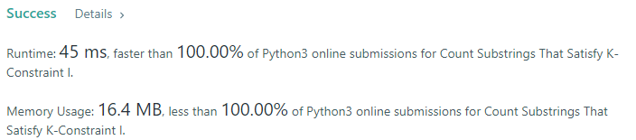
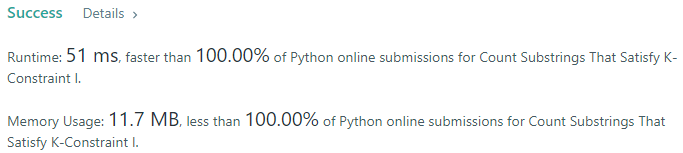
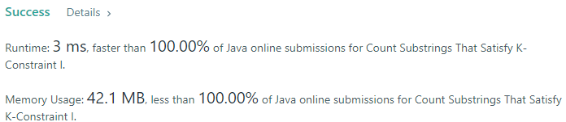
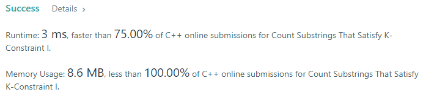

# 💢☠💫Easiest👾Faster✅💯 Lesser🧠 🎯 C++✅Python3🐍✅Java✅C✅Python🐍✅C#✅💥🔥💫Explained☠💥🔥 Beats 💯

**Author:** Edwards310
**Votes:** 3
**Link:** [https://leetcode.com/problems/count-substrings-that-satisfy-k-constraint-i/solutions/5654879/](https://leetcode.com/problems/count-substrings-that-satisfy-k-constraint-i/solutions/5654879/)

---

# Intuition
<!-- Describe your first thoughts on how to solve this problem. -->








```javascript []
//JavaScript Code
/**
 * @param {string} s
 * @param {number} k
 * @return {number}
 */
var countKConstraintSubstrings = function(s, k) {
    var res = 0
    var n = s.length
    for(let i = 0; i < n; i++){
        let z = 0, o = 0
        for(let j = i; j < n; j++){
            if(s[j] == '0')
                z++
            else
                o++
            if(z <= k || o <= k)
                res++
        }
    }
    return res
};
```
```C++ []
//C++ Code

#include <bits/stdc++.h>

using namespace std;

typedef long long LL;
typedef vector<int> vi;


#define FOR(a, b, c) for (int a = b; a < c; a++)
#define FOR1(a, b, c) for (int a = b; a <= c; ++a)
#define Rep(i, n) FOR(i, 0, n)


class Solution {
public:
    int countKConstraintSubstrings(string s, int k) {
         int n = s.size();
         int cnt = 0;
        Rep (start, n) {
            int zero_cnt = 0;
            int one_cnt = 0;
            FOR (end, start, n) {
            if (s[end] == '0')
                zero_cnt++;
            else
                one_cnt++;
            if (zero_cnt <= k || one_cnt <= k)
                cnt++;
            }
        }
        return cnt;
    }
};
```
```Python3 []
#Python3 Code
class Solution:
    def countKConstraintSubstrings(self, s: str, k: int) -> int:
        res = 0
        n = len(s)
        for i in range(n):
            z = o = 0
            for j in range(i, n):
                if s[j] == '0':
                    z += 1
                else:
                    o += 1
                if z <= k or o <= k:
                    res += 1
        return res
```
```Java []
//Java Code
class Solution {
    public int countKConstraintSubstrings(String s, int k) {
        int cnt = 0, n = s.length();
        for(int i = 0; i < n; i++){
            int zero = 0, ones = 0;
            for(int j = i; j < n; ++j){
                if(s.charAt(j) == '0')
                    zero++;
                else
                    ones++;
                if(ones <= k || zero <= k)
                    cnt++;
            }
        }
        return cnt;
    }
}
```
```C []
//C Code
#include<stdio.h>
#include<stdlib.h>
#define Rep(i, n) for(int i = 0; i < n; ++i)
#define Rep1(i, n) for(int i = 1; i < n; ++i)
#define FOR(a, b, c) for(int a = b; a < c; ++a)
int countKConstraintSubstrings(char* s, int k) {
    int res = 0, n = strlen(s);
    Rep(i, n){
        int z = 0, o = 0;
        FOR(j, i, n){
            s[j] == '0' ? ++z : ++o;
            if(z <= k || o <= k)
                res++;
        }
    }
    return res;
}
```
```Python []
#Python Code
class Solution(object):
    def countKConstraintSubstrings(self, s, k):
        """
        :type s: str
        :type k: int
        :rtype: int
        """
        res = 0
        n = len(s)
        for i in range(n):
            z = o = 0
            for j in range(i, n):
                if s[j] == '0':
                    z += 1
                else:
                    o += 1
                if z <= k or o <= k:
                    res += 1
        return res
```
```C# []
//C# Code
public class Solution {
    public int CountKConstraintSubstrings(string s, int k) {
        int res = 0;
        int n = s.Length;
        for(int i = 0; i < n; i++){
            int z = 0, o = 0;
            for(int j = i; j < n; j++){
                if(s[j] == '0')
                    z++;
                else
                    o++;
                if(z <= k || o <= k)
                    res++;
            }
        }
        return res;
    }
}
```
# Approach
<!-- Describe your approach to solving the problem. -->

# Complexity
- Time complexity:
<!-- Add your time complexity here, e.g. $$O(n)$$ -->
     O(i * j)
- Space complexity:
<!-- Add your space complexity here, e.g. $$O(n)$$ -->
     O(1)
# Code


