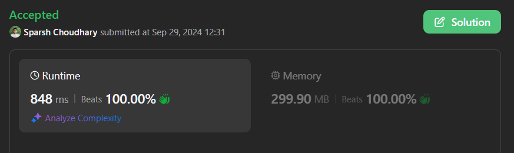

# 🔥BEATS 💯 % 🎯 |✨SUPER EASY BEGINNERS 👏

**Author:** CodeWithSparsh
**Votes:** 1
**Link:** [https://leetcode.com/problems/find-the-occurrence-of-first-almost-equal-substring/solutions/5846964/](https://leetcode.com/problems/find-the-occurrence-of-first-almost-equal-substring/solutions/5846964/)

---





## Intuition
The problem requires finding a substring in `s` that matches the pattern with at most one character being different. The Z-algorithm helps efficiently find matching lengths by constructing a Z-array.

## Approach
1. **Z-Array Calculation**: Create a Z-array to determine the longest substring matches.
2. **Two Comparisons**: Use the Z-array to compare the pattern against the string `s` in both forward and backward directions.
3. **Index Determination**: Check for valid starting indices by summing the matches and checking against the pattern length.

## Complexity
- **Time Complexity**: \\(O(n)\\) where \\(n\\) is the length of the string.
- **Space Complexity**: \\(O(n)\\) for storing the Z-array.

## Code Implementations

```dart []
class Solution {
  List<int> computeZArray(String str) {
    int n = str.length;
    List<int> zArray = List.filled(n, 0);
    int left = 0, right = 0;

    for (int i = 1; i < n; i++) {
      if (i < right) {
        zArray[i] = (right - i < zArray[i - left]) ? (right - i) : zArray[i - left];
      }
      while (i + zArray[i] < n && str[zArray[i]] == str[i + zArray[i]]) {
        zArray[i]++;
      }
      if (i + zArray[i] > right) {
        left = i;
        right = i + zArray[i];
      }
    }
    return zArray;
  }

  int minStartingIndex(String s, String pattern) {
    String forwardConcat = pattern + s;
    List<int> forwardZArray = computeZArray(forwardConcat);
    
    pattern = pattern.split('').reversed.join();
    s = s.split('').reversed.join();
    String backwardConcat = pattern + s;
    List<int> backwardZArray = computeZArray(backwardConcat);

    int n = forwardZArray.length;
    int comparisonOffset = 2 * pattern.length;
    comparisonOffset = n - comparisonOffset;
    comparisonOffset = pattern.length + comparisonOffset;

    for (int i = pattern.length; i < n; i++) {
      if (comparisonOffset >= n || comparisonOffset < pattern.length) break;

      int forwardMatch = forwardZArray[i];
      int backwardMatch = backwardZArray[comparisonOffset];

      if (forwardMatch + backwardMatch >= pattern.length - 1) {
        return i - pattern.length;
      }
      comparisonOffset--;
    }

    return -1;
  }
}
```

```python []
class Solution:
    def compute_z_array(self, s):
        z = [0] * len(s)
        left, right = 0, 0

        for i in range(1, len(s)):
            if i < right:
                z[i] = min(right - i, z[i - left])
            while i + z[i] < len(s) and s[z[i]] == s[i + z[i]]:
                z[i] += 1
            if i + z[i] > right:
                left, right = i, i + z[i]
        return z

    def min_starting_index(self, s: str, pattern: str) -> int:
        forward_concat = pattern + s
        forward_z = self.compute_z_array(forward_concat)

        pattern = pattern[::-1]
        s = s[::-1]
        backward_concat = pattern + s
        backward_z = self.compute_z_array(backward_concat)

        n = len(forward_z)
        comparison_offset = n - 2 * len(pattern)

        for i in range(len(pattern), n):
            if comparison_offset >= n or comparison_offset < len(pattern):
                break

            forward_match = forward_z[i]
            backward_match = backward_z[comparison_offset]

            if forward_match + backward_match >= len(pattern) - 1:
                return i - len(pattern)
            comparison_offset -= 1

        return -1
```

```java []
class Solution {
    public int[] computeZArray(String str) {
        int n = str.length();
        int[] zArray = new int[n];
        int left = 0, right = 0;

        for (int i = 1; i < n; i++) {
            if (i < right) {
                zArray[i] = Math.min(right - i, zArray[i - left]);
            }
            while (i + zArray[i] < n && str.charAt(zArray[i]) == str.charAt(i + zArray[i])) {
                zArray[i]++;
            }
            if (i + zArray[i] > right) {
                left = i;
                right = i + zArray[i];
            }
        }
        return zArray;
    }

    public int minStartingIndex(String s, String pattern) {
        String forwardConcat = pattern + s;
        int[] forwardZ = computeZArray(forwardConcat);

        pattern = new StringBuilder(pattern).reverse().toString();
        s = new StringBuilder(s).reverse().toString();
        String backwardConcat = pattern + s;
        int[] backwardZ = computeZArray(backwardConcat);

        int n = forwardZ.length;
        int comparisonOffset = 2 * pattern.length();
        comparisonOffset = n - comparisonOffset;

        for (int i = pattern.length(); i < n; i++) {
            if (comparisonOffset >= n || comparisonOffset < pattern.length()) break;

            int forwardMatch = forwardZ[i];
            int backwardMatch = backwardZ[comparisonOffset];

            if (forwardMatch + backwardMatch >= pattern.length() - 1) {
                return i - pattern.length();
            }
            comparisonOffset--;
        }

        return -1;
    }
}
```

```cpp []
class Solution {
public:
    vector<int> computeZArray(string str) {
        int n = str.size();
        vector<int> zArray(n, 0);
        int left = 0, right = 0;

        for (int i = 1; i < n; i++) {
            if (i < right) {
                zArray[i] = min(right - i, zArray[i - left]);
            }
            while (i + zArray[i] < n && str[zArray[i]] == str[i + zArray[i]]) {
                zArray[i]++;
            }
            if (i + zArray[i] > right) {
                left = i;
                right = i + zArray[i];
            }
        }
        return zArray;
    }

    int minStartingIndex(string s, string pattern) {
        string forwardConcat = pattern + s;
        vector<int> forwardZ = computeZArray(forwardConcat);

        reverse(pattern.begin(), pattern.end());
        reverse(s.begin(), s.end());
        string backwardConcat = pattern + s;
        vector<int> backwardZ = computeZArray(backwardConcat);

        int n = forwardZ.size();
        int comparisonOffset = n - 2 * pattern.size();

        for (int i = pattern.size(); i < n; i++) {
            if (comparisonOffset >= n || comparisonOffset < pattern.size()) break;

            int forwardMatch = forwardZ[i];
            int backwardMatch = backwardZ[comparisonOffset];

            if (forwardMatch + backwardMatch >= pattern.size() - 1) {
                return i - pattern.size();
            }
            comparisonOffset--;
        }

        return -1;
    }
};
```

```javascript []
class Solution {
    computeZArray(str) {
        const n = str.length;
        const zArray = Array(n).fill(0);
        let left = 0, right = 0;

        for (let i = 1; i < n; i++) {
            if (i < right) {
                zArray[i] = Math.min(right - i, zArray[i - left]);
            }
            while (i + zArray[i] < n && str[zArray[i]] === str[i + zArray[i]]) {
                zArray[i]++;
            }
            if (i + zArray[i] > right) {
                left = i;
                right = i + zArray[i];
            }
        }
        return zArray;
    }

    minStartingIndex(s, pattern) {
        const forwardConcat = pattern + s;
        const forwardZ = this.computeZArray(forwardConcat);

        pattern = pattern.split('').reverse().join('');
        s = s.split('').reverse().join('');
        const backwardConcat = pattern + s;
        const backwardZ = this.computeZArray(backwardConcat);

        const n = forwardZ.length;
        let comparisonOffset = 2 * pattern.length;
        comparisonOffset = n - comparisonOffset;

        for (let i = pattern.length; i < n; i++) {
            if (comparisonOffset >= n || comparisonOffset < pattern.length) break;

            const forwardMatch = forwardZ[i];
            const backwardMatch = backwardZ[comparisonOffset];

            if (forwardMatch + backwardMatch >= pattern.length - 1) {
                return i - pattern.length;
            }
            comparisonOffset--;
        }

        return -1;
    }
}
```

```go []
package main

import "math"

type Solution struct{}

func (s *Solution) computeZArray(str string) []int {
	n := len(str)
	zArray := make([]int, n)
	left, right := 0, 0

	for i := 1;

 i < n; i++ {
		if i < right {
			zArray[i] = int(math.Min(float64(right-i), float64(zArray[i-left])))
		}
		for i+zArray[i] < n && str[zArray[i]] == str[i+zArray[i]] {
			zArray[i]++
		}
		if i+zArray[i] > right {
			left, right = i, i+zArray[i]
		}
	}
	return zArray
}

func (s *Solution) MinStartingIndex(sStr string, pattern string) int {
	forwardConcat := pattern + sStr
	forwardZ := s.computeZArray(forwardConcat)

	patternRunes := []rune(pattern)
	reverse(patternRunes)
	pattern = string(patternRunes)

	sRunes := []rune(sStr)
	reverse(sRunes)
	sStr = string(sRunes)

	backwardConcat := pattern + sStr
	backwardZ := s.computeZArray(backwardConcat)

	n := len(forwardZ)
	comparisonOffset := 2*len(pattern)
	comparisonOffset = n - comparisonOffset

	for i := len(pattern); i < n; i++ {
		if comparisonOffset >= n || comparisonOffset < len(pattern) {
			break
		}

		forwardMatch := forwardZ[i]
		backwardMatch := backwardZ[comparisonOffset]

		if forwardMatch+backwardMatch >= len(pattern)-1 {
			return i - len(pattern)
		}
		comparisonOffset--
	}

	return -1
}

func reverse(runes []rune) {
	for i, j := 0, len(runes)-1; i < j; i, j = i+1, j-1 {
		runes[i], runes[j] = runes[j], runes[i]
	}
}
```
 {:style='width:250px'}


