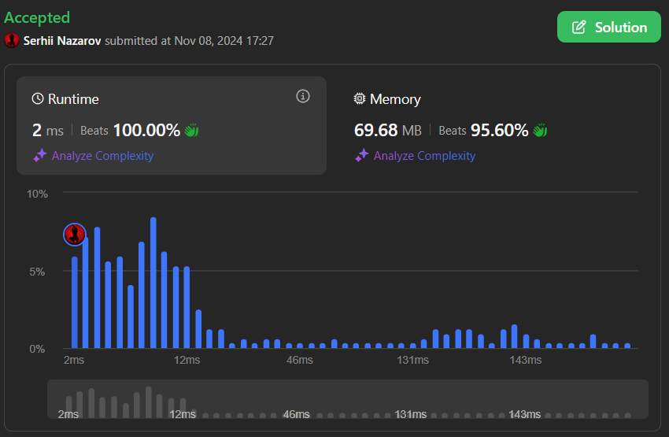

# ✅ Javascript | Simplest Solution | 🏆Simulation🏆 |🔥Beats 100%🔥

**Author:** Satansoft
**Votes:** 0
**Link:** [https://leetcode.com/problems/find-the-sequence-of-strings-appeared-on-the-screen/solutions/6024793/](https://leetcode.com/problems/find-the-sequence-of-strings-appeared-on-the-screen/solutions/6024793/)

---



# Intuition
Use double loop to iterate through `target` in first and through `alphabet` in second with update outer accumulator variable and push to result array accumulator variable + current alphabet letter.

# Approach
Define:
`strings` - result array;
`string` - accumulator;
`alphabet` - all letters of latin alphabet;

The outer loop goes through each character in the `target` string.

In inner loop goes through each character in the `alphabet`, push to `strings` concatenated `string` with current `alphabet` letter and check, if current `alphabet` letter equal to current `target` letter, add current `alphabet` letter to `string`, break inner loop and continue to the next letter of `target`;

At the end return `strings`;

# Complexity
- Time complexity:
$$O(target * 26)$$

- Space complexity:
$$O(target * 26)$$

# Code
```javascript []
/**
 * @param {string} target
 * @return {string[]}
 */
var stringSequence = function(target) {
    const strings = [];
    let string = '';
    const alphabet = 'abcdefghijklmnopqrstuvwxyz';

    for (let i = 0; i < target.length; i++) {

        for (let j = 0; j < alphabet.length; j++) {
            const letter = alphabet[j];

            strings.push(string + letter);
            
            if (target[i] === letter) {
                string += letter
                break;
            }
        }

    }

    return strings;
};
```