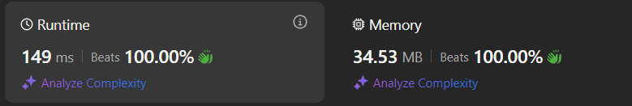

# Simple solution Kotlin and Java (beats 100%) + 1 more Kotlin ☆*: .｡. o(≧▽≦)o .｡.:*☆

**Author:** Phantom2097
**Votes:** 1
**Link:** [https://leetcode.com/problems/find-the-original-typed-string-i/solutions/5971851/](https://leetcode.com/problems/find-the-original-typed-string-i/solutions/5971851/)

---


# Complexity
- Time complexity:
$$O(n)$$

- Space complexity:
$$O(1)$$

# Kotlin Code 1


```kotlin []
class Solution {
    fun possibleStringCount(word: String): Int {
        var count = 0
        var prev = '0'
        for (w in word) {
            if (prev == w) count++
            prev = w
        }
        return count + 1
    }
}
```
# Kotlin Code 2


```
class Solution {
    fun possibleStringCount(word: String): Int =
        word.zipWithNext().count { it.first == it.second } + 1
}
```
# Java code


```
class Solution {
    public int possibleStringCount(String word) {
        int count = 0;
        char prev = '0';
        for (char w : word.toCharArray()) {
            if (prev == w) count++;
            prev = w;
        }
        return count + 1;
    }
}
```