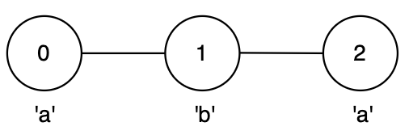

# [3615. Longest Palindromic Path in Graph](https://leetcode.com/problems/longest-palindromic-path-in-graph/)

| Category | Difficulty | Likes | Dislikes |
| :------: | :--------: | :---: | :------: |
| Algorithms | Hard | 56 | 5 |

**Tags:** [`string`](https://leetcode.com/tag/string), [`dynamic-programming`](https://leetcode.com/tag/dynamic-programming), [`bit-manipulation`](https://leetcode.com/tag/bit-manipulation), [`graph`](https://leetcode.com/tag/graph), [`bitmask`](https://leetcode.com/tag/bitmask)

## Description

You are given an integer `n` and an **undirected** graph with `n` nodes labeled from 0 to `n - 1` and a 2D array `edges`, where `edges[i] = [u_i, v_i]` indicates an edge between nodes `u_i` and `v_i`.

You are also given a string `label` of length `n`, where `label[i]` is the character associated with node `i`.

You may start at any node and move to any adjacent node, visiting each node **at most** once.

Return the **maximum** possible length of a **palindrome** that can be formed by visiting a set of **unique** nodes along a valid path.

 

**Example 1:**

**Input:** n = 3, edges = [[0,1],[1,2]], label = "aba"

**Output:** 3

**Exp****lanation:**

	- The longest palindromic path is from node 0 to node 2 via node 1, following the path `0 &rarr; 1 &rarr; 2` forming string `"aba"`.

	- This is a valid palindrome of length 3.

**Example 2:**

**Input:** n = 3, edges = [[0,1],[0,2]], label = "abc"

**Output:** 1

**Explanation:**

	- No path with more than one node forms a palindrome.

	- The best option is any single node, giving a palindrome of length 1.

**Example 3:**

**Input:** n = 4, edges = [[0,2],[0,3],[3,1]], label = "bbac"

**Output:** 3

**Explanation:**

	- The longest palindromic path is from node 0 to node 1, following the path `0 &rarr; 3 &rarr; 1`, forming string `"bcb"`.

	- This is a valid palindrome of length 3.

 

**Constraints:**

	- `1 <= n <= 14`

	- `n - 1 <= edges.length <= n * (n - 1) / 2`

	- `edges[i] == [u_i, v_i]`

	- `0 <= u_i, v_i <= n - 1`

	- `u_i != v_i`

	- `label.length == n`

	- `label` consists of lowercase English letters.

	- There are no duplicate edges.

---

**Links:** [Submissions](https://leetcode.com/problems/longest-palindromic-path-in-graph/) | [Solutions](https://leetcode.com/problems/longest-palindromic-path-in-graph/)
