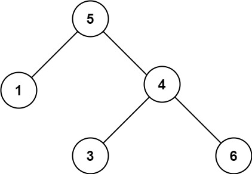

# [98. Validate Binary Search Tree](https://leetcode.com/problems/validate-binary-search-tree/)

| Category | Difficulty | Likes | Dislikes |
| :------: | :--------: | :---: | :------: |
| Algorithms | Medium | 18109 | 1438 |

**Tags:** [`tree`](https://leetcode.com/tag/tree), [`depth-first-search`](https://leetcode.com/tag/depth-first-search), [`binary-search-tree`](https://leetcode.com/tag/binary-search-tree), [`binary-tree`](https://leetcode.com/tag/binary-tree)

**Companies:** `bloomberg`, `amazon`, `facebook`, `microsoft`, `google`, `citadel`, `millennium`, `oracle`, `salesforce`, `apple`, `yandex`, `yahoo`, `ibm`, `uber`, `wix`

## Description

Given the `root` of a binary tree, *determine if it is a valid binary search tree (BST)*.

A **valid BST** is defined as follows:

	- The left subtree of a node contains only nodes with keys **strictly less than** the node's key.

	- The right subtree of a node contains only nodes with keys **strictly greater than** the node's key.

	- Both the left and right subtrees must also be binary search trees.

 

**Example 1:**


```

Input: root = [2,1,3]
Output: true

```

**Example 2:**


```

Input: root = [5,1,4,null,null,3,6]
Output: false
Explanation: The root node&#39;s value is 5 but its right child&#39;s value is 4.

```

 

**Constraints:**

	- The number of nodes in the tree is in the range `[1, 10^4]`.

	- `-2^31 <= Node.val <= 2^31 - 1`

---

**Links:** [Submissions](https://leetcode.com/problems/validate-binary-search-tree/) | [Solutions](https://leetcode.com/problems/validate-binary-search-tree/)
