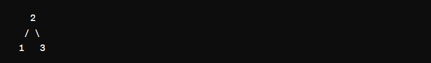

# Simple, Beginner Friendly & Dry Run || Recursive Solution || Time O(n) Space O(n) || Gits ✅✅👈👈

**Author:** GiteshSK_12
**Votes:** 42
**Link:** [https://leetcode.com/problems/validate-binary-search-tree/solutions/4732811/](https://leetcode.com/problems/validate-binary-search-tree/solutions/4732811/)

---

# Intuition \uD83D\uDC48

In the question given, the root of a binary tree is provided, and we have to determine whether the given tree is a binary search tree or not. To solve this question, we should know what a binary search tree is.

**Understanding BSTs**

A Binary Search Tree (BST) is a binary tree where for every node, all nodes in its left subtree have smaller values, and all nodes in its right subtree have larger values. This property must be true for all nodes in the tree, not just the immediate children of any node.

# Approach \uD83D\uDC48
 
**In-Order Traversal**

1.  **Recursive Traversal**: The algorithm recursively traverses the binary tree in an in-order manner. This means it first visits the left subtree, then the current node, and finally the right subtree.
    
2.  **Previous Node Tracking**: It keeps track of the previously visited node (`prev`) to compare its value with the current node's value. This is crucial for ensuring that the current node's value is greater than all values in the left subtree.
    
3.  **Validation**: During the traversal, at each node, it checks if the current node's value is greater than the value of the `prev` node. This comparison is valid because, in an in-order traversal of a BST, every node must have a greater value than the previous node.
    
    *   If the condition is violated (i.e., the current node's value is not greater than the `prev` node's value), the tree is not a BST, and the algorithm sets a boolean flag (`result`) to `false`.
    
4.  **Early Termination**: Although not explicitly implemented in the provided code, an optimization could be to terminate the traversal early if a violation is found, as further traversal is unnecessary once it's determined that the tree is not a BST.

# Code Explanation \uD83D\uDC48


The `Solution` class contains the logic to determine if a given binary tree is a valid BST.

*   `prev`: A `TreeNode` variable that holds the previously visited node during the in-order traversal. Initially, it is `null`.
*   `result`: A boolean variable that indicates whether the binary tree is a valid BST. It is initially set to `true`.

#### The `helper` Method

This method performs an in-order traversal of the binary tree:

1.  Base Case: If the current node (`root`) is `null`, the method returns immediately, as there is nothing to process.
2.  Recursive Call on Left Subtree: `helper(root.left)` recursively processes the left subtree. This ensures that nodes are visited in ascending order, according to BST properties.
3.  Process Current Node:
    *   If `prev` is `null`, it means this is the first node being visited (the leftmost node), so `prev` is set to the current node.
    *   If `prev` is not `null`, the current node's value (`root.val`) is compared to the `prev` node's value. If `root.val` is not greater than `prev.val`, it violates the BST property, and `result` is set to `false`.
    *   Update `prev` to the current node to prepare for the next comparison.
4.  Recursive Call on Right Subtree: `helper(root.right)` processes the right subtree, continuing the in-order traversal.

#### The `isValidBST` Method

This method is the entry point for checking if a tree is a valid BST. It calls `helper(root)` to start the in-order traversal and validation process, then returns the value of `result`.

# Complexity \uD83D\uDC48
- Time complexity: O(n)

- Space complexity: O(n)


# Code \uD83D\uDC48
```C []
/**
 * Definition for a binary tree node.
 * struct TreeNode {
 *     int val;
 *     struct TreeNode *left;
 *     struct TreeNode *right;
 * };
 */
void helper(struct TreeNode* root, struct TreeNode** prev, bool* result){
    if(root == NULL) return;
    helper(root->left, prev, result);
    if(*prev != NULL && root->val <= (*prev)->val) {
        *result = false;
        return;
    }
    *prev = root;
    helper(root->right, prev, result);
}
bool isValidBST(struct TreeNode* root) {
    struct TreeNode* prev = NULL;
    bool result = true;
    helper(root, &prev, &result);
    return result;
}
```
```C++ []
/**
 * Definition for a binary tree node.
 * struct TreeNode {
 *     int val;
 *     TreeNode *left;
 *     TreeNode *right;
 *     TreeNode() : val(0), left(nullptr), right(nullptr) {}
 *     TreeNode(int x) : val(x), left(nullptr), right(nullptr) {}
 *     TreeNode(int x, TreeNode *left, TreeNode *right) : val(x), left(left), right(right) {}
 * };
 */
class Solution {
public:
    TreeNode* prev = NULL;
    bool result = true;
    void helper(TreeNode* root){
        if(root == NULL)return;
        helper(root->left);
        if(prev == NULL)prev = root;
        else if(root->val <= prev->val)result = false;
        else prev = root;
        helper(root->right);
    }
    bool isValidBST(TreeNode* root) {
        helper(root);
        return result;
    }
};
```
```Java []
/**
 * Definition for a binary tree node.
 * public class TreeNode {
 *     int val;
 *     TreeNode left;
 *     TreeNode right;
 *     TreeNode() {}
 *     TreeNode(int val) { this.val = val; }
 *     TreeNode(int val, TreeNode left, TreeNode right) {
 *         this.val = val;
 *         this.left = left;
 *         this.right = right;
 *     }
 * }
 */
class Solution {
    TreeNode prev = null;
    boolean result = true;
    public void helper(TreeNode root){
        if(root == null)return;
        helper(root.left);
        if(prev == null)prev = root;
        else if(root.val <= prev.val)result = false;
        else prev = root;
        helper(root.right);
    }
    public boolean isValidBST(TreeNode root) {
        helper(root);
        return result;
    }
}
```
```javascript []
/**
 * Definition for a binary tree node.
 * function TreeNode(val, left, right) {
 *     this.val = (val===undefined ? 0 : val)
 *     this.left = (left===undefined ? null : left)
 *     this.right = (right===undefined ? null : right)
 * }
 */
/**
 * @param {TreeNode} root
 * @return {boolean}
 */
var isValidBST = function(root) {
    let prev = null;
    function helper(node) {
        if(node === null) return true;
        if(!helper(node.left)) return false;
        if(prev !== null && node.val <= prev.val) return false;
        prev = node;
        return helper(node.right);
    }
    return helper(root);
};
```
```C# []
/**
 * Definition for a binary tree node.
 * public class TreeNode {
 *     public int val;
 *     public TreeNode left;
 *     public TreeNode right;
 *     public TreeNode(int val=0, TreeNode left=null, TreeNode right=null) {
 *         this.val = val;
 *         this.left = left;
 *         this.right = right;
 *     }
 * }
 */
public class Solution {
    TreeNode prev = null;
    bool result = true;
    public void helper(TreeNode root){
        if(root == null)return;
        helper(root.left);
        if(prev == null)prev = root;
        else if(root.val <= prev.val)result = false;
        else prev = root;
        helper(root.right);
    }
    public bool IsValidBST(TreeNode root) {
         helper(root);
        return result;
    }
}
```
```Python []
# Definition for a binary tree node.
# class TreeNode(object):
#     def __init__(self, val=0, left=None, right=None):
#         self.val = val
#         self.left = left
#         self.right = right
class Solution(object):
    def helper(self, root, prev, result):
        if root is None: return
        self.helper(root.left, prev, result)
        if prev[0] and root.val <= prev[0].val:
            result[0] = False
            return
        prev[0] = root
        self.helper(root.right, prev, result)
    
    
    def isValidBST(self, root):
        """
        :type root: TreeNode
        :rtype: bool
        """
        prev = [None]  
        result = [True]
        self.helper(root, prev, result)
        return result[0]
```
```python3 []
# Definition for a binary tree node.
# class TreeNode:
#     def __init__(self, val=0, left=None, right=None):
#         self.val = val
#         self.left = left
#         self.right = right
class Solution:
    def helper(self, root, prev, result):
        if root is None: return
        self.helper(root.left, prev, result)
        if prev[0] and root.val <= prev[0].val:
            result[0] = False
            return
        prev[0] = root
        self.helper(root.right, prev, result)

    def isValidBST(self, root: Optional[TreeNode]) -> bool:
        prev = [None]  
        result = [True]
        self.helper(root, prev, result)
        return result[0]
```
```ruby []
# Definition for a binary tree node.
# class TreeNode
#     attr_accessor :val, :left, :right
#     def initialize(val = 0, left = nil, right = nil)
#         @val = val
#         @left = left
#         @right = right
#     end
# end
# @param {TreeNode} root
# @return {Boolean}
def helper( root, prev, result)
    if root == nil 
        return
    end
    helper(root.left, prev, result)
    if prev[0] and root.val <= prev[0].val
        result[0] = false
        return
    end
    prev[0] = root
    helper(root.right, prev, result)
end

def is_valid_bst(root)
    prev = [nil]  
    result = [true]
    helper(root, prev, result)
    return result[0]
end
```
# Dry Run \uD83D\uDC48




1.  **Start with the root node (`2`):**
    
    *   Call `helper(2)`
    *   `root` is not `null`, so continue.
    *   Recursively call `helper` on the left child: `helper(1)`
2.  **Move to the left child (`1`):**
    
    *   `root` is not `null`, so continue.
    *   Recursively call `helper` on the left child of `1`, but it's `null`. So, return to `helper(1)`.
    *   Check if `prev` is `null`. Yes, it is, so set `prev` to the current node (`1`).
    *   Recursively call `helper` on the right child of `1`, but it's `null`. So, return to `helper(1)` and then back to `helper(2)`.
3.  **Back to the root node (`2`):**
    
    *   The left subtree (with root `1`) is done, so now check the current node `2`.
    *   `prev` is now `1`, and since `2` > `1`, continue without changing `result`.
    *   Set `prev` to the current node (`2`).
    *   Recursively call `helper` on the right child: `helper(3)`
4.  **Move to the right child (`3`):**
    
    *   `root` is not `null`, so continue.
    *   Recursively call `helper` on the left child of `3`, but it's `null`. So, return to `helper(3)`.
    *   Check if `prev` (which is `2`) is less than the current node (`3`). Yes, it is, so continue without changing `result`.
    *   Set `prev` to the current node (`3`).
    *   Recursively call `helper` on the right child of `3`, but it's `null`. So, return to `helper(3)` and then finish the traversal.

### Conclusion

At the end of the traversal, `result` remains `true`, as there were no violations of the BST properties. The tree `[2,1,3]` is correctly identified as a valid BST.

# Guys if the solution and explanation is helpful then upvote me.\u2764\uFE0F\u2764\uFE0F\u2764\uFE0F\u2764\uFE0F\u2764\uFE0F\u2764\uFE0F\u2764\uFE0F\u2764\uFE0F

