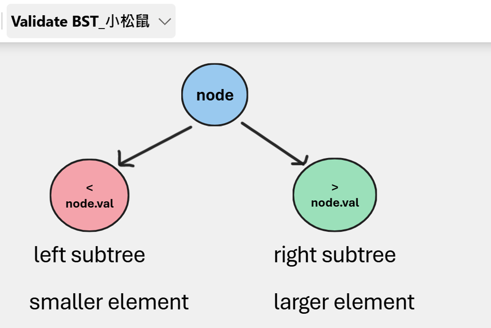

# Python/JS/Java/Go/C++ O(n) by DFS and rule [w/ Visualization] 有中文解析文章

**Author:** brianchiang_tw
**Votes:** 133
**Link:** [https://leetcode.com/problems/validate-binary-search-tree/solutions/974147/](https://leetcode.com/problems/validate-binary-search-tree/solutions/974147/)

---

O( n ) sol. by DFS and rule.

[\u672C\u984C\u5C0D\u61C9\u7684\u4E2D\u6587\u89E3\u984C\u6587\u7AE0](https://vocus.cc/article/650988e9fd897800019a383f)

[\u7528Python\u5BE6\u73FEBinary Search Tree\u4E8C\u5143\u641C\u5C0B\u6A39](https://vocus.cc/article/66d4426bfd897800012df5fc)

---

# Visualization



**Hint**:

Think of BST rule:
**Left sub-tree** nodes' value **< current** node value
**Right sub-tree** nodes' value **> current** node value

---

**Algorithm**:

Step_#1:
Set upper bound as maximum integer, and lower bound as minimum integer in run-time environment.

Step_#2:
Start DFS traversal from root node, and check whether each level follow BST rules or not.
Update lower bound and upper bound before going down to next level.

Step_#3:
Once we find the violation, reject and early return False.
Otherwise, accept and return True if all tree nodes follow BST rule.

---

Python

```
class Solution:
    def isValidBST(self, root: TreeNode) -> bool:
        
        # Use maximal system integer to represent infinity
        INF = sys.maxsize
        
        def helper(node, lower, upper):
            
            if not node:
				# empty node or empty tree
                return True
            
            if lower < node.val < upper:
				# check if all tree nodes follow BST rule
                return helper(node.left, lower, node.val) and helper(node.right, node.val, upper)
            
            else:
				# early reject when we find violation
                return False
            
        # ----------------------------------
        
        return helper( node=root, lower=-INF, upper=INF )
```

---

Java

<details>
	<summary>Click to show source code
	</summary>

```
class Solution {
    public boolean isValidBST(TreeNode root) {
        
        return checker( -INF, INF, root);
    }
    
    private boolean checker( long lower, long upper, TreeNode node ){
        
        if( node == null ){
            return true;
        }
        
        if( (lower < node.val) && ( node.val < upper ) ){
            return checker(lower, node.val, node.left) && checker(node.val, upper, node.right);
        }
        
        return false;
    }
    
    private long INF = Long.MAX_VALUE;

}
```

</details>

---

C++

<details>
	<summary>Click to show source code
	</summary>
	
```
	class Solution {
	public:
		bool isValidBST(TreeNode* root) {

			return validate(root, std::numeric_limits<long>::min(), std::numeric_limits<long>::max() );
		}

	private:
		bool validate(TreeNode* node, long lower, long upper){

			if( node == NULL ){

				// empty node or empty tree is valid always
				return true;
			}

			if( (lower < node->val) && (node->val < upper) ){

				// check if all tree nodes follow BST rule
				return validate(node->left, lower, node->val) && validate(node->right, node->val, upper);
			}
			else{
				// early reject when we find violation
				return false;
			}


		}
	};
```

</details>

,or

<details>
	<summary>Click to show source code
	</summary>
	
```
class Solution {
public:
    bool isValidBST(TreeNode* root) {
        
        prev = NULL;
        
        return validate(root );
    }
    
private:
    TreeNode *prev;
    bool validate(TreeNode* node){
        
        if( node == NULL ){
            
            // empty node or empty tree is valid always
            return true;
        }
        
        
        if( !validate(node->left ) ){
            return false;
        }
        
        if( prev != NULL && (node->val <= prev -> val) ){
            return false;
        }
        prev = node;
        
        return validate(node->right);
        
    }
};
```

</details>


---
Go

<details>
	<summary>Click to show source code
	</summary>
	
```
func isValidBST(root *TreeNode) bool {
    
    return validate( root, math.MinInt, math.MaxInt)
}

func validate(node *TreeNode, lower int, upper int)bool{
    
    if node == nil{
        
        //empty node or empty tree is always valid
        return true
    }
    
    if( (lower < node.Val) && (node.Val < upper) ){
        
        // check if all tree nodes follow BST rule
        return validate( node.Left, lower, node.Val ) && validate( node.Right, node.Val, upper )
    }else{
        
        // early reject when we find violation
        return false
    }
    
}
```

</details>

---

Javascript

<details>
	<summary>Click to show source code
	</summary>
	
```
var isValidBST = function(root) {
    
    return validate(root, -Infinity, Infinity);
};


var validate = function(node, lower,upper){
    
    if ( node == null ){
        
        // empty node or empty tree
        return true;
    }
    
    if( (lower < node.val) && ( node.val < upper ) ){
        
        // check if all tree nodes follow BST rule
        return validate( node.left, lower, node.val) && validate( node.right, node.val, upper);
    }else{
        
        // early reject when we find violation
        return false;
    }
    
}
```

</details>

---

Share anotehr implementation with well-ordered property of BST's inorder traversal

```
class Solution:
    def isValidBST(self, root: Optional[TreeNode]) -> bool:
        
        def checker(node):
            
            if not node:
				## Base case
                # empty node or empty tree
                yield True
                
            else:
                ## General cases:

                yield from checker(node.left)

                if checker.prev and (checker.prev.val >= node.val):
                    # previous node should be smaller then current node
                    # find violation
                    yield False

                checker.prev = node

                yield from checker(node.right)
                
            return
        # ---------------------------------------
        
        # use the property that inorder traversla of BST outputs sorted ascending sequence naturally
        checker.prev = None
        return all( checker(root) )
```

---

Relative leetcode challenge

[Leetcode #99 Recover Binary Search Tree](https://leetcode.com/problems/recover-binary-search-tree/)

[Leetcode #700 Search in a Binary Search Tree](https://leetcode.com/problems/search-in-a-binary-search-tree/)