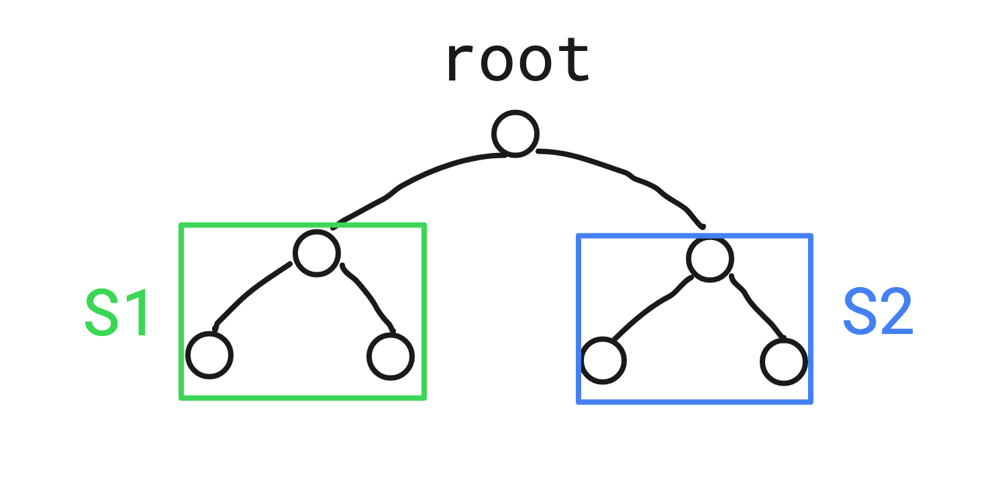
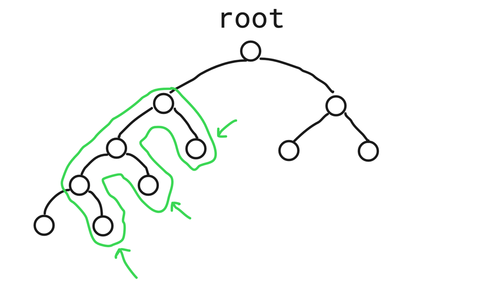
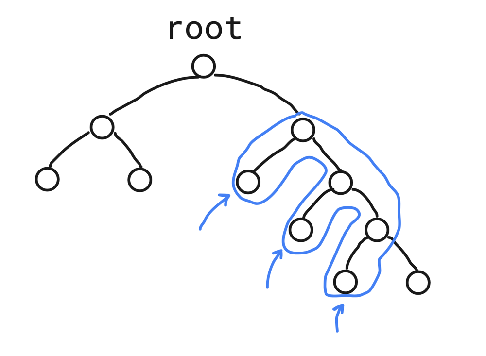

# Kotlin recursive solution | O(N)

**Author:** AleksandrT
**Votes:** 6
**Link:** [https://leetcode.com/problems/validate-binary-search-tree/solutions/2200843/](https://leetcode.com/problems/validate-binary-search-tree/solutions/2200843/)

---


First of all, let's "split" BST tree into 2 parts:
1) S1 - subtree where each element is less than the root element
2) S2 - subtree where each element is greater than the root element



For the S1 subtree, we must check firstly right child nodes, because left child nodes must have less value than the root.



For the S2 subtree, we must check firstly left child nodes, because right child nodes must have greater values than the root.



In order not to separate the checks into two functions, we can think in terms of ranges. For each node, we set a range within which that node should have a value.
```
fun isValidBST(root: TreeNode?): Boolean {
    fun isValidBST(curr: TreeNode?, low: Long, high: Long): Boolean =
        curr == null ||
                       (curr.`val` > low
                        && curr.`val` < high
                        && isValidBST(curr?.left, low, curr.`val`.toLong())
                        && isValidBST(curr?.right, curr.`val`.toLong(), high))

    return isValidBST(curr = root, low = Long.MIN_VALUE, high = Long.MAX_VALUE)
}
```
